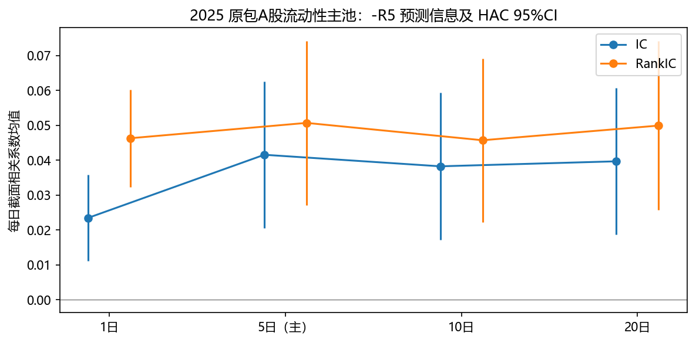
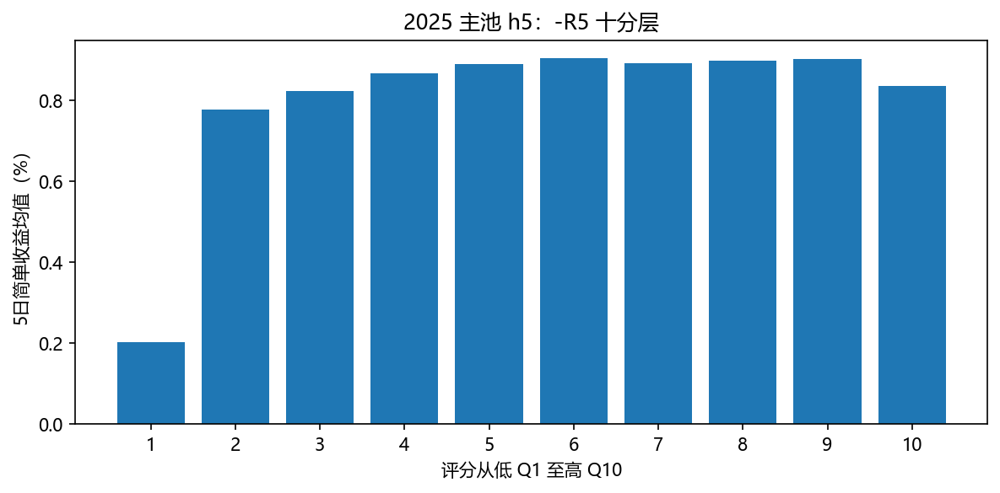
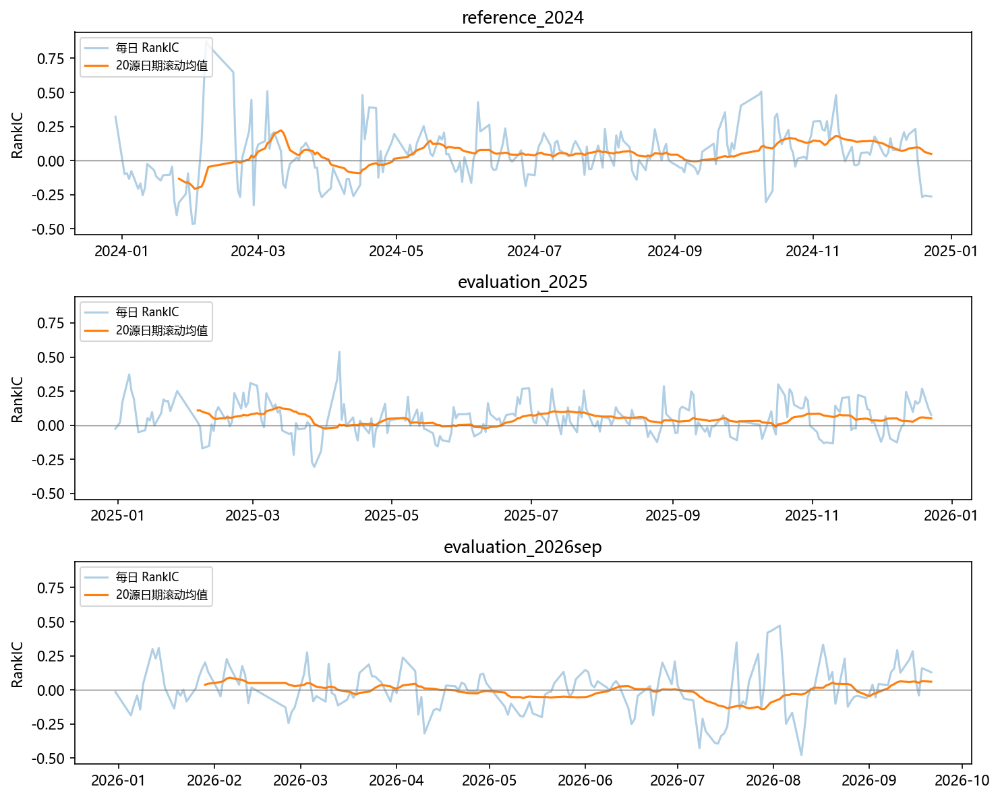
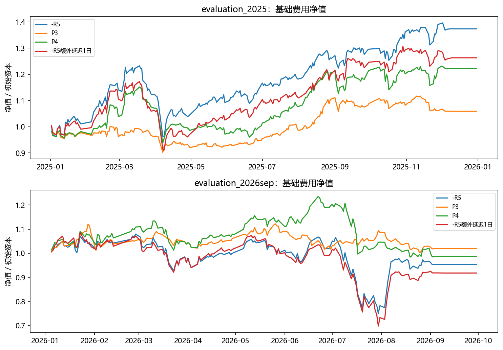
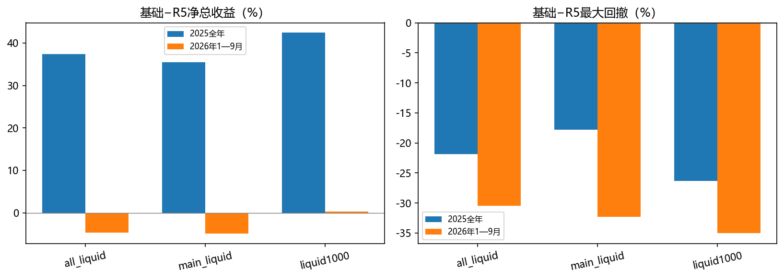

# 5DR 五维评价报告

运行：`evaluation_20261023_200711`；北京时间。独立验收通过。2025为主评价，2024仅统计参照，2026年1—9月为固定分期对照。

独立复核覆盖36个信息cohort、20条逐日组合账本及6组配对统计，并从原ZIP抽取三个交易日独立抽算。这不是全量逐笔交易独立重放，也不是条件beta对全部股票日的独立重算；验收通过不证明真实ST排除或开盘可成交性。

## 定义与结论边界

原始 R5=C_adj[t]/C_adj[t-5]−1；主评分为 −R5，要求完整过去六行价格路径。原始R5的IC/RankIC与主评分符号相反，下表并列披露；两个方向不算独立发现。目标为下一日开盘至h日后开盘的复权简单收益，完整开盘/复权路径、进出均落在期间内；h5为主。所有区间此前均已观察，不能称真正未触碰的样本外。

主池all_liquid：原包全部A股中的动态合格池，20日均额≥2000万元；原包是否包含历史所有上市股票无法独立证明。price_proxy仅为价格代理筛选，不代表准确排除真实历史ST。main_liquid与liquid1000仅作敏感性对照。成交金额按人民币元解释沿用原假设，缺少供应商单位字典的独立确认。

IC是每日横截面上因子值与未来收益的Pearson相关；Rank IC是二者转为秩后的Spearman相关，回答能否排序。本文主评分是−R5，因此正Rank IC对应短期反转；若直接使用原始R5，同一结果为负。ICIR是日IC均值除以日IC标准差，这里仅作描述，不能当策略Sharpe、HAC t或独立日样本的年化指标。

经济斜率beta来自未来收益对信号日已确定百分位的横截面回归；第25到75百分位对应0.5×beta的预测收益差。条件beta仅控制momentum20、lowvol20、liquidity20的百分位，不含行业、市值或官方风险因子。有效日n是时间序列推断样本数，股票×日配对数量不能当作独立观测量。

交易对照固定10亿元、目标100只、每周调仓、仅多头，延续佣金单边1bp和卖出印花税5bp，另含最低佣金5元、过户费和不利刻度滑点。提前20个源交易日退出来自先前回顾性修复；统计标签仍评价所有期内可完整观察窗口，因此与提前退出的组合持有区间不同。

## 五维结论（2025 all_liquid h5为统计主格）

| 维度 | 实际结果与解释 |
| --- | --- |
| 预测信息 | RankIC=0.0506819；区间位于0以上；IC=0.0415525 |
| 经济幅度 | Q10−Q1=0.00631828；区间位于0以上；beta=0.00440883 |
| 统计可信度 | RankIC有效日n=238；HAC t=4.22338，原始P=2.40668e-05；分期是回顾性稳定性检查 |
| 交易可实现性 | 基础5DR净Sharpe=1.49064，年双边换手=67.2387；成本/延迟/容量见压力表 |
| 组合增量 | 条件beta=0.00348828；区间跨0，未发现明确方向；IR(P4−P3)=1.18185；不能称ΔIR |

分层形状：2025 h5最高组均值在Q6（0.9045%），Q1为0.2032%，Q10为0.8351%。十分层均值并不随评分单调上升。这10个组的均值不应仅用顶底差概括；最高评分组不一定是收益最高组，分层均值是回顾性形状诊断，不据此追加阈值优化。

## 全部分期、池与期限统计

均值与区间均为简单收益或相关系数原单位。mean/std只作描述，不年化、不充当t；CI为正态近似HAC。只报告原始P，多期限/池/指标未校正多重搜索。

| 期 | 池 | h | 指标 | 有效日n | −R5均值 | 原R5均值（仅IC） | 95%CI | HAC L | t | 原始P | 均值/std |
| --- | --- | --- | --- | --- | --- | --- | --- | --- | --- | --- | --- |
| reference_2024 | all_liquid | 1 | ic | 241 | 0.0245534 | -0.0245534 | [0.00485744, 0.0442493] | 5 | 2.44333 | 0.0145523 | 0.135853 |
| reference_2024 | all_liquid | 1 | rank_ic | 241 | 0.0186249 | -0.0186249 | [-0.00869232, 0.0459422] | 5 | 1.33631 | 0.181449 | 0.0855006 |
| reference_2024 | all_liquid | 1 | spread_q10_q1 | 241 | 0.00173076 | — | [-0.00080712, 0.00426864] | 5 | 1.33664 | 0.181341 | 0.0727425 |
| reference_2024 | all_liquid | 1 | beta | 241 | 0.000221161 | — | [-0.00267275, 0.00311507] | 5 | 0.149786 | 0.880933 | 0.00844885 |
| reference_2024 | all_liquid | 1 | p25_p75_difference | 241 | 0.00011058 | — | [-0.00133638, 0.00155754] | 5 | 0.149786 | 0.880933 | 0.00844885 |
| reference_2024 | all_liquid | 1 | conditional_beta | 241 | 0.000912625 | — | [-0.00145285, 0.0032781] | 5 | 0.756174 | 0.449545 | 0.0469141 |
| reference_2024 | all_liquid | 5 | ic | 237 | 0.059616 | -0.059616 | [0.0320168, 0.0872151] | 5 | 4.23365 | 2.29929e-05 | 0.407349 |
| reference_2024 | all_liquid | 5 | rank_ic | 237 | 0.0477495 | -0.0477495 | [0.00775938, 0.0877397] | 5 | 2.34026 | 0.0192703 | 0.241938 |
| reference_2024 | all_liquid | 5 | spread_q10_q1 | 237 | 0.0115316 | — | [0.00324731, 0.0198159] | 5 | 2.72824 | 0.00636734 | 0.265747 |
| reference_2024 | all_liquid | 5 | beta | 237 | 0.00734202 | — | [-0.00224508, 0.0169291] | 5 | 1.50099 | 0.133359 | 0.147924 |
| reference_2024 | all_liquid | 5 | p25_p75_difference | 237 | 0.00367101 | — | [-0.00112254, 0.00846456] | 5 | 1.50099 | 0.133359 | 0.147924 |
| reference_2024 | all_liquid | 5 | conditional_beta | 237 | 0.00704766 | — | [0.00208101, 0.0120143] | 5 | 2.78118 | 0.00541613 | 0.221477 |
| reference_2024 | all_liquid | 10 | ic | 232 | 0.0595031 | -0.0595031 | [0.0292316, 0.0897746] | 10 | 3.8526 | 0.00011687 | 0.43833 |
| reference_2024 | all_liquid | 10 | rank_ic | 232 | 0.0475921 | -0.0475921 | [0.0043327, 0.0908515] | 10 | 2.15627 | 0.0310628 | 0.263293 |
| reference_2024 | all_liquid | 10 | spread_q10_q1 | 232 | 0.0143921 | — | [0.00267882, 0.0261054] | 10 | 2.4082 | 0.0160312 | 0.267678 |
| reference_2024 | all_liquid | 10 | beta | 232 | 0.00906039 | — | [-0.00536878, 0.0234896] | 10 | 1.2307 | 0.218433 | 0.144735 |
| reference_2024 | all_liquid | 10 | p25_p75_difference | 232 | 0.0045302 | — | [-0.00268439, 0.0117448] | 10 | 1.2307 | 0.218433 | 0.144735 |
| reference_2024 | all_liquid | 10 | conditional_beta | 232 | 0.00494907 | — | [-0.00277877, 0.0126769] | 10 | 1.2552 | 0.209405 | 0.138214 |
| reference_2024 | all_liquid | 20 | ic | 222 | 0.0649263 | -0.0649263 | [0.043402, 0.0864506] | 20 | 5.91206 | 3.37847e-09 | 0.51061 |
| reference_2024 | all_liquid | 20 | rank_ic | 222 | 0.0571803 | -0.0571803 | [0.0288038, 0.0855569] | 20 | 3.94944 | 7.83348e-05 | 0.333263 |
| reference_2024 | all_liquid | 20 | spread_q10_q1 | 222 | 0.0219795 | — | [0.0113793, 0.0325797] | 20 | 4.06399 | 4.82404e-05 | 0.337933 |
| reference_2024 | all_liquid | 20 | beta | 222 | 0.018228 | — | [0.00714276, 0.0293133] | 20 | 3.22286 | 0.00126916 | 0.248878 |
| reference_2024 | all_liquid | 20 | p25_p75_difference | 222 | 0.009114 | — | [0.00357138, 0.0146566] | 20 | 3.22286 | 0.00126916 | 0.248878 |
| reference_2024 | all_liquid | 20 | conditional_beta | 222 | 0.0102025 | — | [-0.00430921, 0.0247143] | 20 | 1.37796 | 0.168216 | 0.204127 |
| reference_2024 | main_liquid | 1 | ic | 241 | 0.0258913 | -0.0258913 | [0.00439691, 0.0473857] | 5 | 2.3609 | 0.0182309 | 0.136531 |
| reference_2024 | main_liquid | 1 | rank_ic | 241 | 0.0121916 | -0.0121916 | [-0.0157283, 0.0401115] | 5 | 0.855845 | 0.392084 | 0.0549015 |
| reference_2024 | main_liquid | 1 | spread_q10_q1 | 241 | 0.00166458 | — | [-0.000888362, 0.00421752] | 5 | 1.27794 | 0.20127 | 0.0723304 |
| reference_2024 | main_liquid | 1 | beta | 241 | -4.45304e-05 | — | [-0.00287014, 0.00278108] | 5 | -0.0308882 | 0.975359 | -0.00179392 |
| reference_2024 | main_liquid | 1 | p25_p75_difference | 241 | -2.22652e-05 | — | [-0.00143507, 0.00139054] | 5 | -0.0308882 | 0.975359 | -0.00179392 |
| reference_2024 | main_liquid | 1 | conditional_beta | 241 | 0.000759442 | — | [-0.0013618, 0.00288069] | 5 | 0.7017 | 0.482866 | 0.0411465 |
| reference_2024 | main_liquid | 5 | ic | 237 | 0.0577899 | -0.0577899 | [0.0252247, 0.0903552] | 5 | 3.47813 | 0.000504929 | 0.357601 |
| reference_2024 | main_liquid | 5 | rank_ic | 237 | 0.0382693 | -0.0382693 | [-0.00257343, 0.0791119] | 5 | 1.83647 | 0.0662882 | 0.193632 |
| reference_2024 | main_liquid | 5 | spread_q10_q1 | 237 | 0.00895909 | — | [0.000687392, 0.0172308] | 5 | 2.12284 | 0.0337672 | 0.216666 |
| reference_2024 | main_liquid | 5 | beta | 237 | 0.00465807 | — | [-0.00470052, 0.0140167] | 5 | 0.975537 | 0.329294 | 0.1005 |
| reference_2024 | main_liquid | 5 | p25_p75_difference | 237 | 0.00232903 | — | [-0.00235026, 0.00700833] | 5 | 0.975537 | 0.329294 | 0.1005 |
| reference_2024 | main_liquid | 5 | conditional_beta | 237 | 0.00536298 | — | [0.000569864, 0.0101561] | 5 | 2.19299 | 0.0283082 | 0.189973 |
| reference_2024 | main_liquid | 10 | ic | 232 | 0.0565446 | -0.0565446 | [0.0224087, 0.0906805] | 10 | 3.24659 | 0.00116797 | 0.374721 |
| reference_2024 | main_liquid | 10 | rank_ic | 232 | 0.0397029 | -0.0397029 | [-0.00422881, 0.0836346] | 10 | 1.7713 | 0.0765107 | 0.213487 |
| reference_2024 | main_liquid | 10 | spread_q10_q1 | 232 | 0.0118377 | — | [0.00050078, 0.0231746] | 10 | 2.04654 | 0.0407032 | 0.230405 |
| reference_2024 | main_liquid | 10 | beta | 232 | 0.00607443 | — | [-0.00790102, 0.0200499] | 10 | 0.851898 | 0.394271 | 0.101495 |
| reference_2024 | main_liquid | 10 | p25_p75_difference | 232 | 0.00303722 | — | [-0.00395051, 0.0100249] | 10 | 0.851898 | 0.394271 | 0.101495 |
| reference_2024 | main_liquid | 10 | conditional_beta | 232 | 0.00334007 | — | [-0.00390524, 0.0105854] | 10 | 0.903539 | 0.36624 | 0.0977058 |
| reference_2024 | main_liquid | 20 | ic | 222 | 0.0628192 | -0.0628192 | [0.0388873, 0.0867511] | 20 | 5.14473 | 2.67904e-07 | 0.466579 |
| reference_2024 | main_liquid | 20 | rank_ic | 222 | 0.0506331 | -0.0506331 | [0.020902, 0.0803643] | 20 | 3.33788 | 0.000844196 | 0.288216 |
| reference_2024 | main_liquid | 20 | spread_q10_q1 | 222 | 0.020173 | — | [0.00922255, 0.0311234] | 20 | 3.61066 | 0.000305416 | 0.322066 |
| reference_2024 | main_liquid | 20 | beta | 222 | 0.0158364 | — | [0.00511864, 0.0265542] | 20 | 2.89601 | 0.00377937 | 0.229033 |
| reference_2024 | main_liquid | 20 | p25_p75_difference | 222 | 0.00791821 | — | [0.00255932, 0.0132771] | 20 | 2.89601 | 0.00377937 | 0.229033 |
| reference_2024 | main_liquid | 20 | conditional_beta | 222 | 0.00820474 | — | [-0.00424245, 0.0206519] | 20 | 1.29194 | 0.196379 | 0.190211 |
| reference_2024 | liquid1000 | 1 | ic | 241 | 0.0216388 | -0.0216388 | [0.00217271, 0.0411048] | 5 | 2.17873 | 0.029352 | 0.113916 |
| reference_2024 | liquid1000 | 1 | rank_ic | 241 | 0.0232069 | -0.0232069 | [-0.00300745, 0.0494213] | 5 | 1.73511 | 0.0827219 | 0.111711 |
| reference_2024 | liquid1000 | 1 | spread_q10_q1 | 241 | 0.0020491 | — | [-0.000401409, 0.00449961] | 5 | 1.63891 | 0.101232 | 0.081228 |
| reference_2024 | liquid1000 | 1 | beta | 241 | 0.000845694 | — | [-0.0018437, 0.00353509] | 5 | 0.616321 | 0.537682 | 0.0330977 |
| reference_2024 | liquid1000 | 1 | p25_p75_difference | 241 | 0.000422847 | — | [-0.000921849, 0.00176754] | 5 | 0.616321 | 0.537682 | 0.0330977 |
| reference_2024 | liquid1000 | 1 | conditional_beta | 241 | 0.00170156 | — | [-0.000228901, 0.00363201] | 5 | 1.72756 | 0.0840664 | 0.0911568 |
| reference_2024 | liquid1000 | 5 | ic | 237 | 0.046459 | -0.046459 | [0.0162853, 0.0766327] | 5 | 3.01779 | 0.00254623 | 0.303338 |
| reference_2024 | liquid1000 | 5 | rank_ic | 237 | 0.0423141 | -0.0423141 | [0.00162175, 0.0830065] | 5 | 2.03808 | 0.0415423 | 0.219347 |
| reference_2024 | liquid1000 | 5 | spread_q10_q1 | 237 | 0.00921314 | — | [0.00162131, 0.016805] | 5 | 2.37853 | 0.0173817 | 0.21965 |
| reference_2024 | liquid1000 | 5 | beta | 237 | 0.00570919 | — | [-0.00334676, 0.0147651] | 5 | 1.23563 | 0.216596 | 0.123582 |
| reference_2024 | liquid1000 | 5 | p25_p75_difference | 237 | 0.0028546 | — | [-0.00167338, 0.00738257] | 5 | 1.23563 | 0.216596 | 0.123582 |
| reference_2024 | liquid1000 | 5 | conditional_beta | 237 | 0.0096671 | — | [0.00420335, 0.0151309] | 5 | 3.46779 | 0.000524751 | 0.288395 |
| reference_2024 | liquid1000 | 10 | ic | 232 | 0.0566448 | -0.0566448 | [0.02089, 0.0923996] | 10 | 3.10509 | 0.00190223 | 0.360479 |
| reference_2024 | liquid1000 | 10 | rank_ic | 232 | 0.0473856 | -0.0473856 | [0.00153473, 0.0932365] | 10 | 2.02557 | 0.042809 | 0.250941 |
| reference_2024 | liquid1000 | 10 | spread_q10_q1 | 232 | 0.0132264 | — | [0.000464128, 0.0259887] | 10 | 2.03124 | 0.0422304 | 0.231412 |
| reference_2024 | liquid1000 | 10 | beta | 232 | 0.00896204 | — | [-0.00608397, 0.0240081] | 10 | 1.16744 | 0.243034 | 0.136743 |
| reference_2024 | liquid1000 | 10 | p25_p75_difference | 232 | 0.00448102 | — | [-0.00304198, 0.012004] | 10 | 1.16744 | 0.243034 | 0.136743 |
| reference_2024 | liquid1000 | 10 | conditional_beta | 232 | 0.00965751 | — | [0.00277023, 0.0165448] | 10 | 2.74831 | 0.00599034 | 0.259552 |
| reference_2024 | liquid1000 | 20 | ic | 222 | 0.0617422 | -0.0617422 | [0.0323288, 0.0911557] | 20 | 4.1142 | 3.88529e-05 | 0.432567 |
| reference_2024 | liquid1000 | 20 | rank_ic | 222 | 0.0524937 | -0.0524937 | [0.013816, 0.0911714] | 20 | 2.66008 | 0.00781228 | 0.30352 |
| reference_2024 | liquid1000 | 20 | spread_q10_q1 | 222 | 0.0181741 | — | [0.00541639, 0.0309319] | 20 | 2.79208 | 0.00523705 | 0.262457 |
| reference_2024 | liquid1000 | 20 | beta | 222 | 0.0157329 | — | [0.0015589, 0.0299068] | 20 | 2.17553 | 0.0295906 | 0.200684 |
| reference_2024 | liquid1000 | 20 | p25_p75_difference | 222 | 0.00786643 | — | [0.000779452, 0.0149534] | 20 | 2.17553 | 0.0295906 | 0.200684 |
| reference_2024 | liquid1000 | 20 | conditional_beta | 222 | 0.0143609 | — | [0.00211372, 0.026608] | 20 | 2.29823 | 0.0215485 | 0.286286 |
| evaluation_2025 | all_liquid | 1 | ic | 242 | 0.0234816 | -0.0234816 | [0.0111639, 0.0357993] | 5 | 3.73634 | 0.000186716 | 0.195703 |
| evaluation_2025 | all_liquid | 1 | rank_ic | 242 | 0.0462974 | -0.0462974 | [0.0323321, 0.0602627] | 5 | 6.49762 | 8.16012e-11 | 0.344747 |
| evaluation_2025 | all_liquid | 1 | spread_q10_q1 | 242 | 0.00178711 | — | [0.000593959, 0.00298025] | 5 | 2.93565 | 0.00332848 | 0.148913 |
| evaluation_2025 | all_liquid | 1 | beta | 242 | 0.00146866 | — | [0.000263263, 0.00267407] | 5 | 2.38802 | 0.0169392 | 0.126304 |
| evaluation_2025 | all_liquid | 1 | p25_p75_difference | 242 | 0.000734332 | — | [0.000131631, 0.00133703] | 5 | 2.38802 | 0.0169392 | 0.126304 |
| evaluation_2025 | all_liquid | 1 | conditional_beta | 242 | 0.000853082 | — | [-0.000202417, 0.00190858] | 5 | 1.58409 | 0.113172 | 0.0974698 |
| evaluation_2025 | all_liquid | 5 | ic | 238 | 0.0415525 | -0.0415525 | [0.020504, 0.062601] | 5 | 3.86922 | 0.000109185 | 0.410322 |
| evaluation_2025 | all_liquid | 5 | rank_ic | 238 | 0.0506819 | -0.0506819 | [0.0271617, 0.0742022] | 5 | 4.22338 | 2.40668e-05 | 0.424316 |
| evaluation_2025 | all_liquid | 5 | spread_q10_q1 | 238 | 0.00631828 | — | [0.00208172, 0.0105548] | 5 | 2.92304 | 0.00346636 | 0.29788 |
| evaluation_2025 | all_liquid | 5 | beta | 238 | 0.00440883 | — | [0.000213285, 0.00860438] | 5 | 2.0596 | 0.0394367 | 0.205252 |
| evaluation_2025 | all_liquid | 5 | p25_p75_difference | 238 | 0.00220442 | — | [0.000106642, 0.00430219] | 5 | 2.0596 | 0.0394367 | 0.205252 |
| evaluation_2025 | all_liquid | 5 | conditional_beta | 238 | 0.00348828 | — | [-5.70943e-05, 0.00703366] | 5 | 1.9284 | 0.0538053 | 0.194197 |
| evaluation_2025 | all_liquid | 10 | ic | 233 | 0.038247 | -0.038247 | [0.0171683, 0.0593256] | 10 | 3.55633 | 0.000376074 | 0.402898 |
| evaluation_2025 | all_liquid | 10 | rank_ic | 233 | 0.0457112 | -0.0457112 | [0.0222671, 0.0691554] | 10 | 3.82152 | 0.000132631 | 0.378729 |
| evaluation_2025 | all_liquid | 10 | spread_q10_q1 | 233 | 0.00848203 | — | [0.00265628, 0.0143078] | 10 | 2.85362 | 0.00432245 | 0.29306 |
| evaluation_2025 | all_liquid | 10 | beta | 233 | 0.00529816 | — | [-0.000669092, 0.0112654] | 10 | 1.7402 | 0.0818242 | 0.17492 |
| evaluation_2025 | all_liquid | 10 | p25_p75_difference | 233 | 0.00264908 | — | [-0.000334546, 0.00563271] | 10 | 1.7402 | 0.0818242 | 0.17492 |
| evaluation_2025 | all_liquid | 10 | conditional_beta | 233 | 0.0061823 | — | [0.000647939, 0.0117167] | 10 | 2.18943 | 0.0285657 | 0.237181 |
| evaluation_2025 | all_liquid | 20 | ic | 223 | 0.0396765 | -0.0396765 | [0.0186608, 0.0606921] | 20 | 3.7003 | 0.000215342 | 0.393411 |
| evaluation_2025 | all_liquid | 20 | rank_ic | 223 | 0.049912 | -0.049912 | [0.025756, 0.0740681] | 20 | 4.04974 | 5.12735e-05 | 0.36097 |
| evaluation_2025 | all_liquid | 20 | spread_q10_q1 | 223 | 0.0129235 | — | [0.00372181, 0.0221251] | 20 | 2.75271 | 0.00591037 | 0.27993 |
| evaluation_2025 | all_liquid | 20 | beta | 223 | 0.00956611 | — | [9.1e-05, 0.0190412] | 20 | 1.97879 | 0.0478399 | 0.188624 |
| evaluation_2025 | all_liquid | 20 | p25_p75_difference | 223 | 0.00478305 | — | [4.55e-05, 0.00952061] | 20 | 1.97879 | 0.0478399 | 0.188624 |
| evaluation_2025 | all_liquid | 20 | conditional_beta | 223 | 0.0101868 | — | [0.00252966, 0.0178439] | 20 | 2.60747 | 0.00912136 | 0.27261 |
| evaluation_2025 | main_liquid | 1 | ic | 242 | 0.0303645 | -0.0303645 | [0.0173254, 0.0434036] | 5 | 4.56422 | 5.01355e-06 | 0.23609 |
| evaluation_2025 | main_liquid | 1 | rank_ic | 242 | 0.0489128 | -0.0489128 | [0.0346462, 0.0631794] | 5 | 6.7197 | 1.82095e-11 | 0.35173 |
| evaluation_2025 | main_liquid | 1 | spread_q10_q1 | 242 | 0.00202529 | — | [0.000843947, 0.00320663] | 5 | 3.36016 | 0.000778987 | 0.161583 |
| evaluation_2025 | main_liquid | 1 | beta | 242 | 0.00167591 | — | [0.000523987, 0.00282784] | 5 | 2.85151 | 0.00435119 | 0.141436 |
| evaluation_2025 | main_liquid | 1 | p25_p75_difference | 242 | 0.000837956 | — | [0.000261994, 0.00141392] | 5 | 2.85151 | 0.00435119 | 0.141436 |
| evaluation_2025 | main_liquid | 1 | conditional_beta | 242 | 0.000968176 | — | [-1.59216e-05, 0.00195227] | 5 | 1.92825 | 0.0538235 | 0.108465 |
| evaluation_2025 | main_liquid | 5 | ic | 238 | 0.0516461 | -0.0516461 | [0.0299815, 0.0733107] | 5 | 4.67234 | 2.97787e-06 | 0.501821 |
| evaluation_2025 | main_liquid | 5 | rank_ic | 238 | 0.0551444 | -0.0551444 | [0.032413, 0.0778759] | 5 | 4.75469 | 1.98747e-06 | 0.475041 |
| evaluation_2025 | main_liquid | 5 | spread_q10_q1 | 238 | 0.00706539 | — | [0.00314463, 0.0109861] | 5 | 3.53195 | 0.000412514 | 0.359864 |
| evaluation_2025 | main_liquid | 5 | beta | 238 | 0.00508085 | — | [0.00125822, 0.00890347] | 5 | 2.60509 | 0.00918499 | 0.258435 |
| evaluation_2025 | main_liquid | 5 | p25_p75_difference | 238 | 0.00254042 | — | [0.000629112, 0.00445173] | 5 | 2.60509 | 0.00918499 | 0.258435 |
| evaluation_2025 | main_liquid | 5 | conditional_beta | 238 | 0.00369467 | — | [0.000552375, 0.00683696] | 5 | 2.3045 | 0.0211946 | 0.228889 |
| evaluation_2025 | main_liquid | 10 | ic | 233 | 0.0513713 | -0.0513713 | [0.030932, 0.0718106] | 10 | 4.92609 | 8.38903e-07 | 0.544578 |
| evaluation_2025 | main_liquid | 10 | rank_ic | 233 | 0.0508956 | -0.0508956 | [0.0291724, 0.0726188] | 10 | 4.59203 | 4.3895e-06 | 0.435933 |
| evaluation_2025 | main_liquid | 10 | spread_q10_q1 | 233 | 0.0103256 | — | [0.00509631, 0.0155548] | 10 | 3.8701 | 0.00010879 | 0.384497 |
| evaluation_2025 | main_liquid | 10 | beta | 233 | 0.00677094 | — | [0.00156706, 0.0119748] | 10 | 2.55017 | 0.010767 | 0.247379 |
| evaluation_2025 | main_liquid | 10 | p25_p75_difference | 233 | 0.00338547 | — | [0.000783528, 0.00598742] | 10 | 2.55017 | 0.010767 | 0.247379 |
| evaluation_2025 | main_liquid | 10 | conditional_beta | 233 | 0.00658452 | — | [0.00137424, 0.0117948] | 10 | 2.47692 | 0.0132523 | 0.270609 |
| evaluation_2025 | main_liquid | 20 | ic | 223 | 0.049956 | -0.049956 | [0.0286497, 0.0712623] | 20 | 4.59544 | 4.31831e-06 | 0.488617 |
| evaluation_2025 | main_liquid | 20 | rank_ic | 223 | 0.0542129 | -0.0542129 | [0.031823, 0.0766028] | 20 | 4.74568 | 2.07806e-06 | 0.401215 |
| evaluation_2025 | main_liquid | 20 | spread_q10_q1 | 223 | 0.0149359 | — | [0.0065068, 0.0233651] | 20 | 3.47294 | 0.000514789 | 0.34567 |
| evaluation_2025 | main_liquid | 20 | beta | 223 | 0.0107542 | — | [0.0025724, 0.018936] | 20 | 2.57619 | 0.00998961 | 0.232934 |
| evaluation_2025 | main_liquid | 20 | p25_p75_difference | 223 | 0.00537709 | — | [0.0012862, 0.00946798] | 20 | 2.57619 | 0.00998961 | 0.232934 |
| evaluation_2025 | main_liquid | 20 | conditional_beta | 223 | 0.0101691 | — | [0.00343081, 0.0169074] | 20 | 2.95788 | 0.00309762 | 0.299194 |
| evaluation_2025 | liquid1000 | 1 | ic | 242 | 0.0256223 | -0.0256223 | [0.0106201, 0.0406246] | 5 | 3.34742 | 0.000815677 | 0.172705 |
| evaluation_2025 | liquid1000 | 1 | rank_ic | 242 | 0.0543048 | -0.0543048 | [0.0389979, 0.0696118] | 5 | 6.9534 | 3.56579e-12 | 0.35672 |
| evaluation_2025 | liquid1000 | 1 | spread_q10_q1 | 242 | 0.00241075 | — | [0.000701643, 0.00411985] | 5 | 2.76459 | 0.00569939 | 0.138191 |
| evaluation_2025 | liquid1000 | 1 | beta | 242 | 0.00240478 | — | [0.000712173, 0.00409738] | 5 | 2.78463 | 0.00535888 | 0.145571 |
| evaluation_2025 | liquid1000 | 1 | p25_p75_difference | 242 | 0.00120239 | — | [0.000356087, 0.00204869] | 5 | 2.78463 | 0.00535888 | 0.145571 |
| evaluation_2025 | liquid1000 | 1 | conditional_beta | 242 | 0.00159655 | — | [-0.000111925, 0.00330503] | 5 | 1.83156 | 0.0670164 | 0.11208 |
| evaluation_2025 | liquid1000 | 5 | ic | 238 | 0.044196 | -0.044196 | [0.0185819, 0.06981] | 5 | 3.38183 | 0.000720044 | 0.354064 |
| evaluation_2025 | liquid1000 | 5 | rank_ic | 238 | 0.059645 | -0.059645 | [0.0321443, 0.0871456] | 5 | 4.25088 | 2.12934e-05 | 0.436254 |
| evaluation_2025 | liquid1000 | 5 | spread_q10_q1 | 238 | 0.00893001 | — | [0.00266648, 0.0151935] | 5 | 2.79435 | 0.0052004 | 0.284134 |
| evaluation_2025 | liquid1000 | 5 | beta | 238 | 0.00703404 | — | [0.00110135, 0.0129667] | 5 | 2.32381 | 0.0201355 | 0.235154 |
| evaluation_2025 | liquid1000 | 5 | p25_p75_difference | 238 | 0.00351702 | — | [0.000550676, 0.00648337] | 5 | 2.32381 | 0.0201355 | 0.235154 |
| evaluation_2025 | liquid1000 | 5 | conditional_beta | 238 | 0.00599216 | — | [0.000625124, 0.0113592] | 5 | 2.18825 | 0.0286514 | 0.221953 |
| evaluation_2025 | liquid1000 | 10 | ic | 233 | 0.0338271 | -0.0338271 | [0.00519804, 0.0624562] | 10 | 2.31582 | 0.0205679 | 0.277896 |
| evaluation_2025 | liquid1000 | 10 | rank_ic | 233 | 0.0540803 | -0.0540803 | [0.0228577, 0.085303] | 10 | 3.39482 | 0.000686726 | 0.369374 |
| evaluation_2025 | liquid1000 | 10 | spread_q10_q1 | 233 | 0.00924693 | — | [-4.01272e-05, 0.018534] | 10 | 1.9515 | 0.0509981 | 0.211946 |
| evaluation_2025 | liquid1000 | 10 | beta | 233 | 0.00764475 | — | [-0.00170236, 0.0169919] | 10 | 1.603 | 0.108934 | 0.173183 |
| evaluation_2025 | liquid1000 | 10 | p25_p75_difference | 233 | 0.00382237 | — | [-0.00085118, 0.00849593] | 10 | 1.603 | 0.108934 | 0.173183 |
| evaluation_2025 | liquid1000 | 10 | conditional_beta | 233 | 0.00785323 | — | [-0.00147147, 0.0171779] | 10 | 1.65068 | 0.0988049 | 0.194382 |
| evaluation_2025 | liquid1000 | 20 | ic | 223 | 0.0358178 | -0.0358178 | [0.00483366, 0.0668019] | 20 | 2.26573 | 0.0234681 | 0.300847 |
| evaluation_2025 | liquid1000 | 20 | rank_ic | 223 | 0.0579208 | -0.0579208 | [0.0207753, 0.0950663] | 20 | 3.05616 | 0.00224191 | 0.375999 |
| evaluation_2025 | liquid1000 | 20 | spread_q10_q1 | 223 | 0.0130002 | — | [-0.00247025, 0.0284707] | 20 | 1.64701 | 0.0995567 | 0.216329 |
| evaluation_2025 | liquid1000 | 20 | beta | 223 | 0.0110915 | — | [-0.00528343, 0.0274663] | 20 | 1.32757 | 0.184319 | 0.171074 |
| evaluation_2025 | liquid1000 | 20 | p25_p75_difference | 223 | 0.00554573 | — | [-0.00264171, 0.0137332] | 20 | 1.32757 | 0.184319 | 0.171074 |
| evaluation_2025 | liquid1000 | 20 | conditional_beta | 223 | 0.0114644 | — | [-0.00199839, 0.0249271] | 20 | 1.66903 | 0.0951113 | 0.21479 |
| evaluation_2026sep | all_liquid | 1 | ic | 180 | 0.00144644 | -0.00144644 | [-0.018994, 0.0218869] | 5 | 0.138694 | 0.889692 | 0.00938876 |
| evaluation_2026sep | all_liquid | 1 | rank_ic | 180 | 0.0128141 | -0.0128141 | [-0.00888107, 0.0345093] | 5 | 1.15764 | 0.247011 | 0.0778576 |
| evaluation_2026sep | all_liquid | 1 | spread_q10_q1 | 180 | -0.000161819 | — | [-0.00253361, 0.00220997] | 5 | -0.133721 | 0.893623 | -0.00877406 |
| evaluation_2026sep | all_liquid | 1 | beta | 180 | -0.000530498 | — | [-0.00302656, 0.00196556] | 5 | -0.416559 | 0.677001 | -0.0288328 |
| evaluation_2026sep | all_liquid | 1 | p25_p75_difference | 180 | -0.000265249 | — | [-0.00151328, 0.000982782] | 5 | -0.416559 | 0.677001 | -0.0288328 |
| evaluation_2026sep | all_liquid | 1 | conditional_beta | 180 | 0.0005691 | — | [-0.00113886, 0.00227706] | 5 | 0.653068 | 0.513712 | 0.0442558 |
| evaluation_2026sep | all_liquid | 5 | ic | 176 | -0.00619359 | 0.00619359 | [-0.044161, 0.0317738] | 5 | -0.319727 | 0.749175 | -0.0394795 |
| evaluation_2026sep | all_liquid | 5 | rank_ic | 176 | -0.00106845 | 0.00106845 | [-0.0411381, 0.0390012] | 5 | -0.052262 | 0.95832 | -0.00647535 |
| evaluation_2026sep | all_liquid | 5 | spread_q10_q1 | 176 | -0.00312332 | — | [-0.0130005, 0.00675388] | 5 | -0.61977 | 0.535409 | -0.0760523 |
| evaluation_2026sep | all_liquid | 5 | beta | 176 | -0.00425334 | — | [-0.0144742, 0.00596749] | 5 | -0.815628 | 0.414713 | -0.103986 |
| evaluation_2026sep | all_liquid | 5 | p25_p75_difference | 176 | -0.00212667 | — | [-0.00723708, 0.00298374] | 5 | -0.815628 | 0.414713 | -0.103986 |
| evaluation_2026sep | all_liquid | 5 | conditional_beta | 176 | -0.000983655 | — | [-0.00755502, 0.00558771] | 5 | -0.293383 | 0.769229 | -0.0353018 |
| evaluation_2026sep | all_liquid | 10 | ic | 171 | -0.000538467 | 0.000538467 | [-0.0477981, 0.0467212] | 10 | -0.0223314 | 0.982184 | -0.00353747 |
| evaluation_2026sep | all_liquid | 10 | rank_ic | 171 | 0.0143107 | -0.0143107 | [-0.0348523, 0.0634737] | 10 | 0.570518 | 0.568326 | 0.090354 |
| evaluation_2026sep | all_liquid | 10 | spread_q10_q1 | 171 | -0.00389679 | — | [-0.0216091, 0.0138155] | 10 | -0.431202 | 0.666322 | -0.0673488 |
| evaluation_2026sep | all_liquid | 10 | beta | 171 | -0.00464522 | — | [-0.0223144, 0.0130239] | 10 | -0.515274 | 0.606362 | -0.0821408 |
| evaluation_2026sep | all_liquid | 10 | p25_p75_difference | 171 | -0.00232261 | — | [-0.0111572, 0.00651197] | 10 | -0.515274 | 0.606362 | -0.0821408 |
| evaluation_2026sep | all_liquid | 10 | conditional_beta | 171 | -0.000999438 | — | [-0.0129441, 0.0109452] | 10 | -0.163995 | 0.869735 | -0.0248306 |
| evaluation_2026sep | all_liquid | 20 | ic | 161 | 0.012079 | -0.012079 | [-0.0518231, 0.075981] | 20 | 0.370479 | 0.711026 | 0.0738939 |
| evaluation_2026sep | all_liquid | 20 | rank_ic | 161 | 0.028963 | -0.028963 | [-0.025036, 0.0829619] | 20 | 1.05125 | 0.293144 | 0.176808 |
| evaluation_2026sep | all_liquid | 20 | spread_q10_q1 | 161 | -0.00140209 | — | [-0.0340629, 0.0312587] | 20 | -0.084139 | 0.932946 | -0.0164527 |
| evaluation_2026sep | all_liquid | 20 | beta | 161 | -0.000320197 | — | [-0.0312306, 0.0305902] | 20 | -0.020303 | 0.983802 | -0.00378898 |
| evaluation_2026sep | all_liquid | 20 | p25_p75_difference | 161 | -0.000160098 | — | [-0.0156153, 0.0152951] | 20 | -0.020303 | 0.983802 | -0.00378898 |
| evaluation_2026sep | all_liquid | 20 | conditional_beta | 161 | 0.000957204 | — | [-0.0148845, 0.0167989] | 20 | 0.118427 | 0.90573 | 0.0174084 |
| evaluation_2026sep | main_liquid | 1 | ic | 180 | 0.00643827 | -0.00643827 | [-0.0139196, 0.0267961] | 5 | 0.619848 | 0.535358 | 0.041796 |
| evaluation_2026sep | main_liquid | 1 | rank_ic | 180 | 0.0164946 | -0.0164946 | [-0.00462493, 0.0376141] | 5 | 1.53075 | 0.12583 | 0.105309 |
| evaluation_2026sep | main_liquid | 1 | spread_q10_q1 | 180 | 0.000358343 | — | [-0.00187809, 0.00259477] | 5 | 0.314045 | 0.753487 | 0.0212581 |
| evaluation_2026sep | main_liquid | 1 | beta | 180 | 9.20419e-05 | — | [-0.00210039, 0.00228447] | 5 | 0.0822826 | 0.934422 | 0.00579496 |
| evaluation_2026sep | main_liquid | 1 | p25_p75_difference | 180 | 4.60209e-05 | — | [-0.00105019, 0.00114224] | 5 | 0.0822826 | 0.934422 | 0.00579496 |
| evaluation_2026sep | main_liquid | 1 | conditional_beta | 180 | 0.000786306 | — | [-0.000912681, 0.00248529] | 5 | 0.907089 | 0.36436 | 0.0625125 |
| evaluation_2026sep | main_liquid | 5 | ic | 176 | 0.00531204 | -0.00531204 | [-0.0320685, 0.0426926] | 5 | 0.278525 | 0.78061 | 0.0343373 |
| evaluation_2026sep | main_liquid | 5 | rank_ic | 176 | 0.00911287 | -0.00911287 | [-0.0292913, 0.047517] | 5 | 0.465078 | 0.641876 | 0.0583272 |
| evaluation_2026sep | main_liquid | 5 | spread_q10_q1 | 176 | -0.000312903 | — | [-0.0093941, 0.0087683] | 5 | -0.0675328 | 0.946158 | -0.0084501 |
| evaluation_2026sep | main_liquid | 5 | beta | 176 | -0.00156753 | — | [-0.0103229, 0.00718788] | 5 | -0.350903 | 0.725661 | -0.0451898 |
| evaluation_2026sep | main_liquid | 5 | p25_p75_difference | 176 | -0.000783764 | — | [-0.00516147, 0.00359394] | 5 | -0.350903 | 0.725661 | -0.0451898 |
| evaluation_2026sep | main_liquid | 5 | conditional_beta | 176 | 0.000394507 | — | [-0.00591715, 0.00670616] | 5 | 0.122507 | 0.902498 | 0.0151486 |
| evaluation_2026sep | main_liquid | 10 | ic | 171 | 0.0108003 | -0.0108003 | [-0.0334215, 0.0550222] | 10 | 0.478683 | 0.632164 | 0.0742201 |
| evaluation_2026sep | main_liquid | 10 | rank_ic | 171 | 0.0201642 | -0.0201642 | [-0.023142, 0.0634703] | 10 | 0.912596 | 0.361455 | 0.13828 |
| evaluation_2026sep | main_liquid | 10 | spread_q10_q1 | 171 | 0.000139091 | — | [-0.0149727, 0.0152508] | 10 | 0.0180398 | 0.985607 | 0.00277613 |
| evaluation_2026sep | main_liquid | 10 | beta | 171 | -0.00153541 | — | [-0.0153434, 0.0122726] | 10 | -0.217942 | 0.827474 | -0.0335295 |
| evaluation_2026sep | main_liquid | 10 | p25_p75_difference | 171 | -0.000767704 | — | [-0.0076717, 0.00613629] | 10 | -0.217942 | 0.827474 | -0.0335295 |
| evaluation_2026sep | main_liquid | 10 | conditional_beta | 171 | 0.0011665 | — | [-0.00977939, 0.0121124] | 10 | 0.208873 | 0.834548 | 0.0324959 |
| evaluation_2026sep | main_liquid | 20 | ic | 161 | 0.0219034 | -0.0219034 | [-0.0341654, 0.0779722] | 20 | 0.765665 | 0.443875 | 0.141325 |
| evaluation_2026sep | main_liquid | 20 | rank_ic | 161 | 0.0374806 | -0.0374806 | [-0.00623253, 0.0811938] | 20 | 1.68052 | 0.0928569 | 0.249605 |
| evaluation_2026sep | main_liquid | 20 | spread_q10_q1 | 161 | 0.00452431 | — | [-0.0218159, 0.0308646] | 20 | 0.336652 | 0.736379 | 0.0610833 |
| evaluation_2026sep | main_liquid | 20 | beta | 161 | 0.00421603 | — | [-0.0194125, 0.0278445] | 20 | 0.349716 | 0.726551 | 0.0609387 |
| evaluation_2026sep | main_liquid | 20 | p25_p75_difference | 161 | 0.00210802 | — | [-0.00970623, 0.0139223] | 20 | 0.349716 | 0.726551 | 0.0609387 |
| evaluation_2026sep | main_liquid | 20 | conditional_beta | 161 | 0.0045538 | — | [-0.0104587, 0.0195663] | 20 | 0.594524 | 0.552162 | 0.0907754 |
| evaluation_2026sep | liquid1000 | 1 | ic | 180 | 0.00130234 | -0.00130234 | [-0.0204663, 0.023071] | 5 | 0.117258 | 0.906656 | 0.0076077 |
| evaluation_2026sep | liquid1000 | 1 | rank_ic | 180 | 0.0119137 | -0.0119137 | [-0.0128145, 0.0366418] | 5 | 0.944283 | 0.345025 | 0.060697 |
| evaluation_2026sep | liquid1000 | 1 | spread_q10_q1 | 180 | -0.000620931 | — | [-0.00365215, 0.00241029] | 5 | -0.401489 | 0.68806 | -0.0257439 |
| evaluation_2026sep | liquid1000 | 1 | beta | 180 | -0.00117234 | — | [-0.0045941, 0.00224942] | 5 | -0.671509 | 0.501896 | -0.0439381 |
| evaluation_2026sep | liquid1000 | 1 | p25_p75_difference | 180 | -0.00058617 | — | [-0.00229705, 0.00112471] | 5 | -0.671509 | 0.501896 | -0.0439381 |
| evaluation_2026sep | liquid1000 | 1 | conditional_beta | 180 | 0.000579152 | — | [-0.00200911, 0.00316741] | 5 | 0.438563 | 0.660978 | 0.0309385 |
| evaluation_2026sep | liquid1000 | 5 | ic | 176 | -0.00572743 | 0.00572743 | [-0.0457602, 0.0343054] | 5 | -0.280409 | 0.779164 | -0.0330882 |
| evaluation_2026sep | liquid1000 | 5 | rank_ic | 176 | -0.000380149 | 0.000380149 | [-0.0458343, 0.045074] | 5 | -0.0163919 | 0.986922 | -0.00194007 |
| evaluation_2026sep | liquid1000 | 5 | spread_q10_q1 | 176 | -0.00318548 | — | [-0.0152603, 0.00888936] | 5 | -0.517061 | 0.605114 | -0.0601255 |
| evaluation_2026sep | liquid1000 | 5 | beta | 176 | -0.00521452 | — | [-0.0198069, 0.0093779] | 5 | -0.700382 | 0.483689 | -0.0857232 |
| evaluation_2026sep | liquid1000 | 5 | p25_p75_difference | 176 | -0.00260726 | — | [-0.00990347, 0.00468895] | 5 | -0.700382 | 0.483689 | -0.0857232 |
| evaluation_2026sep | liquid1000 | 5 | conditional_beta | 176 | 0.00129385 | — | [-0.00854106, 0.0111288] | 5 | 0.257846 | 0.796526 | 0.0302957 |
| evaluation_2026sep | liquid1000 | 10 | ic | 171 | 0.000824588 | -0.000824588 | [-0.0519012, 0.0535504] | 10 | 0.0306523 | 0.975547 | 0.00471922 |
| evaluation_2026sep | liquid1000 | 10 | rank_ic | 171 | 0.0170221 | -0.0170221 | [-0.0429092, 0.0769534] | 10 | 0.556684 | 0.577744 | 0.0866716 |
| evaluation_2026sep | liquid1000 | 10 | spread_q10_q1 | 171 | -0.00377349 | — | [-0.0258891, 0.0183421] | 10 | -0.33442 | 0.738062 | -0.0509577 |
| evaluation_2026sep | liquid1000 | 10 | beta | 171 | -0.00695158 | — | [-0.0334761, 0.019573] | 10 | -0.51367 | 0.607483 | -0.0797873 |
| evaluation_2026sep | liquid1000 | 10 | p25_p75_difference | 171 | -0.00347579 | — | [-0.0167381, 0.00978648] | 10 | -0.51367 | 0.607483 | -0.0797873 |
| evaluation_2026sep | liquid1000 | 10 | conditional_beta | 171 | -0.000614118 | — | [-0.0171731, 0.0159449] | 10 | -0.0726885 | 0.942054 | -0.0103226 |
| evaluation_2026sep | liquid1000 | 20 | ic | 161 | 0.0165656 | -0.0165656 | [-0.0556513, 0.0887825] | 20 | 0.44959 | 0.653006 | 0.090593 |
| evaluation_2026sep | liquid1000 | 20 | rank_ic | 161 | 0.0347053 | -0.0347053 | [-0.0414487, 0.110859] | 20 | 0.893204 | 0.371748 | 0.174191 |
| evaluation_2026sep | liquid1000 | 20 | spread_q10_q1 | 161 | -0.00395018 | — | [-0.0503879, 0.0424875] | 20 | -0.166723 | 0.867588 | -0.0357658 |
| evaluation_2026sep | liquid1000 | 20 | beta | 161 | -0.00493309 | — | [-0.0526351, 0.0427689] | 20 | -0.202689 | 0.839378 | -0.0402465 |
| evaluation_2026sep | liquid1000 | 20 | p25_p75_difference | 161 | -0.00246655 | — | [-0.0263175, 0.0213844] | 20 | -0.202689 | 0.839378 | -0.0402465 |
| evaluation_2026sep | liquid1000 | 20 | conditional_beta | 161 | 0.00082549 | — | [-0.0244419, 0.0260929] | 20 | 0.0640323 | 0.948945 | 0.00989624 |

## h5 HAC滞后敏感性

| 期 | 池 | 指标 | L | n | 95%CI | t | 原始P |
| --- | --- | --- | --- | --- | --- | --- | --- |
| reference_2024 | all_liquid | ic | 10 | 237 | [0.0338279, 0.085404] | 4.53098 | 5.87109e-06 |
| reference_2024 | all_liquid | ic | 20 | 237 | [0.0350631, 0.0841689] | 4.75891 | 1.94637e-06 |
| reference_2024 | all_liquid | rank_ic | 10 | 237 | [0.00612793, 0.0893711] | 2.24853 | 0.0245425 |
| reference_2024 | all_liquid | rank_ic | 20 | 237 | [0.00443995, 0.0910591] | 2.16089 | 0.0307036 |
| reference_2024 | all_liquid | spread_q10_q1 | 10 | 237 | [0.00397185, 0.0190913] | 2.98972 | 0.00279235 |
| reference_2024 | all_liquid | spread_q10_q1 | 20 | 237 | [0.0047073, 0.0183559] | 3.31192 | 0.000926593 |
| reference_2024 | all_liquid | beta | 10 | 237 | [-0.00143849, 0.0161225] | 1.63887 | 0.101241 |
| reference_2024 | all_liquid | beta | 20 | 237 | [-0.000510503, 0.0151945] | 1.83254 | 0.0668704 |
| reference_2024 | all_liquid | p25_p75_difference | 10 | 237 | [-0.000719244, 0.00806127] | 1.63887 | 0.101241 |
| reference_2024 | all_liquid | p25_p75_difference | 20 | 237 | [-0.000255251, 0.00759727] | 1.83254 | 0.0668704 |
| reference_2024 | all_liquid | conditional_beta | 10 | 237 | [0.00225433, 0.011841] | 2.88175 | 0.00395476 |
| reference_2024 | all_liquid | conditional_beta | 20 | 237 | [0.00267064, 0.0114247] | 3.15583 | 0.00160041 |
| reference_2024 | main_liquid | ic | 10 | 237 | [0.0282087, 0.0873712] | 3.82898 | 0.000128673 |
| reference_2024 | main_liquid | ic | 20 | 237 | [0.0332875, 0.0822924] | 4.62264 | 3.78879e-06 |
| reference_2024 | main_liquid | rank_ic | 10 | 237 | [-0.00291599, 0.0794545] | 1.8212 | 0.0685772 |
| reference_2024 | main_liquid | rank_ic | 20 | 237 | [-0.00248975, 0.0790283] | 1.84024 | 0.065733 |
| reference_2024 | main_liquid | spread_q10_q1 | 10 | 237 | [0.00148691, 0.0164313] | 2.34998 | 0.0187743 |
| reference_2024 | main_liquid | spread_q10_q1 | 20 | 237 | [0.00248586, 0.0154323] | 2.71263 | 0.00667513 |
| reference_2024 | main_liquid | beta | 10 | 237 | [-0.00372551, 0.0130416] | 1.08899 | 0.276157 |
| reference_2024 | main_liquid | beta | 20 | 237 | [-0.00243755, 0.0117537] | 1.28666 | 0.198213 |
| reference_2024 | main_liquid | p25_p75_difference | 10 | 237 | [-0.00186275, 0.00652082] | 1.08899 | 0.276157 |
| reference_2024 | main_liquid | p25_p75_difference | 20 | 237 | [-0.00121877, 0.00587684] | 1.28666 | 0.198213 |
| reference_2024 | main_liquid | conditional_beta | 10 | 237 | [0.0008489, 0.00987707] | 2.32855 | 0.0198831 |
| reference_2024 | main_liquid | conditional_beta | 20 | 237 | [0.00123111, 0.00949486] | 2.54394 | 0.0109609 |
| reference_2024 | liquid1000 | ic | 10 | 237 | [0.0174305, 0.0754876] | 3.13684 | 0.00170777 |
| reference_2024 | liquid1000 | ic | 20 | 237 | [0.0198458, 0.0730722] | 3.42154 | 0.000622679 |
| reference_2024 | liquid1000 | rank_ic | 10 | 237 | [0.000532123, 0.0840961] | 1.98493 | 0.0471528 |
| reference_2024 | liquid1000 | rank_ic | 20 | 237 | [0.000917914, 0.0837103] | 2.00342 | 0.0451318 |
| reference_2024 | liquid1000 | spread_q10_q1 | 10 | 237 | [0.00215607, 0.0162702] | 2.55877 | 0.0105043 |
| reference_2024 | liquid1000 | spread_q10_q1 | 20 | 237 | [0.00303222, 0.0153941] | 2.92148 | 0.00348377 |
| reference_2024 | liquid1000 | beta | 10 | 237 | [-0.00284201, 0.0142604] | 1.30857 | 0.190681 |
| reference_2024 | liquid1000 | beta | 20 | 237 | [-0.00178342, 0.0132018] | 1.49345 | 0.135321 |
| reference_2024 | liquid1000 | p25_p75_difference | 10 | 237 | [-0.001421, 0.0071302] | 1.30857 | 0.190681 |
| reference_2024 | liquid1000 | p25_p75_difference | 20 | 237 | [-0.000891712, 0.0066009] | 1.49345 | 0.135321 |
| reference_2024 | liquid1000 | conditional_beta | 10 | 237 | [0.00413298, 0.0152012] | 3.4237 | 0.000617744 |
| reference_2024 | liquid1000 | conditional_beta | 20 | 237 | [0.00433784, 0.0149964] | 3.55531 | 0.000377536 |
| evaluation_2025 | all_liquid | ic | 10 | 238 | [0.0205682, 0.0625368] | 3.88106 | 0.000104002 |
| evaluation_2025 | all_liquid | ic | 20 | 238 | [0.0242092, 0.0588958] | 4.69585 | 2.65501e-06 |
| evaluation_2025 | all_liquid | rank_ic | 10 | 238 | [0.0274193, 0.0739446] | 4.27013 | 1.95357e-05 |
| evaluation_2025 | all_liquid | rank_ic | 20 | 238 | [0.0305148, 0.0708491] | 4.92556 | 8.4117e-07 |
| evaluation_2025 | all_liquid | spread_q10_q1 | 10 | 238 | [0.00210006, 0.0105365] | 2.93574 | 0.00332753 |
| evaluation_2025 | all_liquid | spread_q10_q1 | 20 | 238 | [0.00283699, 0.00979956] | 3.55719 | 0.00037484 |
| evaluation_2025 | all_liquid | beta | 10 | 238 | [0.000320256, 0.00849741] | 2.11349 | 0.0345591 |
| evaluation_2025 | all_liquid | beta | 20 | 238 | [0.000999607, 0.00781806] | 2.53464 | 0.0112564 |
| evaluation_2025 | all_liquid | p25_p75_difference | 10 | 238 | [0.000160128, 0.0042487] | 2.11349 | 0.0345591 |
| evaluation_2025 | all_liquid | p25_p75_difference | 20 | 238 | [0.000499803, 0.00390903] | 2.53464 | 0.0112564 |
| evaluation_2025 | all_liquid | conditional_beta | 10 | 238 | [-0.000120481, 0.00709705] | 1.89453 | 0.0581548 |
| evaluation_2025 | all_liquid | conditional_beta | 20 | 238 | [-4.27718e-05, 0.00701934] | 1.93622 | 0.0528404 |
| evaluation_2025 | main_liquid | ic | 10 | 238 | [0.0303699, 0.0729223] | 4.75763 | 1.95876e-06 |
| evaluation_2025 | main_liquid | ic | 20 | 238 | [0.0345179, 0.0687743] | 5.90983 | 3.42462e-09 |
| evaluation_2025 | main_liquid | rank_ic | 10 | 238 | [0.0322915, 0.0779973] | 4.72943 | 2.2515e-06 |
| evaluation_2025 | main_liquid | rank_ic | 20 | 238 | [0.0346121, 0.0756767] | 5.26395 | 1.40995e-07 |
| evaluation_2025 | main_liquid | spread_q10_q1 | 10 | 238 | [0.00318901, 0.0109418] | 3.57238 | 0.000353749 |
| evaluation_2025 | main_liquid | spread_q10_q1 | 20 | 238 | [0.003869, 0.0102618] | 4.33237 | 1.47516e-05 |
| evaluation_2025 | main_liquid | beta | 10 | 238 | [0.00135095, 0.00881074] | 2.66985 | 0.00758849 |
| evaluation_2025 | main_liquid | beta | 20 | 238 | [0.00191686, 0.00824483] | 3.14739 | 0.00164736 |
| evaluation_2025 | main_liquid | p25_p75_difference | 10 | 238 | [0.000675473, 0.00440537] | 2.66985 | 0.00758849 |
| evaluation_2025 | main_liquid | p25_p75_difference | 20 | 238 | [0.000958432, 0.00412241] | 3.14739 | 0.00164736 |
| evaluation_2025 | main_liquid | conditional_beta | 10 | 238 | [0.000460559, 0.00692878] | 2.23908 | 0.025151 |
| evaluation_2025 | main_liquid | conditional_beta | 20 | 238 | [0.000533998, 0.00685534] | 2.2911 | 0.0219575 |
| evaluation_2025 | liquid1000 | ic | 10 | 238 | [0.0185279, 0.069864] | 3.37472 | 0.000738906 |
| evaluation_2025 | liquid1000 | ic | 20 | 238 | [0.0231349, 0.065257] | 4.11293 | 3.90667e-05 |
| evaluation_2025 | liquid1000 | rank_ic | 10 | 238 | [0.031987, 0.0873029] | 4.2267 | 2.37141e-05 |
| evaluation_2025 | liquid1000 | rank_ic | 20 | 238 | [0.0372302, 0.0820598] | 5.21539 | 1.83426e-07 |
| evaluation_2025 | liquid1000 | spread_q10_q1 | 10 | 238 | [0.00280229, 0.0150577] | 2.85628 | 0.00428634 |
| evaluation_2025 | liquid1000 | spread_q10_q1 | 20 | 238 | [0.00415254, 0.0137075] | 3.66355 | 0.000248742 |
| evaluation_2025 | liquid1000 | beta | 10 | 238 | [0.00113106, 0.012937] | 2.33551 | 0.0195167 |
| evaluation_2025 | liquid1000 | beta | 20 | 238 | [0.00220796, 0.0118601] | 2.85666 | 0.00428128 |
| evaluation_2025 | liquid1000 | p25_p75_difference | 10 | 238 | [0.000565532, 0.00646851] | 2.33551 | 0.0195167 |
| evaluation_2025 | liquid1000 | p25_p75_difference | 20 | 238 | [0.00110398, 0.00593006] | 2.85666 | 0.00428128 |
| evaluation_2025 | liquid1000 | conditional_beta | 10 | 238 | [0.000332903, 0.0116514] | 2.07526 | 0.0379626 |
| evaluation_2025 | liquid1000 | conditional_beta | 20 | 238 | [0.000354512, 0.0116298] | 2.08321 | 0.0372319 |
| evaluation_2026sep | all_liquid | ic | 10 | 176 | [-0.041713, 0.0293258] | -0.341762 | 0.73253 |
| evaluation_2026sep | all_liquid | ic | 20 | 176 | [-0.0383106, 0.0259234] | -0.377968 | 0.705454 |
| evaluation_2026sep | all_liquid | rank_ic | 10 | 176 | [-0.0401412, 0.0380043] | -0.0535954 | 0.957258 |
| evaluation_2026sep | all_liquid | rank_ic | 20 | 176 | [-0.0369518, 0.0348149] | -0.0583591 | 0.953463 |
| evaluation_2026sep | all_liquid | spread_q10_q1 | 10 | 176 | [-0.0122689, 0.00602226] | -0.669349 | 0.503273 |
| evaluation_2026sep | all_liquid | spread_q10_q1 | 20 | 176 | [-0.0108458, 0.00459912] | -0.792702 | 0.427951 |
| evaluation_2026sep | all_liquid | beta | 10 | 176 | [-0.0141382, 0.00563156] | -0.843346 | 0.399035 |
| evaluation_2026sep | all_liquid | beta | 20 | 176 | [-0.0127539, 0.0042472] | -0.98069 | 0.326746 |
| evaluation_2026sep | all_liquid | p25_p75_difference | 10 | 176 | [-0.00706912, 0.00281578] | -0.843346 | 0.399035 |
| evaluation_2026sep | all_liquid | p25_p75_difference | 20 | 176 | [-0.00637694, 0.0021236] | -0.98069 | 0.326746 |
| evaluation_2026sep | all_liquid | conditional_beta | 10 | 176 | [-0.00705457, 0.00508726] | -0.317568 | 0.750812 |
| evaluation_2026sep | all_liquid | conditional_beta | 20 | 176 | [-0.00627506, 0.00430775] | -0.364351 | 0.715596 |
| evaluation_2026sep | main_liquid | ic | 10 | 176 | [-0.0292465, 0.0398706] | 0.301268 | 0.76321 |
| evaluation_2026sep | main_liquid | ic | 20 | 176 | [-0.0254733, 0.0360974] | 0.338193 | 0.735217 |
| evaluation_2026sep | main_liquid | rank_ic | 10 | 176 | [-0.0288067, 0.0470325] | 0.47102 | 0.637626 |
| evaluation_2026sep | main_liquid | rank_ic | 20 | 176 | [-0.0256942, 0.0439199] | 0.51314 | 0.607853 |
| evaluation_2026sep | main_liquid | spread_q10_q1 | 10 | 176 | [-0.00869891, 0.0080731] | -0.0731313 | 0.941702 |
| evaluation_2026sep | main_liquid | spread_q10_q1 | 20 | 176 | [-0.0072439, 0.00661809] | -0.0884836 | 0.929492 |
| evaluation_2026sep | main_liquid | beta | 10 | 176 | [-0.0100216, 0.00688657] | -0.363409 | 0.716299 |
| evaluation_2026sep | main_liquid | beta | 20 | 176 | [-0.00888967, 0.00575461] | -0.41959 | 0.674785 |
| evaluation_2026sep | main_liquid | p25_p75_difference | 10 | 176 | [-0.00501081, 0.00344328] | -0.363409 | 0.716299 |
| evaluation_2026sep | main_liquid | p25_p75_difference | 20 | 176 | [-0.00444483, 0.00287731] | -0.41959 | 0.674785 |
| evaluation_2026sep | main_liquid | conditional_beta | 10 | 176 | [-0.00569927, 0.00648828] | 0.126887 | 0.89903 |
| evaluation_2026sep | main_liquid | conditional_beta | 20 | 176 | [-0.00514214, 0.00593115] | 0.139655 | 0.888933 |
| evaluation_2026sep | liquid1000 | ic | 10 | 176 | [-0.0411433, 0.0296884] | -0.316964 | 0.751271 |
| evaluation_2026sep | liquid1000 | ic | 20 | 176 | [-0.0370317, 0.0255768] | -0.358595 | 0.719898 |
| evaluation_2026sep | liquid1000 | rank_ic | 10 | 176 | [-0.0420058, 0.0412455] | -0.0178995 | 0.985719 |
| evaluation_2026sep | liquid1000 | rank_ic | 20 | 176 | [-0.0380771, 0.0373168] | -0.019765 | 0.984231 |
| evaluation_2026sep | liquid1000 | spread_q10_q1 | 10 | 176 | [-0.0139239, 0.00755292] | -0.581411 | 0.560963 |
| evaluation_2026sep | liquid1000 | spread_q10_q1 | 20 | 176 | [-0.0125345, 0.00616355] | -0.667815 | 0.504252 |
| evaluation_2026sep | liquid1000 | beta | 10 | 176 | [-0.0187311, 0.00830208] | -0.756127 | 0.449573 |
| evaluation_2026sep | liquid1000 | beta | 20 | 176 | [-0.0164781, 0.00604903] | -0.907376 | 0.364208 |
| evaluation_2026sep | liquid1000 | p25_p75_difference | 10 | 176 | [-0.00936556, 0.00415104] | -0.756127 | 0.449573 |
| evaluation_2026sep | liquid1000 | p25_p75_difference | 20 | 176 | [-0.00823903, 0.00302452] | -0.907376 | 0.364208 |
| evaluation_2026sep | liquid1000 | conditional_beta | 10 | 176 | [-0.00783236, 0.0104201] | 0.27787 | 0.781112 |
| evaluation_2026sep | liquid1000 | conditional_beta | 20 | 176 | [-0.00715204, 0.00973974] | 0.300252 | 0.763985 |

## 费用、容量与额外延迟执行压力

2024不进行执行回测。各项收益、Sharpe、回撤为模型净表现；年双边换手含买入和卖出。base为基础费用、日金额容量1%；double_cost将佣金/最低佣金、印花税、过户费与滑点翻倍，刻度取整可使实际总成本不恰好翻倍；capacity_0p1pct将日金额容量1%降至0.1%；5dr_lag1在原信号执行基础上额外延迟1个源交易日。容量均为事后日线约束，不是开盘成交量。

| 期 | 策略 | 情景 | 日数 | 净总收益 | 净Sharpe | 最大回撤 | 年双边换手 | 总成本 | 减记损失 |
| --- | --- | --- | --- | --- | --- | --- | --- | --- | --- |
| evaluation_2025 | 5dr | 基础：日金额容量1% | 243 | 0.373564 | 1.49064 | -0.218629 | 67.2387 | 1.01173e+08 | 0 |
| evaluation_2025 | base_combo | 基础：日金额容量1% | 243 | 0.0590349 | 0.483342 | -0.0989458 | 40.5773 | 5.47533e+07 | 0 |
| evaluation_2025 | added_combo | 基础：日金额容量1% | 243 | 0.221905 | 1.05788 | -0.185344 | 76.1419 | 1.05494e+08 | 0 |
| evaluation_2025 | 5dr | 全部模型费用及滑点翻倍 | 243 | 0.335331 | 1.36355 | -0.221393 | 67.3359 | 1.59297e+08 | 0 |
| evaluation_2025 | base_combo | 全部模型费用及滑点翻倍 | 243 | 0.0392994 | 0.349117 | -0.102158 | 40.4944 | 8.29732e+07 | 0 |
| evaluation_2025 | added_combo | 全部模型费用及滑点翻倍 | 243 | 0.178598 | 0.889174 | -0.187455 | 76.0972 | 1.63856e+08 | 0 |
| evaluation_2025 | 5dr | 日金额容量1%降至0.1% | 243 | 0.0847718 | 1.23649 | -0.0619332 | 16.5314 | 2.08355e+07 | 1980 |
| evaluation_2025 | base_combo | 日金额容量1%降至0.1% | 243 | 0.11021 | 1.10137 | -0.0704886 | 19.6088 | 2.61841e+07 | 0 |
| evaluation_2025 | added_combo | 日金额容量1%降至0.1% | 243 | 0.110989 | 1.02244 | -0.101178 | 31.6155 | 3.99396e+07 | 0 |
| evaluation_2025 | 5dr_lag1 | 基础：日金额容量1% | 243 | 0.263213 | 1.12972 | -0.223415 | 69.0673 | 9.98754e+07 | 0 |
| evaluation_2026sep | 5dr | 基础：日金额容量1% | 181 | -0.0471999 | -0.0341606 | -0.304867 | 74.1864 | 6.5362e+07 | 0 |
| evaluation_2026sep | base_combo | 基础：日金额容量1% | 181 | 0.018778 | 0.233898 | -0.106899 | 38.1558 | 3.74636e+07 | 0 |
| evaluation_2026sep | added_combo | 基础：日金额容量1% | 181 | -0.0134882 | 0.045442 | -0.203305 | 72.8745 | 7.02562e+07 | 0 |
| evaluation_2026sep | 5dr | 全部模型费用及滑点翻倍 | 181 | -0.0722666 | -0.145246 | -0.315673 | 74.2258 | 1.06472e+08 | 0 |
| evaluation_2026sep | base_combo | 全部模型费用及滑点翻倍 | 181 | 0.00743064 | 0.147214 | -0.113575 | 38.1033 | 5.90156e+07 | 0 |
| evaluation_2026sep | added_combo | 全部模型费用及滑点翻倍 | 181 | -0.0396609 | -0.106769 | -0.211283 | 72.8974 | 1.13601e+08 | 0 |
| evaluation_2026sep | 5dr | 日金额容量1%降至0.1% | 181 | -0.0249474 | -0.15973 | -0.159908 | 24.949 | 2.00659e+07 | 0 |
| evaluation_2026sep | base_combo | 日金额容量1%降至0.1% | 181 | 0.0401481 | 0.473958 | -0.0769998 | 21.0429 | 1.95675e+07 | 0 |
| evaluation_2026sep | added_combo | 日金额容量1%降至0.1% | 181 | -0.047812 | -0.355804 | -0.146381 | 38.2853 | 3.30409e+07 | 0 |
| evaluation_2026sep | 5dr_lag1 | 基础：日金额容量1% | 181 | -0.0819929 | -0.176764 | -0.356991 | 72.8598 | 6.43287e+07 | 0 |

## 组合增量

P3为momentum20、lowvol20、liquidity20三项等权rank；P4加入−R5后四项等权。二者采用同一四项过去均有效池，但原三项权重同时变化，不能解释成固定其余权重的纯边际效应。相对alpha来自净rP4=a+b净rP3，不是CAPM或官方风险模型alpha。没有共同可投资基准，IR(P4−P3)不能称ΔIR；回撤差为P4−P3，正值表示回撤较浅。

| 期 | 情景 | 配对日数 | IR(P4−P3) | 日均差95%CI | 差原始P | 净Sharpe差 | 回撤差 | 日alpha | 日alpha95%CI | alpha原始P | alpha×252 | alpha×252的95%CI |
| --- | --- | --- | --- | --- | --- | --- | --- | --- | --- | --- | --- | --- |
| evaluation_2025 | base | 243 | 1.18185 | [-0.000539014, 0.00182725] | 0.285954 | 0.574535 | -0.086398 | 0.000588621 | [-0.000590727, 0.00176797] | 0.32796 | 0.148332 | [-0.148863, 0.445528] |
| evaluation_2025 | double_cost | 243 | 1.05555 | [-0.000603298, 0.00174854] | 0.339874 | 0.540057 | -0.0852971 | 0.000532417 | [-0.000636421, 0.00170126] | 0.371974 | 0.134169 | [-0.160378, 0.428717] |
| evaluation_2025 | capacity_0p1pct | 243 | 0.0258754 | [-0.000544769, 0.000558822] | 0.980088 | -0.0789258 | -0.0306898 | 6.16499e-05 | [-0.00046259, 0.00058589] | 0.817712 | 0.0155358 | [-0.116573, 0.147644] |
| evaluation_2026sep | base | 181 | -0.145324 | [-0.00220511, 0.00195868] | 0.907655 | -0.188456 | -0.0964058 | -7.60796e-05 | [-0.0020955, 0.00194334] | 0.941138 | -0.0191721 | [-0.528066, 0.489722] |
| evaluation_2026sep | double_cost | 181 | -0.245742 | [-0.00228773, 0.0018705] | 0.844096 | -0.253984 | -0.0977086 | -0.000179594 | [-0.00219639, 0.0018372] | 0.861446 | -0.0452577 | [-0.553489, 0.462974] |
| evaluation_2026sep | capacity_0p1pct | 181 | -0.802424 | [-0.00200658, 0.00105602] | 0.542968 | -0.829762 | -0.0693812 | -0.00036512 | [-0.0017749, 0.00104466] | 0.611726 | -0.0920102 | [-0.447276, 0.263255] |

## 覆盖、期末截断与缺失

下表为股票×信号日期计数，不是独立样本数。有效统计日数见主统计表。期内覆盖率只在完整期间窗口分母内计算，边界截断单列，不能当作期内缺失。

| 期 | 池 | h | 期内信号 | 期内配对 | 期内缺失 | 期内覆盖率 | 边界截断信号 |
| --- | --- | --- | --- | --- | --- | --- | --- |
| reference_2024 | all_liquid | 1 | 1.08263e+06 | 1.08263e+06 | 0 | 1 | 4869 |
| reference_2024 | all_liquid | 5 | 1.06313e+06 | 1.06313e+06 | 0 | 1 | 24370 |
| reference_2024 | all_liquid | 10 | 1.0387e+06 | 1.0387e+06 | 0 | 1 | 48800 |
| reference_2024 | all_liquid | 20 | 989880 | 989880 | 0 | 1 | 97618 |
| reference_2024 | main_liquid | 1 | 674655 | 674655 | 0 | 1 | 3019 |
| reference_2024 | main_liquid | 5 | 662586 | 662586 | 0 | 1 | 15088 |
| reference_2024 | main_liquid | 10 | 647452 | 647452 | 0 | 1 | 30222 |
| reference_2024 | main_liquid | 20 | 617287 | 617287 | 0 | 1 | 60387 |
| reference_2024 | liquid1000 | 1 | 241000 | 241000 | 0 | 1 | 1000 |
| reference_2024 | liquid1000 | 5 | 237000 | 237000 | 0 | 1 | 5000 |
| reference_2024 | liquid1000 | 10 | 232000 | 232000 | 0 | 1 | 10000 |
| reference_2024 | liquid1000 | 20 | 222000 | 222000 | 0 | 1 | 20000 |
| evaluation_2025 | all_liquid | 1 | 1.18044e+06 | 1.18043e+06 | 2 | 0.999998 | 4909 |
| evaluation_2025 | all_liquid | 5 | 1.16078e+06 | 1.16078e+06 | 6 | 0.999995 | 24560 |
| evaluation_2025 | all_liquid | 10 | 1.1362e+06 | 1.13619e+06 | 11 | 0.99999 | 49139 |
| evaluation_2025 | all_liquid | 20 | 1.0869e+06 | 1.08686e+06 | 40 | 0.999963 | 98441 |
| evaluation_2025 | main_liquid | 1 | 724432 | 724432 | 0 | 1 | 3005 |
| evaluation_2025 | main_liquid | 5 | 712393 | 712393 | 0 | 1 | 15044 |
| evaluation_2025 | main_liquid | 10 | 697372 | 697372 | 0 | 1 | 30065 |
| evaluation_2025 | main_liquid | 20 | 667344 | 667325 | 19 | 0.999972 | 60093 |
| evaluation_2025 | liquid1000 | 1 | 242000 | 241998 | 2 | 0.999992 | 1000 |
| evaluation_2025 | liquid1000 | 5 | 238000 | 237994 | 6 | 0.999975 | 5000 |
| evaluation_2025 | liquid1000 | 10 | 233000 | 232989 | 11 | 0.999953 | 10000 |
| evaluation_2025 | liquid1000 | 20 | 223000 | 222960 | 40 | 0.999821 | 20000 |
| evaluation_2026sep | all_liquid | 1 | 890277 | 890277 | 0 | 1 | 4968 |
| evaluation_2026sep | all_liquid | 5 | 870372 | 870372 | 0 | 1 | 24873 |
| evaluation_2026sep | all_liquid | 10 | 845486 | 845486 | 0 | 1 | 49759 |
| evaluation_2026sep | all_liquid | 20 | 795566 | 795566 | 0 | 1 | 99679 |
| evaluation_2026sep | main_liquid | 1 | 539024 | 539024 | 0 | 1 | 3032 |
| evaluation_2026sep | main_liquid | 5 | 526874 | 526874 | 0 | 1 | 15182 |
| evaluation_2026sep | main_liquid | 10 | 511678 | 511678 | 0 | 1 | 30378 |
| evaluation_2026sep | main_liquid | 20 | 481217 | 481217 | 0 | 1 | 60839 |
| evaluation_2026sep | liquid1000 | 1 | 180000 | 180000 | 0 | 1 | 1000 |
| evaluation_2026sep | liquid1000 | 5 | 176000 | 176000 | 0 | 1 | 5000 |
| evaluation_2026sep | liquid1000 | 10 | 171000 | 171000 | 0 | 1 | 10000 |
| evaluation_2026sep | liquid1000 | 20 | 161000 | 161000 | 0 | 1 | 20000 |

源交易日历：

```json
{
  "reference_2024": {
    "first_source_date": "2024-01-02",
    "last_source_date": "2024-12-31",
    "source_dates": 242
  },
  "evaluation_2025": {
    "first_source_date": "2025-01-02",
    "last_source_date": "2025-12-31",
    "source_dates": 243
  },
  "evaluation_2026sep": {
    "first_source_date": "2026-01-05",
    "last_source_date": "2026-09-30",
    "source_dates": 181
  }
}
```

## 图形



2025 all_liquid；误差线为各期限协议 HAC 均值95%CI。



每日组内简单均值，再对有效日期等权平均；无费、重叠5日收益，不作复利或可空组合解释。



主池 h5 RankIC 时间序列；保留源日期空值，滚动均值要求20日完整有效。这是相关系数，不是收益。



日线约束模型下净值，已含模型费用与可能减记；减记不是卖出，非实盘可实现性证明。



同10亿元/目标100只/周调仓，3个动态池；期间长度不同，图为描述性敏感性，减记已计入净表现。

## 三池执行敏感性补充

| 期间 | 动态股票池 | 交易日 | −R5净总收益 | 最大回撤 | 净Sharpe | 年双边换手 | 减记损失/元 | 残仓估值/元 | 全由交易退出 | h5 RankIC |
| --- | --- | --- | --- | --- | --- | --- | --- | --- | --- | --- |
| evaluation_2025 | all_liquid | 243 | 37.3564% | -21.8629% | 1.49064 | 67.2387 | 0 | 0 | 是 | 0.0506819 |
| evaluation_2025 | main_liquid | 243 | 35.4277% | -17.8363% | 1.71014 | 65.2389 | 0 | 0 | 是 | 0.0551444 |
| evaluation_2025 | liquid1000 | 243 | 42.4130% | -26.3222% | 1.37233 | 82.3872 | 1.07268e+07 | 0 | 否 | 0.059645 |
| evaluation_2026sep | all_liquid | 181 | -4.7200% | -30.4867% | -0.0341606 | 74.1864 | 0 | 451997 | 否 | -0.00106845 |
| evaluation_2026sep | main_liquid | 181 | -4.8922% | -32.2733% | -0.0948148 | 71.959 | 0 | 0 | 是 | 0.00911287 |
| evaluation_2026sep | liquid1000 | 181 | 0.3277% | -35.0116% | 0.208509 | 83.7389 | 0 | 0 | 是 | -0.000380149 |

三个股票池得到不同的收益和回撤；尚未检验池间差异是否统计显著。2025与2026年1—9月样本长度不同，应在各期间内比较股票池，不直接把两个期间总收益当同长度年度收益比较。liquid1000在2025年的减记约1072.68万元，即使期末残仓为0，也不代表全部由交易卖出；all_liquid在2026年仍有约45.20万元模型残仓。2026三池均未检出明确RankIC关联，未进行跨期差异检验，不能说相对2025显著下降。2025主池条件beta原始P约0.0538，主板池和前1000池则分别约0.0212、0.0287，说明条件评价也依赖股票池；这些辅助比较未经多重搜索校正。三池基础情景的P4与P3配对净收益差均未发现明确证据，不能把条件关联直接解释成可实现的组合增益。

补充独立验收通过2443项：核对40条补充逐日账本的13项表现、收益/现金/配置/日历与终态语义，12组配对差及HAC/相对alpha；核对全期池数量/转换，并在每池每期间首中末日抽算池数量。沿用已验收all_liquid原20条运行，原13830项验收未重跑。未独立逐笔重建现金/头寸/价格/费用/容量；资格抽算复用冻结Market.eligible，非独立资格实现，完整5DR路径另行构建。不能证明历史ST或开盘成交。

[完整三池敏感性](POOL_SENSITIVITY.md) · [三池HTML](POOL_SENSITIVITY.md) · [已验收补充结果](../pool_sensitivity_20261023_202110/result.json)

## 残仓、拒单与分半期诊断

提前20个源交易日退出继承旧后验修复，不能保证残仓为0。减记不是市场卖出。以下完整保留终态、拒单及日历分半期汇总，避免用净值掩盖执行失败。

```json
[
  {
    "period": "evaluation_2025",
    "strategy": "5dr",
    "scenario": "base",
    "terminal": {
      "requested": true,
      "date": "2025-12-31",
      "residual_positions": 0,
      "residual_value": 0.0,
      "fully_liquidated": true,
      "blocked_reasons": {},
      "synthetic_fractional_share_equivalents_possible": true,
      "wind_down_start": "2025-12-04",
      "wind_down_days_requested": 20,
      "wind_down_days": 20,
      "wind_down_rejections": {
        "partial_capacity_remaining": 366,
        "conservative_open_move_guard": 2,
        "slipped_price_outside_daily_range_posthoc_audit": 24,
        "no_daily_turnover_posthoc_audit": 3,
        "unknown_ST_rounded_5pct_lower_guard": 1
      },
      "model_position_zero": true,
      "fully_exited_by_trades": true,
      "writeoff_loss": 0.0,
      "fully_liquidated_semantics": "compatibility field: zero remaining synthetic model positions, possibly after write-off; use fully_exited_by_trades for exit claims",
      "liquidation_attempt_days": 20,
      "wind_down_schedule_basis": "last N source trading dates in the declared interval, preplanned calendar only; no future price or turnover selection"
    },
    "blocked": {
      "conservative_open_move_guard": 265,
      "slipped_price_outside_daily_range_posthoc_audit": 2751,
      "below_lot_or_budget": 4066,
      "theoretical_upper_limit": 18,
      "tick_fill_at_unknown_ST_lower_guard": 5,
      "unknown_ST_rounded_5pct_lower_guard": 184,
      "unknown_ST_rounded_5pct_upper_guard": 76,
      "factor_jump_posthoc_action_audit": 138,
      "no_longer_signal_eligible": 59,
      "theoretical_lower_limit": 41,
      "daily_capacity_exhausted_or_tiny_order": 16,
      "no_daily_turnover_posthoc_audit": 241
    },
    "calendar_halves": {
      "2025_H1": {
        "start": "2025-01-02",
        "end": "2025-06-30",
        "segmentation": "calendar Jan-Jun or Jul-Dec clipped to observed interval",
        "total_return": 0.16015066930896005,
        "annual_return": 0.37706386206179343,
        "annual_vol": 0.3047423140810781,
        "sharpe": 1.2060309247287098,
        "max_drawdown": -0.21862921319318795,
        "days": 117,
        "final_nav": 1160150669.30896,
        "costs": 49537677.22846949,
        "annual_two_sided_turnover": 70.76368542935631,
        "mean_invested": 0.7921653136038057,
        "trades": 18815,
        "writeoff_loss": 0.0,
        "max_stale_fraction": 0.0
      },
      "2025_H2": {
        "start": "2025-07-01",
        "end": "2025-12-31",
        "segmentation": "calendar Jan-Jun or Jul-Dec clipped to observed interval",
        "total_return": 0.1839528218589339,
        "annual_return": 0.4017442843877326,
        "annual_vol": 0.16135219235867002,
        "sharpe": 2.1744093257134307,
        "max_drawdown": -0.05222463681509637,
        "days": 126,
        "final_nav": 1373563658.709874,
        "costs": 51635384.293247744,
        "annual_two_sided_turnover": 63.965557848149146,
        "mean_invested": 0.6758024234941954,
        "trades": 17897,
        "writeoff_loss": 0.0,
        "max_stale_fraction": 0.0
      }
    },
    "equal_trading_day_halves": {
      "first_half": {
        "start": "2025-01-02",
        "end": "2025-07-04",
        "total_return": 0.156403694130834,
        "annual_return": 0.35342626230753793,
        "annual_vol": 0.3002348879786137,
        "sharpe": 1.1617804812956702,
        "max_drawdown": -0.21862921319318795,
        "days": 121,
        "final_nav": 1156403694.130834,
        "costs": 50910208.645604774,
        "annual_two_sided_turnover": 70.21165892731344,
        "mean_invested": 0.7899054710579402,
        "trades": 19445,
        "writeoff_loss": 0.0,
        "max_stale_fraction": 0.0
      },
      "second_half": {
        "start": "2025-07-07",
        "end": "2025-12-31",
        "total_return": 0.1877890616237261,
        "annual_return": 0.426854148213605,
        "annual_vol": 0.16287807987341624,
        "sharpe": 2.2646810216191655,
        "max_drawdown": -0.05222463681509637,
        "days": 122,
        "final_nav": 1373563658.709874,
        "costs": 50262852.876112476,
        "annual_two_sided_turnover": 64.29017011390619,
        "mean_invested": 0.6742285660155994,
        "trades": 17267,
        "writeoff_loss": 0.0,
        "max_stale_fraction": 0.0
      }
    }
  },
  {
    "period": "evaluation_2025",
    "strategy": "base_combo",
    "scenario": "base",
    "terminal": {
      "requested": true,
      "date": "2025-12-31",
      "residual_positions": 0,
      "residual_value": 0.0,
      "fully_liquidated": true,
      "blocked_reasons": {},
      "synthetic_fractional_share_equivalents_possible": true,
      "wind_down_start": "2025-12-04",
      "wind_down_days_requested": 20,
      "wind_down_days": 20,
      "wind_down_rejections": {
        "partial_capacity_remaining": 198,
        "slipped_price_outside_daily_range_posthoc_audit": 8,
        "factor_jump_posthoc_action_audit": 1
      },
      "model_position_zero": true,
      "fully_exited_by_trades": true,
      "writeoff_loss": 0.0,
      "fully_liquidated_semantics": "compatibility field: zero remaining synthetic model positions, possibly after write-off; use fully_exited_by_trades for exit claims",
      "liquidation_attempt_days": 20,
      "wind_down_schedule_basis": "last N source trading dates in the declared interval, preplanned calendar only; no future price or turnover selection"
    },
    "blocked": {
      "slipped_price_outside_daily_range_posthoc_audit": 1567,
      "below_lot_or_budget": 12955,
      "factor_jump_posthoc_action_audit": 187,
      "daily_capacity_exhausted_or_tiny_order": 17,
      "no_longer_signal_eligible": 11,
      "unknown_ST_rounded_5pct_upper_guard": 26,
      "conservative_open_move_guard": 26,
      "theoretical_upper_limit": 12,
      "unknown_ST_rounded_5pct_lower_guard": 44,
      "no_daily_turnover_posthoc_audit": 2,
      "theoretical_lower_limit": 5,
      "tick_fill_at_unknown_ST_upper_guard": 1
    },
    "calendar_halves": {
      "2025_H1": {
        "start": "2025-01-02",
        "end": "2025-06-30",
        "segmentation": "calendar Jan-Jun or Jul-Dec clipped to observed interval",
        "total_return": -0.052020462185306204,
        "annual_return": -0.10869049877590686,
        "annual_vol": 0.15419912912284925,
        "sharpe": -0.668413871978531,
        "max_drawdown": -0.09894575403807437,
        "days": 117,
        "final_nav": 947979537.8146938,
        "costs": 25076264.92817159,
        "annual_two_sided_turnover": 41.70213745419019,
        "mean_invested": 0.9751498062972502,
        "trades": 7009,
        "writeoff_loss": 0.0,
        "max_stale_fraction": 0.0
      },
      "2025_H2": {
        "start": "2025-07-01",
        "end": "2025-12-31",
        "segmentation": "calendar Jan-Jun or Jul-Dec clipped to observed interval",
        "total_return": 0.11714955404192318,
        "annual_return": 0.24802312609606791,
        "annual_vol": 0.13550777734587213,
        "sharpe": 1.7029802460423038,
        "max_drawdown": -0.05240176690996168,
        "days": 126,
        "final_nav": 1059034917.9105537,
        "costs": 29677068.011332683,
        "annual_two_sided_turnover": 39.532721624645276,
        "mean_invested": 0.8292692817358465,
        "trades": 6259,
        "writeoff_loss": 0.0,
        "max_stale_fraction": 0.0
      }
    },
    "equal_trading_day_halves": {
      "first_half": {
        "start": "2025-01-02",
        "end": "2025-07-04",
        "total_return": -0.03895905830934454,
        "annual_return": -0.07942857697184902,
        "annual_vol": 0.15225807144100792,
        "sharpe": -0.4668076075904872,
        "max_drawdown": -0.09894575403807437,
        "days": 121,
        "final_nav": 961040941.6906555,
        "costs": 25619900.700947624,
        "annual_two_sided_turnover": 41.03717556347411,
        "mean_invested": 0.9759589077104625,
        "trades": 7158,
        "writeoff_loss": 0.0,
        "max_stale_fraction": 0.0
      },
      "second_half": {
        "start": "2025-07-07",
        "end": "2025-12-31",
        "total_return": 0.10196649483788689,
        "annual_return": 0.222086426288983,
        "annual_vol": 0.13725028406700165,
        "sharpe": 1.529914060029286,
        "max_drawdown": -0.05240176690996168,
        "days": 122,
        "final_nav": 1059034917.9105537,
        "costs": 29133432.238556657,
        "annual_two_sided_turnover": 40.12110462020647,
        "mean_invested": 0.8236838442830241,
        "trades": 6110,
        "writeoff_loss": 0.0,
        "max_stale_fraction": 0.0
      }
    }
  },
  {
    "period": "evaluation_2025",
    "strategy": "added_combo",
    "scenario": "base",
    "terminal": {
      "requested": true,
      "date": "2025-12-31",
      "residual_positions": 0,
      "residual_value": 0.0,
      "fully_liquidated": true,
      "blocked_reasons": {},
      "synthetic_fractional_share_equivalents_possible": true,
      "wind_down_start": "2025-12-04",
      "wind_down_days_requested": 20,
      "wind_down_days": 20,
      "wind_down_rejections": {
        "partial_capacity_remaining": 206,
        "slipped_price_outside_daily_range_posthoc_audit": 7
      },
      "model_position_zero": true,
      "fully_exited_by_trades": true,
      "writeoff_loss": 0.0,
      "fully_liquidated_semantics": "compatibility field: zero remaining synthetic model positions, possibly after write-off; use fully_exited_by_trades for exit claims",
      "liquidation_attempt_days": 20,
      "wind_down_schedule_basis": "last N source trading dates in the declared interval, preplanned calendar only; no future price or turnover selection"
    },
    "blocked": {
      "slipped_price_outside_daily_range_posthoc_audit": 1734,
      "below_lot_or_budget": 10683,
      "factor_jump_posthoc_action_audit": 162,
      "daily_capacity_exhausted_or_tiny_order": 16,
      "conservative_open_move_guard": 95,
      "unknown_ST_rounded_5pct_upper_guard": 53,
      "theoretical_upper_limit": 11,
      "no_daily_turnover_posthoc_audit": 39,
      "unknown_ST_rounded_5pct_lower_guard": 76,
      "no_longer_signal_eligible": 9,
      "theoretical_lower_limit": 7
    },
    "calendar_halves": {
      "2025_H1": {
        "start": "2025-01-02",
        "end": "2025-06-30",
        "segmentation": "calendar Jan-Jun or Jul-Dec clipped to observed interval",
        "total_return": 0.0036386090330582377,
        "annual_return": 0.007853458558104043,
        "annual_vol": 0.24659438414264492,
        "sharpe": 0.1571109349599701,
        "max_drawdown": -0.1853437076443003,
        "days": 117,
        "final_nav": 1003638609.0330583,
        "costs": 49489289.50095827,
        "annual_two_sided_turnover": 80.20622822740401,
        "mean_invested": 0.9600166574907989,
        "trades": 11104,
        "writeoff_loss": 0.0,
        "max_stale_fraction": 0.0
      },
      "2025_H2": {
        "start": "2025-07-01",
        "end": "2025-12-31",
        "segmentation": "calendar Jan-Jun or Jul-Dec clipped to observed interval",
        "total_return": 0.21747528793014492,
        "annual_return": 0.4822460767205894,
        "annual_vol": 0.1915574540554958,
        "sharpe": 2.1514492934925946,
        "max_drawdown": -0.07079776096297896,
        "days": 126,
        "final_nav": 1221905204.5103328,
        "costs": 56004641.62750574,
        "annual_two_sided_turnover": 72.36796650017394,
        "mean_invested": 0.8219376773273658,
        "trades": 9223,
        "writeoff_loss": 0.0,
        "max_stale_fraction": 0.0
      }
    },
    "equal_trading_day_halves": {
      "first_half": {
        "start": "2025-01-02",
        "end": "2025-07-04",
        "total_return": 0.02040225295922471,
        "annual_return": 0.04296017998852886,
        "annual_vol": 0.24295718272627945,
        "sharpe": 0.2967171120848729,
        "max_drawdown": -0.1853437076443003,
        "days": 121,
        "final_nav": 1020402252.9592248,
        "costs": 50623039.045065045,
        "annual_two_sided_turnover": 79.02804426066785,
        "mean_invested": 0.959728510051962,
        "trades": 11405,
        "writeoff_loss": 0.0,
        "max_stale_fraction": 0.0
      },
      "second_half": {
        "start": "2025-07-07",
        "end": "2025-12-31",
        "total_return": 0.1974740363094436,
        "annual_return": 0.4509899862697928,
        "annual_vol": 0.19426102704220133,
        "sharpe": 2.0142727133739515,
        "max_drawdown": -0.07079776096297896,
        "days": 122,
        "final_nav": 1221905204.5103328,
        "costs": 54870892.08339896,
        "annual_two_sided_turnover": 73.27950103350308,
        "mean_invested": 0.8176962832244604,
        "trades": 8922,
        "writeoff_loss": 0.0,
        "max_stale_fraction": 0.0
      }
    }
  },
  {
    "period": "evaluation_2025",
    "strategy": "5dr",
    "scenario": "double_cost",
    "terminal": {
      "requested": true,
      "date": "2025-12-31",
      "residual_positions": 0,
      "residual_value": 0.0,
      "fully_liquidated": true,
      "blocked_reasons": {},
      "synthetic_fractional_share_equivalents_possible": true,
      "wind_down_start": "2025-12-04",
      "wind_down_days_requested": 20,
      "wind_down_days": 20,
      "wind_down_rejections": {
        "partial_capacity_remaining": 357,
        "conservative_open_move_guard": 2,
        "slipped_price_outside_daily_range_posthoc_audit": 32,
        "no_daily_turnover_posthoc_audit": 3,
        "unknown_ST_rounded_5pct_lower_guard": 1
      },
      "model_position_zero": true,
      "fully_exited_by_trades": true,
      "writeoff_loss": 0.0,
      "fully_liquidated_semantics": "compatibility field: zero remaining synthetic model positions, possibly after write-off; use fully_exited_by_trades for exit claims",
      "liquidation_attempt_days": 20,
      "wind_down_schedule_basis": "last N source trading dates in the declared interval, preplanned calendar only; no future price or turnover selection"
    },
    "blocked": {
      "conservative_open_move_guard": 266,
      "slipped_price_outside_daily_range_posthoc_audit": 3121,
      "below_lot_or_budget": 4053,
      "theoretical_upper_limit": 18,
      "tick_fill_at_unknown_ST_lower_guard": 5,
      "unknown_ST_rounded_5pct_lower_guard": 184,
      "unknown_ST_rounded_5pct_upper_guard": 76,
      "factor_jump_posthoc_action_audit": 138,
      "no_longer_signal_eligible": 59,
      "theoretical_lower_limit": 39,
      "no_daily_turnover_posthoc_audit": 241,
      "daily_capacity_exhausted_or_tiny_order": 14
    },
    "calendar_halves": {
      "2025_H1": {
        "start": "2025-01-02",
        "end": "2025-06-30",
        "segmentation": "calendar Jan-Jun or Jul-Dec clipped to observed interval",
        "total_return": 0.14283078661883386,
        "annual_return": 0.333165786561596,
        "annual_vol": 0.3066258152862895,
        "sharpe": 1.0949022361979748,
        "max_drawdown": -0.22139308864335694,
        "days": 117,
        "final_nav": 1142830786.6188338,
        "costs": 76254089.6191466,
        "annual_two_sided_turnover": 70.74414906633918,
        "mean_invested": 0.7941858658385145,
        "trades": 18654,
        "writeoff_loss": 0.0,
        "max_stale_fraction": 0.0
      },
      "2025_H2": {
        "start": "2025-07-01",
        "end": "2025-12-31",
        "segmentation": "calendar Jan-Jun or Jul-Dec clipped to observed interval",
        "total_return": 0.1684416408394993,
        "annual_return": 0.3652558680477016,
        "annual_vol": 0.16143474906114777,
        "sharpe": 2.0097942047087436,
        "max_drawdown": -0.05173665986299991,
        "days": 126,
        "final_nav": 1335331079.5188057,
        "costs": 83042678.71706879,
        "annual_two_sided_turnover": 64.17118781301215,
        "mean_invested": 0.6782597242070999,
        "trades": 17652,
        "writeoff_loss": 0.0,
        "max_stale_fraction": 1.9650493576896724e-21
      }
    },
    "equal_trading_day_halves": {
      "first_half": {
        "start": "2025-01-02",
        "end": "2025-07-04",
        "total_return": 0.13886430250916293,
        "annual_return": 0.3110252808200378,
        "annual_vol": 0.30209904809352384,
        "sharpe": 1.051171174005367,
        "max_drawdown": -0.22139308864335694,
        "days": 121,
        "final_nav": 1138864302.509163,
        "costs": 78405170.3314661,
        "annual_two_sided_turnover": 70.19887991950999,
        "mean_invested": 0.7919089059569817,
        "trades": 19285,
        "writeoff_loss": 0.0,
        "max_stale_fraction": 0.0
      },
      "second_half": {
        "start": "2025-07-07",
        "end": "2025-12-31",
        "total_return": 0.1725111381371638,
        "annual_return": 0.38920460627437925,
        "annual_vol": 0.1629308480478979,
        "sharpe": 2.099660880534709,
        "max_drawdown": -0.05173665986299991,
        "days": 122,
        "final_nav": 1335331079.5188057,
        "costs": 80891598.00474927,
        "annual_two_sided_turnover": 64.49648061426642,
        "mean_invested": 0.6767171633803767,
        "trades": 17021,
        "writeoff_loss": 0.0,
        "max_stale_fraction": 1.9650493576896724e-21
      }
    }
  },
  {
    "period": "evaluation_2025",
    "strategy": "base_combo",
    "scenario": "double_cost",
    "terminal": {
      "requested": true,
      "date": "2025-12-31",
      "residual_positions": 0,
      "residual_value": 0.0,
      "fully_liquidated": true,
      "blocked_reasons": {},
      "synthetic_fractional_share_equivalents_possible": true,
      "wind_down_start": "2025-12-04",
      "wind_down_days_requested": 20,
      "wind_down_days": 20,
      "wind_down_rejections": {
        "partial_capacity_remaining": 199,
        "slipped_price_outside_daily_range_posthoc_audit": 12,
        "factor_jump_posthoc_action_audit": 1
      },
      "model_position_zero": true,
      "fully_exited_by_trades": true,
      "writeoff_loss": 0.0,
      "fully_liquidated_semantics": "compatibility field: zero remaining synthetic model positions, possibly after write-off; use fully_exited_by_trades for exit claims",
      "liquidation_attempt_days": 20,
      "wind_down_schedule_basis": "last N source trading dates in the declared interval, preplanned calendar only; no future price or turnover selection"
    },
    "blocked": {
      "slipped_price_outside_daily_range_posthoc_audit": 2005,
      "below_lot_or_budget": 12640,
      "factor_jump_posthoc_action_audit": 186,
      "no_longer_signal_eligible": 11,
      "unknown_ST_rounded_5pct_upper_guard": 25,
      "daily_capacity_exhausted_or_tiny_order": 31,
      "conservative_open_move_guard": 26,
      "theoretical_upper_limit": 12,
      "unknown_ST_rounded_5pct_lower_guard": 45,
      "no_daily_turnover_posthoc_audit": 2,
      "theoretical_lower_limit": 5,
      "tick_fill_at_unknown_ST_upper_guard": 2
    },
    "calendar_halves": {
      "2025_H1": {
        "start": "2025-01-02",
        "end": "2025-06-30",
        "segmentation": "calendar Jan-Jun or Jul-Dec clipped to observed interval",
        "total_return": -0.060488439930209914,
        "annual_return": -0.12575057972544845,
        "annual_vol": 0.1541873845358348,
        "sharpe": -0.7937423951671471,
        "max_drawdown": -0.10215772459006078,
        "days": 117,
        "final_nav": 939511560.0697901,
        "costs": 38452362.572942354,
        "annual_two_sided_turnover": 41.58613817965939,
        "mean_invested": 0.9744703682216833,
        "trades": 6965,
        "writeoff_loss": 0.0,
        "max_stale_fraction": 0.0
      },
      "2025_H2": {
        "start": "2025-07-01",
        "end": "2025-12-31",
        "segmentation": "calendar Jan-Jun or Jul-Dec clipped to observed interval",
        "total_return": 0.10621242693369215,
        "annual_return": 0.2237059335025291,
        "annual_vol": 0.13488991905451309,
        "sharpe": 1.5641747498798,
        "max_drawdown": -0.054499615884618935,
        "days": 126,
        "final_nav": 1039299362.9970618,
        "costs": 44520834.18759847,
        "annual_two_sided_turnover": 39.48062599159839,
        "mean_invested": 0.8281666486754126,
        "trades": 6206,
        "writeoff_loss": 0.0,
        "max_stale_fraction": 0.0
      }
    },
    "equal_trading_day_halves": {
      "first_half": {
        "start": "2025-01-02",
        "end": "2025-07-04",
        "total_return": -0.047355446918333266,
        "annual_return": -0.09609970440635907,
        "annual_vol": 0.1522766812506939,
        "sharpe": -0.5866906341703937,
        "max_drawdown": -0.10215772459006078,
        "days": 121,
        "final_nav": 952644553.0816667,
        "costs": 39210512.5262739,
        "annual_two_sided_turnover": 40.92779204683102,
        "mean_invested": 0.9752657269617259,
        "trades": 7112,
        "writeoff_loss": 0.0,
        "max_stale_fraction": 0.0
      },
      "second_half": {
        "start": "2025-07-07",
        "end": "2025-12-31",
        "total_return": 0.09096237377842487,
        "annual_return": 0.1970130199121658,
        "annual_vol": 0.13659506832391893,
        "sharpe": 1.3847270581842945,
        "max_drawdown": -0.054499615884618935,
        "days": 122,
        "final_nav": 1039299362.9970618,
        "costs": 43762684.23426692,
        "annual_two_sided_turnover": 40.06454265815566,
        "mean_invested": 0.8225809660054926,
        "trades": 6059,
        "writeoff_loss": 0.0,
        "max_stale_fraction": 0.0
      }
    }
  },
  {
    "period": "evaluation_2025",
    "strategy": "added_combo",
    "scenario": "double_cost",
    "terminal": {
      "requested": true,
      "date": "2025-12-31",
      "residual_positions": 0,
      "residual_value": 0.0,
      "fully_liquidated": true,
      "blocked_reasons": {},
      "synthetic_fractional_share_equivalents_possible": true,
      "wind_down_start": "2025-12-04",
      "wind_down_days_requested": 20,
      "wind_down_days": 20,
      "wind_down_rejections": {
        "partial_capacity_remaining": 196,
        "slipped_price_outside_daily_range_posthoc_audit": 12
      },
      "model_position_zero": true,
      "fully_exited_by_trades": true,
      "writeoff_loss": 0.0,
      "fully_liquidated_semantics": "compatibility field: zero remaining synthetic model positions, possibly after write-off; use fully_exited_by_trades for exit claims",
      "liquidation_attempt_days": 20,
      "wind_down_schedule_basis": "last N source trading dates in the declared interval, preplanned calendar only; no future price or turnover selection"
    },
    "blocked": {
      "slipped_price_outside_daily_range_posthoc_audit": 2166,
      "below_lot_or_budget": 10526,
      "factor_jump_posthoc_action_audit": 162,
      "daily_capacity_exhausted_or_tiny_order": 20,
      "conservative_open_move_guard": 95,
      "unknown_ST_rounded_5pct_upper_guard": 53,
      "theoretical_upper_limit": 11,
      "no_daily_turnover_posthoc_audit": 39,
      "unknown_ST_rounded_5pct_lower_guard": 78,
      "no_longer_signal_eligible": 9,
      "theoretical_lower_limit": 7
    },
    "calendar_halves": {
      "2025_H1": {
        "start": "2025-01-02",
        "end": "2025-06-30",
        "segmentation": "calendar Jan-Jun or Jul-Dec clipped to observed interval",
        "total_return": -0.013464172657191797,
        "annual_return": -0.028774648401711178,
        "annual_vol": 0.24637874605676566,
        "sharpe": 0.006835948940239244,
        "max_drawdown": -0.1874548561772812,
        "days": 117,
        "final_nav": 986535827.3428082,
        "costs": 77894701.84918916,
        "annual_two_sided_turnover": 80.10508991128081,
        "mean_invested": 0.960148863325856,
        "trades": 11024,
        "writeoff_loss": 0.0,
        "max_stale_fraction": 0.0
      },
      "2025_H2": {
        "start": "2025-07-01",
        "end": "2025-12-31",
        "segmentation": "calendar Jan-Jun or Jul-Dec clipped to observed interval",
        "total_return": 0.19468339703447302,
        "annual_return": 0.4272684191498284,
        "annual_vol": 0.19052306013557335,
        "sharpe": 1.96342104601702,
        "max_drawdown": -0.07069859405649026,
        "days": 126,
        "final_nav": 1178597973.5061204,
        "costs": 85961070.45083548,
        "annual_two_sided_turnover": 72.37565996802957,
        "mean_invested": 0.8223451797702634,
        "trades": 9020,
        "writeoff_loss": 0.0,
        "max_stale_fraction": 0.0
      }
    },
    "equal_trading_day_halves": {
      "first_half": {
        "start": "2025-01-02",
        "end": "2025-07-04",
        "total_return": 0.002913308309796525,
        "annual_return": 0.006076955171771425,
        "annual_vol": 0.2427535212152407,
        "sharpe": 0.1484822194993536,
        "max_drawdown": -0.1874548561772812,
        "days": 121,
        "final_nav": 1002913308.3097966,
        "costs": 79500476.06859793,
        "annual_two_sided_turnover": 78.91877198751595,
        "mean_invested": 0.9598474283147055,
        "trades": 11319,
        "writeoff_loss": 0.0,
        "max_stale_fraction": 0.0
      },
      "second_half": {
        "start": "2025-07-07",
        "end": "2025-12-31",
        "total_return": 0.17517432836982105,
        "annual_return": 0.39573016055257604,
        "annual_vol": 0.19320360277221219,
        "sharpe": 1.8229881459538575,
        "max_drawdown": -0.07069859405649026,
        "days": 122,
        "final_nav": 1178597973.5061204,
        "costs": 84355296.23142669,
        "annual_two_sided_turnover": 73.29883004182092,
        "mean_invested": 0.8181259904434344,
        "trades": 8725,
        "writeoff_loss": 0.0,
        "max_stale_fraction": 0.0
      }
    }
  },
  {
    "period": "evaluation_2025",
    "strategy": "5dr",
    "scenario": "capacity_0p1pct",
    "terminal": {
      "requested": true,
      "date": "2025-12-31",
      "residual_positions": 0,
      "residual_value": 0.0,
      "fully_liquidated": true,
      "blocked_reasons": {},
      "synthetic_fractional_share_equivalents_possible": true,
      "wind_down_start": "2025-12-04",
      "wind_down_days_requested": 20,
      "wind_down_days": 20,
      "wind_down_rejections": {
        "partial_capacity_remaining": 496,
        "conservative_open_move_guard": 3,
        "slipped_price_outside_daily_range_posthoc_audit": 38,
        "no_daily_turnover_posthoc_audit": 3,
        "unknown_ST_rounded_5pct_lower_guard": 1,
        "factor_jump_posthoc_action_audit": 1
      },
      "model_position_zero": true,
      "fully_exited_by_trades": false,
      "writeoff_loss": 1980.0000000000048,
      "fully_liquidated_semantics": "compatibility field: zero remaining synthetic model positions, possibly after write-off; use fully_exited_by_trades for exit claims",
      "liquidation_attempt_days": 20,
      "wind_down_schedule_basis": "last N source trading dates in the declared interval, preplanned calendar only; no future price or turnover selection"
    },
    "blocked": {
      "conservative_open_move_guard": 314,
      "slipped_price_outside_daily_range_posthoc_audit": 3193,
      "theoretical_upper_limit": 18,
      "tick_fill_at_unknown_ST_lower_guard": 5,
      "unknown_ST_rounded_5pct_lower_guard": 235,
      "unknown_ST_rounded_5pct_upper_guard": 76,
      "factor_jump_posthoc_action_audit": 166,
      "no_longer_signal_eligible": 59,
      "theoretical_lower_limit": 53,
      "below_lot_or_budget": 122,
      "no_daily_turnover_posthoc_audit": 242,
      "missing_open_or_factor": 20
    },
    "calendar_halves": {
      "2025_H1": {
        "start": "2025-01-02",
        "end": "2025-06-30",
        "segmentation": "calendar Jan-Jun or Jul-Dec clipped to observed interval",
        "total_return": 0.043343329414041065,
        "annual_return": 0.09569441525750833,
        "annual_vol": 0.08217422233056207,
        "sharpe": 1.153218484760058,
        "max_drawdown": -0.06193316106904401,
        "days": 117,
        "final_nav": 1043343329.414041,
        "costs": 10118176.240428,
        "annual_two_sided_turnover": 16.300702075278597,
        "mean_invested": 0.20269662400406427,
        "trades": 23607,
        "writeoff_loss": 0.0,
        "max_stale_fraction": 1.2292791981798713e-21
      },
      "2025_H2": {
        "start": "2025-07-01",
        "end": "2025-12-31",
        "segmentation": "calendar Jan-Jun or Jul-Dec clipped to observed interval",
        "total_return": 0.039707466766006005,
        "annual_return": 0.08099161644898545,
        "annual_vol": 0.05733116396945786,
        "sharpe": 1.3870514915989516,
        "max_drawdown": -0.01828155373916296,
        "days": 126,
        "final_nav": 1084771849.992283,
        "costs": 10717325.360714661,
        "annual_two_sided_turnover": 16.745606557149603,
        "mean_invested": 0.19298510337924674,
        "trades": 22901,
        "writeoff_loss": 1980.0000000000048,
        "max_stale_fraction": 1.8761431401436148e-06
      }
    },
    "equal_trading_day_halves": {
      "first_half": {
        "start": "2025-01-02",
        "end": "2025-07-04",
        "total_return": 0.04247728660251138,
        "annual_return": 0.09050160802630502,
        "annual_vol": 0.08094396205468794,
        "sharpe": 1.1108127221416229,
        "max_drawdown": -0.06193316106904401,
        "days": 121,
        "final_nav": 1042477286.6025113,
        "costs": 10407787.649706852,
        "annual_two_sided_turnover": 16.201603794442132,
        "mean_invested": 0.20102957101150665,
        "trades": 24421,
        "writeoff_loss": 0.0,
        "max_stale_fraction": 1.2292791981798713e-21
      },
      "second_half": {
        "start": "2025-07-07",
        "end": "2025-12-31",
        "total_return": 0.040571208536938075,
        "annual_return": 0.08561588135549947,
        "annual_vol": 0.05806634489048042,
        "sharpe": 1.4437446155684508,
        "max_drawdown": -0.01828155373916296,
        "days": 122,
        "final_nav": 1084771849.992283,
        "costs": 10427713.951435812,
        "annual_two_sided_turnover": 16.858479589188097,
        "mean_invested": 0.19432008149072383,
        "trades": 22087,
        "writeoff_loss": 1980.0000000000048,
        "max_stale_fraction": 1.8761431401436148e-06
      }
    }
  },
  {
    "period": "evaluation_2025",
    "strategy": "base_combo",
    "scenario": "capacity_0p1pct",
    "terminal": {
      "requested": true,
      "date": "2025-12-31",
      "residual_positions": 17,
      "residual_value": 30654304.475450058,
      "fully_liquidated": false,
      "blocked_reasons": {
        "partial_capacity_remaining": 13,
        "slipped_price_outside_daily_range_posthoc_audit": 4
      },
      "synthetic_fractional_share_equivalents_possible": true,
      "wind_down_start": "2025-12-04",
      "wind_down_days_requested": 20,
      "wind_down_days": 20,
      "wind_down_rejections": {
        "partial_capacity_remaining": 1376,
        "slipped_price_outside_daily_range_posthoc_audit": 52,
        "factor_jump_posthoc_action_audit": 9,
        "no_daily_turnover_posthoc_audit": 10,
        "daily_capacity_exhausted_or_tiny_order": 1
      },
      "model_position_zero": false,
      "fully_exited_by_trades": false,
      "writeoff_loss": 0.0,
      "fully_liquidated_semantics": "compatibility field: zero remaining synthetic model positions, possibly after write-off; use fully_exited_by_trades for exit claims",
      "liquidation_attempt_days": 20,
      "wind_down_schedule_basis": "last N source trading dates in the declared interval, preplanned calendar only; no future price or turnover selection"
    },
    "blocked": {
      "slipped_price_outside_daily_range_posthoc_audit": 2189,
      "factor_jump_posthoc_action_audit": 269,
      "below_lot_or_budget": 4528,
      "no_longer_signal_eligible": 22,
      "unknown_ST_rounded_5pct_upper_guard": 29,
      "conservative_open_move_guard": 33,
      "theoretical_upper_limit": 14,
      "unknown_ST_rounded_5pct_lower_guard": 61,
      "no_daily_turnover_posthoc_audit": 22,
      "theoretical_lower_limit": 7,
      "daily_capacity_exhausted_or_tiny_order": 14,
      "tick_fill_at_unknown_ST_upper_guard": 1
    },
    "calendar_halves": {
      "2025_H1": {
        "start": "2025-01-02",
        "end": "2025-06-30",
        "segmentation": "calendar Jan-Jun or Jul-Dec clipped to observed interval",
        "total_return": -0.002460081716092577,
        "annual_return": -0.005291118252352511,
        "annual_vol": 0.10295246219020864,
        "sharpe": 0.00021714884451546756,
        "max_drawdown": -0.07048857204068526,
        "days": 117,
        "final_nav": 997539918.2839074,
        "costs": 11162768.10776879,
        "annual_two_sided_turnover": 18.71955802841563,
        "mean_invested": 0.704692965742274,
        "trades": 16375,
        "writeoff_loss": 0.0,
        "max_stale_fraction": 0.0
      },
      "2025_H2": {
        "start": "2025-07-01",
        "end": "2025-12-31",
        "segmentation": "calendar Jan-Jun or Jul-Dec clipped to observed interval",
        "total_return": 0.11294832609025507,
        "annual_return": 0.23865397654710074,
        "annual_vol": 0.10362456733008467,
        "sharpe": 2.117627266927449,
        "max_drawdown": -0.04285027300258193,
        "days": 126,
        "final_nav": 1110210382.2622845,
        "costs": 15021378.602396963,
        "annual_two_sided_turnover": 20.434574008710374,
        "mean_invested": 0.6700369721242567,
        "trades": 16460,
        "writeoff_loss": 0.0,
        "max_stale_fraction": 0.0
      }
    },
    "equal_trading_day_halves": {
      "first_half": {
        "start": "2025-01-02",
        "end": "2025-07-04",
        "total_return": 0.011063203687355694,
        "annual_return": 0.023178749006879107,
        "annual_vol": 0.10193906090248062,
        "sharpe": 0.2760384543079159,
        "max_drawdown": -0.07048857204068526,
        "days": 121,
        "final_nav": 1011063203.6873558,
        "costs": 11454214.337914437,
        "annual_two_sided_turnover": 18.572174322059432,
        "mean_invested": 0.7085253936657395,
        "trades": 16832,
        "writeoff_loss": 0.0,
        "max_stale_fraction": 0.0
      },
      "second_half": {
        "start": "2025-07-07",
        "end": "2025-12-31",
        "total_return": 0.09806229542657485,
        "annual_return": 0.2131598333026754,
        "annual_vol": 0.1048158321783027,
        "sharpe": 1.8961438162423365,
        "max_drawdown": -0.04285027300258193,
        "days": 122,
        "final_nav": 1110210382.2622845,
        "costs": 14729932.372251319,
        "annual_two_sided_turnover": 20.636979684040526,
        "mean_invested": 0.6650996954585894,
        "trades": 16003,
        "writeoff_loss": 0.0,
        "max_stale_fraction": 0.0
      }
    }
  },
  {
    "period": "evaluation_2025",
    "strategy": "added_combo",
    "scenario": "capacity_0p1pct",
    "terminal": {
      "requested": true,
      "date": "2025-12-31",
      "residual_positions": 2,
      "residual_value": 1726005.5394777432,
      "fully_liquidated": false,
      "blocked_reasons": {
        "partial_capacity_remaining": 2
      },
      "synthetic_fractional_share_equivalents_possible": true,
      "wind_down_start": "2025-12-04",
      "wind_down_days_requested": 20,
      "wind_down_days": 20,
      "wind_down_rejections": {
        "partial_capacity_remaining": 727,
        "slipped_price_outside_daily_range_posthoc_audit": 36,
        "no_daily_turnover_posthoc_audit": 10,
        "conservative_open_move_guard": 1,
        "unknown_ST_rounded_5pct_lower_guard": 1,
        "factor_jump_posthoc_action_audit": 5,
        "daily_capacity_exhausted_or_tiny_order": 1
      },
      "model_position_zero": false,
      "fully_exited_by_trades": false,
      "writeoff_loss": 0.0,
      "fully_liquidated_semantics": "compatibility field: zero remaining synthetic model positions, possibly after write-off; use fully_exited_by_trades for exit claims",
      "liquidation_attempt_days": 20,
      "wind_down_schedule_basis": "last N source trading dates in the declared interval, preplanned calendar only; no future price or turnover selection"
    },
    "blocked": {
      "slipped_price_outside_daily_range_posthoc_audit": 2541,
      "factor_jump_posthoc_action_audit": 239,
      "below_lot_or_budget": 1429,
      "conservative_open_move_guard": 153,
      "no_daily_turnover_posthoc_audit": 72,
      "unknown_ST_rounded_5pct_upper_guard": 54,
      "theoretical_upper_limit": 11,
      "unknown_ST_rounded_5pct_lower_guard": 123,
      "no_longer_signal_eligible": 9,
      "daily_capacity_exhausted_or_tiny_order": 3,
      "theoretical_lower_limit": 15
    },
    "calendar_halves": {
      "2025_H1": {
        "start": "2025-01-02",
        "end": "2025-06-30",
        "segmentation": "calendar Jan-Jun or Jul-Dec clipped to observed interval",
        "total_return": 0.0007343710560916428,
        "annual_return": 0.001582392437040836,
        "annual_vol": 0.11578221254938215,
        "sharpe": 0.07156330130076245,
        "max_drawdown": -0.101178341537831,
        "days": 117,
        "final_nav": 1000734371.0560917,
        "costs": 17418766.70508034,
        "annual_two_sided_turnover": 29.8935780737798,
        "mean_invested": 0.4847527787212798,
        "trades": 21632,
        "writeoff_loss": 0.0,
        "max_stale_fraction": 0.0
      },
      "2025_H2": {
        "start": "2025-07-01",
        "end": "2025-12-31",
        "segmentation": "calendar Jan-Jun or Jul-Dec clipped to observed interval",
        "total_return": 0.11017406302249966,
        "annual_return": 0.23248645020788494,
        "annual_vol": 0.11049892600291732,
        "sharpe": 1.947348651758738,
        "max_drawdown": -0.03928454455478381,
        "days": 126,
        "final_nav": 1110989342.721607,
        "costs": 22520807.104070853,
        "annual_two_sided_turnover": 33.21449693856331,
        "mean_invested": 0.4788178992976704,
        "trades": 20472,
        "writeoff_loss": 0.0,
        "max_stale_fraction": 0.0
      }
    },
    "equal_trading_day_halves": {
      "first_half": {
        "start": "2025-01-02",
        "end": "2025-07-04",
        "total_return": 0.006595822297742693,
        "annual_return": 0.01378580938453533,
        "annual_vol": 0.11400065317678051,
        "sharpe": 0.17713803947842444,
        "max_drawdown": -0.101178341537831,
        "days": 121,
        "final_nav": 1006595822.2977427,
        "costs": 18012344.577234633,
        "annual_two_sided_turnover": 29.820801619001422,
        "mean_invested": 0.48305922289574066,
        "trades": 22377,
        "writeoff_loss": 0.0,
        "max_stale_fraction": 0.0
      },
      "second_half": {
        "start": "2025-07-07",
        "end": "2025-12-31",
        "total_return": 0.10370947118135909,
        "annual_return": 0.22608248237172623,
        "annual_vol": 0.11220407526139792,
        "sharpe": 1.872952138529214,
        "max_drawdown": -0.03928454455478381,
        "days": 122,
        "final_nav": 1110989342.721607,
        "costs": 21927229.23191657,
        "annual_two_sided_turnover": 33.39555945075445,
        "mean_invested": 0.4803029873074719,
        "trades": 19727,
        "writeoff_loss": 0.0,
        "max_stale_fraction": 0.0
      }
    }
  },
  {
    "period": "evaluation_2025",
    "strategy": "5dr_lag1",
    "scenario": "base",
    "terminal": {
      "requested": true,
      "date": "2025-12-31",
      "residual_positions": 0,
      "residual_value": 0.0,
      "fully_liquidated": true,
      "blocked_reasons": {},
      "synthetic_fractional_share_equivalents_possible": true,
      "wind_down_start": "2025-12-04",
      "wind_down_days_requested": 20,
      "wind_down_days": 20,
      "wind_down_rejections": {
        "partial_capacity_remaining": 344,
        "slipped_price_outside_daily_range_posthoc_audit": 19,
        "no_daily_turnover_posthoc_audit": 5,
        "unknown_ST_rounded_5pct_lower_guard": 1,
        "conservative_open_move_guard": 1
      },
      "model_position_zero": true,
      "fully_exited_by_trades": true,
      "writeoff_loss": 0.0,
      "fully_liquidated_semantics": "compatibility field: zero remaining synthetic model positions, possibly after write-off; use fully_exited_by_trades for exit claims",
      "liquidation_attempt_days": 20,
      "wind_down_schedule_basis": "last N source trading dates in the declared interval, preplanned calendar only; no future price or turnover selection"
    },
    "blocked": {
      "tick_fill_at_unknown_ST_upper_guard": 1,
      "slipped_price_outside_daily_range_posthoc_audit": 2754,
      "theoretical_upper_limit": 24,
      "below_lot_or_budget": 4207,
      "unknown_ST_rounded_5pct_upper_guard": 89,
      "conservative_open_move_guard": 301,
      "unknown_ST_rounded_5pct_lower_guard": 201,
      "tick_fill_at_unknown_ST_lower_guard": 7,
      "no_daily_turnover_posthoc_audit": 248,
      "theoretical_lower_limit": 46,
      "factor_jump_posthoc_action_audit": 130,
      "daily_capacity_exhausted_or_tiny_order": 8,
      "no_longer_signal_eligible": 47
    },
    "calendar_halves": {
      "2025_H1": {
        "start": "2025-01-02",
        "end": "2025-06-30",
        "segmentation": "calendar Jan-Jun or Jul-Dec clipped to observed interval",
        "total_return": 0.09658026469975156,
        "annual_return": 0.2196659977911959,
        "annual_vol": 0.29800069605435014,
        "sharpe": 0.8190357152443876,
        "max_drawdown": -0.22341546325895023,
        "days": 117,
        "final_nav": 1096580264.6997516,
        "costs": 48805281.09448258,
        "annual_two_sided_turnover": 72.28954164352595,
        "mean_invested": 0.8065299747659611,
        "trades": 18533,
        "writeoff_loss": 0.0,
        "max_stale_fraction": 0.0
      },
      "2025_H2": {
        "start": "2025-07-01",
        "end": "2025-12-31",
        "segmentation": "calendar Jan-Jun or Jul-Dec clipped to observed interval",
        "total_return": 0.1519570001242132,
        "annual_return": 0.3270049301351765,
        "annual_vol": 0.17247449499883696,
        "sharpe": 1.7265300174912044,
        "max_drawdown": -0.05820467467645396,
        "days": 126,
        "final_nav": 1263213312.1189415,
        "costs": 51070146.10878694,
        "annual_two_sided_turnover": 66.07528117304103,
        "mean_invested": 0.6914820841519348,
        "trades": 17627,
        "writeoff_loss": 0.0,
        "max_stale_fraction": 0.0
      }
    },
    "equal_trading_day_halves": {
      "first_half": {
        "start": "2025-01-02",
        "end": "2025-07-04",
        "total_return": 0.08919089230303445,
        "annual_return": 0.19474287352840247,
        "annual_vol": 0.2936643638701991,
        "sharpe": 0.7563151587706826,
        "max_drawdown": -0.22341546325895023,
        "days": 121,
        "final_nav": 1089190892.3030345,
        "costs": 50149735.055983916,
        "annual_two_sided_turnover": 71.73909364151199,
        "mean_invested": 0.8054426044533086,
        "trades": 19146,
        "writeoff_loss": 0.0,
        "max_stale_fraction": 0.0
      },
      "second_half": {
        "start": "2025-07-07",
        "end": "2025-12-31",
        "total_return": 0.15977219516401409,
        "annual_return": 0.35820881677176564,
        "annual_vol": 0.17414284161840154,
        "sharpe": 1.8452304129638066,
        "max_drawdown": -0.05820467467645396,
        "days": 122,
        "final_nav": 1263213312.1189415,
        "costs": 49725692.14728561,
        "annual_two_sided_turnover": 66.41747106125212,
        "mean_invested": 0.6887884796058269,
        "trades": 17014,
        "writeoff_loss": 0.0,
        "max_stale_fraction": 0.0
      }
    }
  },
  {
    "period": "evaluation_2026sep",
    "strategy": "5dr",
    "scenario": "base",
    "terminal": {
      "requested": true,
      "date": "2026-09-30",
      "residual_positions": 1,
      "residual_value": 451997.0,
      "fully_liquidated": false,
      "blocked_reasons": {
        "theoretical_lower_limit": 1
      },
      "synthetic_fractional_share_equivalents_possible": true,
      "wind_down_start": "2026-09-02",
      "wind_down_days_requested": 20,
      "wind_down_days": 20,
      "wind_down_rejections": {
        "partial_capacity_remaining": 297,
        "slipped_price_outside_daily_range_posthoc_audit": 21,
        "no_daily_turnover_posthoc_audit": 19,
        "theoretical_lower_limit": 1
      },
      "model_position_zero": false,
      "fully_exited_by_trades": false,
      "writeoff_loss": 0.0,
      "fully_liquidated_semantics": "compatibility field: zero remaining synthetic model positions, possibly after write-off; use fully_exited_by_trades for exit claims",
      "liquidation_attempt_days": 20,
      "wind_down_schedule_basis": "last N source trading dates in the declared interval, preplanned calendar only; no future price or turnover selection"
    },
    "blocked": {
      "theoretical_upper_limit": 16,
      "slipped_price_outside_daily_range_posthoc_audit": 1444,
      "conservative_open_move_guard": 170,
      "below_lot_or_budget": 5057,
      "factor_jump_posthoc_action_audit": 111,
      "unknown_ST_rounded_5pct_upper_guard": 67,
      "daily_capacity_exhausted_or_tiny_order": 21,
      "theoretical_lower_limit": 10,
      "unknown_ST_rounded_5pct_lower_guard": 47,
      "no_longer_signal_eligible": 27,
      "no_daily_turnover_posthoc_audit": 101,
      "tick_fill_at_unknown_ST_upper_guard": 2,
      "tick_fill_at_unknown_ST_lower_guard": 1
    },
    "calendar_halves": {
      "2026_H1": {
        "start": "2026-01-05",
        "end": "2026-06-30",
        "segmentation": "calendar Jan-Jun or Jul-Dec clipped to observed interval",
        "total_return": 0.03425998762730864,
        "annual_return": 0.07592453982179492,
        "annual_vol": 0.2518378705248601,
        "sharpe": 0.4155727091733992,
        "max_drawdown": -0.14139189858232226,
        "days": 116,
        "final_nav": 1034259987.6273087,
        "costs": 48153495.566221,
        "annual_two_sided_turnover": 81.62812635098018,
        "mean_invested": 0.858696061875869,
        "trades": 15280,
        "writeoff_loss": 0.0,
        "max_stale_fraction": 0.0
      },
      "2026_H2": {
        "start": "2026-07-01",
        "end": "2026-09-30",
        "segmentation": "calendar Jan-Jun or Jul-Dec clipped to observed interval",
        "total_return": -0.07876147207493878,
        "annual_return": -0.2724324115680278,
        "annual_vol": 0.44964033061489206,
        "sharpe": -0.4863400217160169,
        "max_drawdown": -0.2957968034461772,
        "days": 65,
        "final_nav": 952800148.4935739,
        "costs": 17208520.26677701,
        "annual_two_sided_turnover": 60.90591848602169,
        "mean_invested": 0.6128346264436565,
        "trades": 6241,
        "writeoff_loss": 0.0,
        "max_stale_fraction": 0.0
      }
    },
    "equal_trading_day_halves": {
      "first_half": {
        "start": "2026-01-05",
        "end": "2026-05-22",
        "total_return": 0.02995449316305754,
        "annual_return": 0.0861517401401175,
        "annual_vol": 0.254736880900823,
        "sharpe": 0.45070082984727733,
        "max_drawdown": -0.14139189858232226,
        "days": 90,
        "final_nav": 1029954493.1630576,
        "costs": 36344224.42506593,
        "annual_two_sided_turnover": 80.22110975740611,
        "mean_invested": 0.863451384916313,
        "trades": 11430,
        "writeoff_loss": 0.0,
        "max_stale_fraction": 0.0
      },
      "second_half": {
        "start": "2026-05-25",
        "end": "2026-09-30",
        "total_return": -0.07491044039483497,
        "annual_return": -0.1939628068573772,
        "annual_vol": 0.40088132868928095,
        "sharpe": -0.3400962931956323,
        "max_drawdown": -0.2969782645291926,
        "days": 91,
        "final_nav": 952800148.4935739,
        "costs": 29017791.40793208,
        "annual_two_sided_turnover": 68.21810417734682,
        "mean_invested": 0.6783776841095635,
        "trades": 10091,
        "writeoff_loss": 0.0,
        "max_stale_fraction": 0.0
      }
    }
  },
  {
    "period": "evaluation_2026sep",
    "strategy": "base_combo",
    "scenario": "base",
    "terminal": {
      "requested": true,
      "date": "2026-09-30",
      "residual_positions": 0,
      "residual_value": 0.0,
      "fully_liquidated": true,
      "blocked_reasons": {},
      "synthetic_fractional_share_equivalents_possible": true,
      "wind_down_start": "2026-09-02",
      "wind_down_days_requested": 20,
      "wind_down_days": 20,
      "wind_down_rejections": {
        "partial_capacity_remaining": 108,
        "unknown_ST_rounded_5pct_lower_guard": 1,
        "slipped_price_outside_daily_range_posthoc_audit": 6
      },
      "model_position_zero": true,
      "fully_exited_by_trades": true,
      "writeoff_loss": 0.0,
      "fully_liquidated_semantics": "compatibility field: zero remaining synthetic model positions, possibly after write-off; use fully_exited_by_trades for exit claims",
      "liquidation_attempt_days": 20,
      "wind_down_schedule_basis": "last N source trading dates in the declared interval, preplanned calendar only; no future price or turnover selection"
    },
    "blocked": {
      "slipped_price_outside_daily_range_posthoc_audit": 966,
      "no_daily_turnover_posthoc_audit": 30,
      "unknown_ST_rounded_5pct_upper_guard": 29,
      "below_lot_or_budget": 9911,
      "no_longer_signal_eligible": 15,
      "factor_jump_posthoc_action_audit": 125,
      "conservative_open_move_guard": 30,
      "theoretical_upper_limit": 11,
      "theoretical_lower_limit": 24,
      "daily_capacity_exhausted_or_tiny_order": 15,
      "unknown_ST_rounded_5pct_lower_guard": 45
    },
    "calendar_halves": {
      "2026_H1": {
        "start": "2026-01-05",
        "end": "2026-06-30",
        "segmentation": "calendar Jan-Jun or Jul-Dec clipped to observed interval",
        "total_return": 0.016892446328743205,
        "annual_return": 0.037061129657479874,
        "annual_vol": 0.20088343901789954,
        "sharpe": 0.281564751004049,
        "max_drawdown": -0.09689033768361344,
        "days": 116,
        "final_nav": 1016892446.3287432,
        "costs": 26366381.42317809,
        "annual_two_sided_turnover": 42.435055569131784,
        "mean_invested": 0.9768273014675504,
        "trades": 5904,
        "writeoff_loss": 0.0,
        "max_stale_fraction": 0.0
      },
      "2026_H2": {
        "start": "2026-07-01",
        "end": "2026-09-30",
        "segmentation": "calendar Jan-Jun or Jul-Dec clipped to observed interval",
        "total_return": 0.001854249156551191,
        "annual_return": 0.007207977991287917,
        "annual_vol": 0.13743009027878328,
        "sharpe": 0.11987438541293102,
        "max_drawdown": -0.08343283453910988,
        "days": 65,
        "final_nav": 1018778018.2896516,
        "costs": 11097267.491944648,
        "annual_two_sided_turnover": 30.519009264723692,
        "mean_invested": 0.6873262083652469,
        "trades": 2553,
        "writeoff_loss": 0.0,
        "max_stale_fraction": 0.0
      }
    },
    "equal_trading_day_halves": {
      "first_half": {
        "start": "2026-01-05",
        "end": "2026-05-22",
        "total_return": 0.09143370658124184,
        "annual_return": 0.27759326393173356,
        "annual_vol": 0.20347530029575203,
        "sharpe": 1.3062140539711362,
        "max_drawdown": -0.09689033768361344,
        "days": 90,
        "final_nav": 1091433706.5812418,
        "costs": 21190355.380894434,
        "annual_two_sided_turnover": 44.675425191113554,
        "mean_invested": 0.9766525198602081,
        "trades": 4682,
        "writeoff_loss": 0.0,
        "max_stale_fraction": 0.0
      },
      "second_half": {
        "start": "2026-05-25",
        "end": "2026-09-30",
        "total_return": -0.06656903470497866,
        "annual_return": -0.17367533061478635,
        "annual_vol": 0.15381976178867354,
        "sharpe": -1.1636580127965586,
        "max_drawdown": -0.10689899417072946,
        "days": 91,
        "final_nav": 1018778018.2896516,
        "costs": 16273293.534228306,
        "annual_two_sided_turnover": 31.70784374753963,
        "mean_invested": 0.7702136673248149,
        "trades": 3775,
        "writeoff_loss": 0.0,
        "max_stale_fraction": 0.0
      }
    }
  },
  {
    "period": "evaluation_2026sep",
    "strategy": "added_combo",
    "scenario": "base",
    "terminal": {
      "requested": true,
      "date": "2026-09-30",
      "residual_positions": 0,
      "residual_value": 0.0,
      "fully_liquidated": true,
      "blocked_reasons": {},
      "synthetic_fractional_share_equivalents_possible": true,
      "wind_down_start": "2026-09-02",
      "wind_down_days_requested": 20,
      "wind_down_days": 20,
      "wind_down_rejections": {
        "partial_capacity_remaining": 118,
        "slipped_price_outside_daily_range_posthoc_audit": 7,
        "conservative_open_move_guard": 1
      },
      "model_position_zero": true,
      "fully_exited_by_trades": true,
      "writeoff_loss": 0.0,
      "fully_liquidated_semantics": "compatibility field: zero remaining synthetic model positions, possibly after write-off; use fully_exited_by_trades for exit claims",
      "liquidation_attempt_days": 20,
      "wind_down_schedule_basis": "last N source trading dates in the declared interval, preplanned calendar only; no future price or turnover selection"
    },
    "blocked": {
      "slipped_price_outside_daily_range_posthoc_audit": 1032,
      "below_lot_or_budget": 8899,
      "conservative_open_move_guard": 102,
      "factor_jump_posthoc_action_audit": 121,
      "unknown_ST_rounded_5pct_upper_guard": 54,
      "no_daily_turnover_posthoc_audit": 25,
      "theoretical_lower_limit": 14,
      "unknown_ST_rounded_5pct_lower_guard": 28,
      "theoretical_upper_limit": 13,
      "daily_capacity_exhausted_or_tiny_order": 28,
      "no_longer_signal_eligible": 9,
      "tick_fill_at_unknown_ST_upper_guard": 1
    },
    "calendar_halves": {
      "2026_H1": {
        "start": "2026-01-05",
        "end": "2026-06-30",
        "segmentation": "calendar Jan-Jun or Jul-Dec clipped to observed interval",
        "total_return": 0.19808918701134548,
        "annual_return": 0.48084945214435404,
        "annual_vol": 0.23107995110348215,
        "sharpe": 1.8147355428662861,
        "max_drawdown": -0.10684162549161336,
        "days": 116,
        "final_nav": 1198089187.0113454,
        "costs": 52013803.1106944,
        "annual_two_sided_turnover": 83.86303228587823,
        "mean_invested": 0.9651463674073888,
        "trades": 8548,
        "writeoff_loss": 0.0,
        "max_stale_fraction": 0.0
      },
      "2026_H2": {
        "start": "2026-07-01",
        "end": "2026-09-30",
        "segmentation": "calendar Jan-Jun or Jul-Dec clipped to observed interval",
        "total_return": -0.17659572110710997,
        "annual_return": -0.5291977218550509,
        "annual_vol": 0.2627001842323192,
        "sharpe": -2.7309560627558427,
        "max_drawdown": -0.18544109959713617,
        "days": 65,
        "final_nav": 986511763.0804458,
        "costs": 18242411.549532842,
        "annual_two_sided_turnover": 53.264102025420485,
        "mean_invested": 0.6795406396980603,
        "trades": 3444,
        "writeoff_loss": 0.0,
        "max_stale_fraction": 0.0
      }
    },
    "equal_trading_day_halves": {
      "first_half": {
        "start": "2026-01-05",
        "end": "2026-05-22",
        "total_return": 0.13194448532966763,
        "annual_return": 0.41484986724704265,
        "annual_vol": 0.23740046337255472,
        "sharpe": 1.5799272805456768,
        "max_drawdown": -0.10684162549161336,
        "days": 90,
        "final_nav": 1131944485.3296676,
        "costs": 39317392.18582031,
        "annual_two_sided_turnover": 83.26382780003355,
        "mean_invested": 0.9680386794295981,
        "trades": 6624,
        "writeoff_loss": 0.0,
        "max_stale_fraction": 0.0
      },
      "second_half": {
        "start": "2026-05-25",
        "end": "2026-09-30",
        "total_return": -0.12848043710099966,
        "annual_return": -0.3166965416701846,
        "annual_vol": 0.250800108500207,
        "sharpe": -1.3909234329322562,
        "max_drawdown": -0.20330480007513452,
        "days": 91,
        "final_nav": 986511763.0804458,
        "costs": 30938822.474406935,
        "annual_two_sided_turnover": 62.59927334957347,
        "mean_invested": 0.7582817478128266,
        "trades": 5368,
        "writeoff_loss": 0.0,
        "max_stale_fraction": 0.0
      }
    }
  },
  {
    "period": "evaluation_2026sep",
    "strategy": "5dr",
    "scenario": "double_cost",
    "terminal": {
      "requested": true,
      "date": "2026-09-30",
      "residual_positions": 1,
      "residual_value": 451997.0,
      "fully_liquidated": false,
      "blocked_reasons": {
        "theoretical_lower_limit": 1
      },
      "synthetic_fractional_share_equivalents_possible": true,
      "wind_down_start": "2026-09-02",
      "wind_down_days_requested": 20,
      "wind_down_days": 20,
      "wind_down_rejections": {
        "partial_capacity_remaining": 292,
        "slipped_price_outside_daily_range_posthoc_audit": 25,
        "no_daily_turnover_posthoc_audit": 19,
        "theoretical_lower_limit": 1
      },
      "model_position_zero": false,
      "fully_exited_by_trades": false,
      "writeoff_loss": 0.0,
      "fully_liquidated_semantics": "compatibility field: zero remaining synthetic model positions, possibly after write-off; use fully_exited_by_trades for exit claims",
      "liquidation_attempt_days": 20,
      "wind_down_schedule_basis": "last N source trading dates in the declared interval, preplanned calendar only; no future price or turnover selection"
    },
    "blocked": {
      "theoretical_upper_limit": 16,
      "slipped_price_outside_daily_range_posthoc_audit": 1672,
      "conservative_open_move_guard": 170,
      "below_lot_or_budget": 5039,
      "factor_jump_posthoc_action_audit": 112,
      "unknown_ST_rounded_5pct_upper_guard": 67,
      "theoretical_lower_limit": 10,
      "unknown_ST_rounded_5pct_lower_guard": 45,
      "daily_capacity_exhausted_or_tiny_order": 19,
      "no_longer_signal_eligible": 27,
      "no_daily_turnover_posthoc_audit": 101,
      "tick_fill_at_unknown_ST_upper_guard": 2,
      "tick_fill_at_unknown_ST_lower_guard": 1
    },
    "calendar_halves": {
      "2026_H1": {
        "start": "2026-01-05",
        "end": "2026-06-30",
        "segmentation": "calendar Jan-Jun or Jul-Dec clipped to observed interval",
        "total_return": 0.014383212985729754,
        "annual_return": 0.0315099617156942,
        "annual_vol": 0.2514746801646178,
        "sharpe": 0.24817034316381562,
        "max_drawdown": -0.14289066367540848,
        "days": 116,
        "final_nav": 1014383212.9857297,
        "costs": 77785619.46987331,
        "annual_two_sided_turnover": 81.6202697268341,
        "mean_invested": 0.8587851121841845,
        "trades": 15108,
        "writeoff_loss": 0.0,
        "max_stale_fraction": 0.0
      },
      "2026_H2": {
        "start": "2026-07-01",
        "end": "2026-09-30",
        "segmentation": "calendar Jan-Jun or Jul-Dec clipped to observed interval",
        "total_return": -0.08542116775301745,
        "annual_return": -0.29261252800737503,
        "annual_vol": 0.44929105206312375,
        "sharpe": -0.5495125026559008,
        "max_drawdown": -0.2978166447780377,
        "days": 65,
        "final_nav": 927733414.3834308,
        "costs": 28686754.929190114,
        "annual_two_sided_turnover": 61.02960353638689,
        "mean_invested": 0.6142612369175354,
        "trades": 6153,
        "writeoff_loss": 0.0,
        "max_stale_fraction": 0.0
      }
    },
    "equal_trading_day_halves": {
      "first_half": {
        "start": "2026-01-05",
        "end": "2026-05-22",
        "total_return": 0.015295667214831221,
        "annual_return": 0.04341984388225839,
        "annual_vol": 0.2543533584453121,
        "sharpe": 0.2931916336014219,
        "max_drawdown": -0.14289066367540848,
        "days": 90,
        "final_nav": 1015295667.2148311,
        "costs": 59051005.71691937,
        "annual_two_sided_turnover": 80.14874188552919,
        "mean_invested": 0.8631693503025641,
        "trades": 11315,
        "writeoff_loss": 0.0,
        "max_stale_fraction": 0.0
      },
      "second_half": {
        "start": "2026-05-25",
        "end": "2026-09-30",
        "total_return": -0.08624310696765003,
        "annual_return": -0.2210114478216283,
        "annual_vol": 0.4005392903899014,
        "sharpe": -0.42580532724153475,
        "max_drawdown": -0.29943163372224246,
        "days": 91,
        "final_nav": 927733414.3834308,
        "costs": 47421368.68214403,
        "annual_two_sided_turnover": 68.36800822505802,
        "mean_invested": 0.6797891416019166,
        "trades": 9946,
        "writeoff_loss": 0.0,
        "max_stale_fraction": 0.0
      }
    }
  },
  {
    "period": "evaluation_2026sep",
    "strategy": "base_combo",
    "scenario": "double_cost",
    "terminal": {
      "requested": true,
      "date": "2026-09-30",
      "residual_positions": 0,
      "residual_value": 0.0,
      "fully_liquidated": true,
      "blocked_reasons": {},
      "synthetic_fractional_share_equivalents_possible": true,
      "wind_down_start": "2026-09-02",
      "wind_down_days_requested": 20,
      "wind_down_days": 20,
      "wind_down_rejections": {
        "partial_capacity_remaining": 108,
        "unknown_ST_rounded_5pct_lower_guard": 1,
        "slipped_price_outside_daily_range_posthoc_audit": 8
      },
      "model_position_zero": true,
      "fully_exited_by_trades": true,
      "writeoff_loss": 0.0,
      "fully_liquidated_semantics": "compatibility field: zero remaining synthetic model positions, possibly after write-off; use fully_exited_by_trades for exit claims",
      "liquidation_attempt_days": 20,
      "wind_down_schedule_basis": "last N source trading dates in the declared interval, preplanned calendar only; no future price or turnover selection"
    },
    "blocked": {
      "slipped_price_outside_daily_range_posthoc_audit": 1235,
      "no_daily_turnover_posthoc_audit": 30,
      "unknown_ST_rounded_5pct_upper_guard": 29,
      "below_lot_or_budget": 9704,
      "no_longer_signal_eligible": 15,
      "factor_jump_posthoc_action_audit": 125,
      "conservative_open_move_guard": 31,
      "theoretical_upper_limit": 11,
      "theoretical_lower_limit": 24,
      "unknown_ST_rounded_5pct_lower_guard": 45,
      "daily_capacity_exhausted_or_tiny_order": 10
    },
    "calendar_halves": {
      "2026_H1": {
        "start": "2026-01-05",
        "end": "2026-06-30",
        "segmentation": "calendar Jan-Jun or Jul-Dec clipped to observed interval",
        "total_return": 0.010365066760556374,
        "annual_return": 0.022654111573426006,
        "annual_vol": 0.19950791288145137,
        "sharpe": 0.2120002611332702,
        "max_drawdown": -0.09768353937610075,
        "days": 116,
        "final_nav": 1010365066.7605565,
        "costs": 41750302.4826211,
        "annual_two_sided_turnover": 42.369564249343966,
        "mean_invested": 0.9756523167727447,
        "trades": 5876,
        "writeoff_loss": 0.0,
        "max_stale_fraction": 0.0
      },
      "2026_H2": {
        "start": "2026-07-01",
        "end": "2026-09-30",
        "segmentation": "calendar Jan-Jun or Jul-Dec clipped to observed interval",
        "total_return": -0.002904318854215493,
        "annual_return": -0.011212865482904677,
        "annual_vol": 0.13744483607534977,
        "sharpe": -0.014406274290602462,
        "max_drawdown": -0.08516189619851677,
        "days": 65,
        "final_nav": 1007430644.4475231,
        "costs": 17265278.473992635,
        "annual_two_sided_turnover": 30.48957680765447,
        "mean_invested": 0.6882624306848322,
        "trades": 2543,
        "writeoff_loss": 0.0,
        "max_stale_fraction": 0.0
      }
    },
    "equal_trading_day_halves": {
      "first_half": {
        "start": "2026-01-05",
        "end": "2026-05-22",
        "total_return": 0.08433259797340353,
        "annual_return": 0.2544548626599983,
        "annual_vol": 0.20240964306213277,
        "sharpe": 1.2216402175213452,
        "max_drawdown": -0.09654676763190617,
        "days": 90,
        "final_nav": 1084332597.9734035,
        "costs": 33798755.079007745,
        "annual_two_sided_turnover": 44.620400914425915,
        "mean_invested": 0.9750482760587544,
        "trades": 4669,
        "writeoff_loss": 0.0,
        "max_stale_fraction": 0.0
      },
      "second_half": {
        "start": "2026-05-25",
        "end": "2026-09-30",
        "total_return": -0.07092100124040224,
        "annual_return": -0.18430012330872747,
        "annual_vol": 0.15296293195823413,
        "sharpe": -1.2555550848084476,
        "max_drawdown": -0.10979008208285213,
        "days": 91,
        "final_nav": 1007430644.4475231,
        "costs": 25216825.87760599,
        "annual_two_sided_turnover": 31.657756737616584,
        "mean_invested": 0.770971229613896,
        "trades": 3750,
        "writeoff_loss": 0.0,
        "max_stale_fraction": 0.0
      }
    }
  },
  {
    "period": "evaluation_2026sep",
    "strategy": "added_combo",
    "scenario": "double_cost",
    "terminal": {
      "requested": true,
      "date": "2026-09-30",
      "residual_positions": 0,
      "residual_value": 0.0,
      "fully_liquidated": true,
      "blocked_reasons": {},
      "synthetic_fractional_share_equivalents_possible": true,
      "wind_down_start": "2026-09-02",
      "wind_down_days_requested": 20,
      "wind_down_days": 20,
      "wind_down_rejections": {
        "partial_capacity_remaining": 113,
        "slipped_price_outside_daily_range_posthoc_audit": 10,
        "conservative_open_move_guard": 1
      },
      "model_position_zero": true,
      "fully_exited_by_trades": true,
      "writeoff_loss": 0.0,
      "fully_liquidated_semantics": "compatibility field: zero remaining synthetic model positions, possibly after write-off; use fully_exited_by_trades for exit claims",
      "liquidation_attempt_days": 20,
      "wind_down_schedule_basis": "last N source trading dates in the declared interval, preplanned calendar only; no future price or turnover selection"
    },
    "blocked": {
      "slipped_price_outside_daily_range_posthoc_audit": 1275,
      "below_lot_or_budget": 8786,
      "conservative_open_move_guard": 102,
      "factor_jump_posthoc_action_audit": 121,
      "unknown_ST_rounded_5pct_upper_guard": 54,
      "no_daily_turnover_posthoc_audit": 25,
      "daily_capacity_exhausted_or_tiny_order": 2,
      "theoretical_lower_limit": 14,
      "unknown_ST_rounded_5pct_lower_guard": 28,
      "theoretical_upper_limit": 13,
      "no_longer_signal_eligible": 9,
      "tick_fill_at_unknown_ST_upper_guard": 1
    },
    "calendar_halves": {
      "2026_H1": {
        "start": "2026-01-05",
        "end": "2026-06-30",
        "segmentation": "calendar Jan-Jun or Jul-Dec clipped to observed interval",
        "total_return": 0.17781337860124924,
        "annual_return": 0.4269459797884456,
        "annual_vol": 0.23123690790273335,
        "sharpe": 1.6530960566085737,
        "max_drawdown": -0.1078622230908991,
        "days": 116,
        "final_nav": 1177813378.6012492,
        "costs": 84301719.95819546,
        "annual_two_sided_turnover": 83.86456800433335,
        "mean_invested": 0.9649668966953044,
        "trades": 8495,
        "writeoff_loss": 0.0,
        "max_stale_fraction": 0.0
      },
      "2026_H2": {
        "start": "2026-07-01",
        "end": "2026-09-30",
        "segmentation": "calendar Jan-Jun or Jul-Dec clipped to observed interval",
        "total_return": -0.18464240427482292,
        "annual_return": -0.5467858236981096,
        "annual_vol": 0.2638363799566373,
        "sharpe": -2.8618795332908373,
        "max_drawdown": -0.19133265187990767,
        "days": 65,
        "final_nav": 960339084.5892622,
        "costs": 29299288.912204027,
        "annual_two_sided_turnover": 53.325269325380305,
        "mean_invested": 0.6803343369252782,
        "trades": 3396,
        "writeoff_loss": 0.0,
        "max_stale_fraction": 0.0
      }
    },
    "equal_trading_day_halves": {
      "first_half": {
        "start": "2026-01-05",
        "end": "2026-05-22",
        "total_return": 0.11937073927361341,
        "annual_return": 0.3712828998922455,
        "annual_vol": 0.2373709792889567,
        "sharpe": 1.448178941344277,
        "max_drawdown": -0.1078622230908991,
        "days": 90,
        "final_nav": 1119370739.2736135,
        "costs": 63919455.35991213,
        "annual_two_sided_turnover": 83.23420964861239,
        "mean_invested": 0.9674468522374288,
        "trades": 6586,
        "writeoff_loss": 0.0,
        "max_stale_fraction": 0.0
      },
      "second_half": {
        "start": "2026-05-25",
        "end": "2026-09-30",
        "total_return": -0.1420723707567617,
        "annual_return": -0.34580155974667626,
        "annual_vol": 0.25179436423746127,
        "sharpe": -1.5569845231826618,
        "max_drawdown": -0.2112834073692722,
        "days": 91,
        "final_nav": 960339084.5892622,
        "costs": 49681553.51048735,
        "annual_two_sided_turnover": 62.67421457447553,
        "mean_invested": 0.75920522214758,
        "trades": 5305,
        "writeoff_loss": 0.0,
        "max_stale_fraction": 0.0
      }
    }
  },
  {
    "period": "evaluation_2026sep",
    "strategy": "5dr",
    "scenario": "capacity_0p1pct",
    "terminal": {
      "requested": true,
      "date": "2026-09-30",
      "residual_positions": 1,
      "residual_value": 44954.00000000001,
      "fully_liquidated": false,
      "blocked_reasons": {
        "theoretical_lower_limit": 1
      },
      "synthetic_fractional_share_equivalents_possible": true,
      "wind_down_start": "2026-09-02",
      "wind_down_days_requested": 20,
      "wind_down_days": 20,
      "wind_down_rejections": {
        "partial_capacity_remaining": 507,
        "slipped_price_outside_daily_range_posthoc_audit": 30,
        "no_daily_turnover_posthoc_audit": 19,
        "theoretical_lower_limit": 1
      },
      "model_position_zero": false,
      "fully_exited_by_trades": false,
      "writeoff_loss": 0.0,
      "fully_liquidated_semantics": "compatibility field: zero remaining synthetic model positions, possibly after write-off; use fully_exited_by_trades for exit claims",
      "liquidation_attempt_days": 20,
      "wind_down_schedule_basis": "last N source trading dates in the declared interval, preplanned calendar only; no future price or turnover selection"
    },
    "blocked": {
      "theoretical_upper_limit": 16,
      "slipped_price_outside_daily_range_posthoc_audit": 1769,
      "conservative_open_move_guard": 204,
      "below_lot_or_budget": 409,
      "factor_jump_posthoc_action_audit": 126,
      "unknown_ST_rounded_5pct_upper_guard": 67,
      "unknown_ST_rounded_5pct_lower_guard": 109,
      "theoretical_lower_limit": 15,
      "no_longer_signal_eligible": 27,
      "no_daily_turnover_posthoc_audit": 105,
      "tick_fill_at_unknown_ST_upper_guard": 2,
      "tick_fill_at_unknown_ST_lower_guard": 1
    },
    "calendar_halves": {
      "2026_H1": {
        "start": "2026-01-05",
        "end": "2026-06-30",
        "segmentation": "calendar Jan-Jun or Jul-Dec clipped to observed interval",
        "total_return": 0.010146243149933065,
        "annual_return": 0.022173015251057082,
        "annual_vol": 0.10556284847547273,
        "sharpe": 0.2600894141946088,
        "max_drawdown": -0.05718293768809446,
        "days": 116,
        "final_nav": 1010146243.149933,
        "costs": 14117176.919145102,
        "annual_two_sided_turnover": 26.37358553309655,
        "mean_invested": 0.30146756598101604,
        "trades": 22971,
        "writeoff_loss": 0.0,
        "max_stale_fraction": 0.0
      },
      "2026_H2": {
        "start": "2026-07-01",
        "end": "2026-09-30",
        "segmentation": "calendar Jan-Jun or Jul-Dec clipped to observed interval",
        "total_return": -0.03474114308317999,
        "annual_return": -0.12810301578672545,
        "annual_vol": 0.20810436603862648,
        "sharpe": -0.5563087623814555,
        "max_drawdown": -0.15389694950565758,
        "days": 65,
        "final_nav": 975052607.9817244,
        "costs": 5948687.060181415,
        "annual_two_sided_turnover": 22.406566767225183,
        "mean_invested": 0.2449374223636862,
        "trades": 9782,
        "writeoff_loss": 0.0,
        "max_stale_fraction": 0.0
      }
    },
    "equal_trading_day_halves": {
      "first_half": {
        "start": "2026-01-05",
        "end": "2026-05-22",
        "total_return": 0.0028223938346019217,
        "annual_return": 0.00792279192881451,
        "annual_vol": 0.11319035785440655,
        "sharpe": 0.1256978529811545,
        "max_drawdown": -0.05718293768809446,
        "days": 90,
        "final_nav": 1002822393.834602,
        "costs": 11149956.819016714,
        "annual_two_sided_turnover": 27.154236406746538,
        "mean_invested": 0.3149976967746226,
        "trades": 17564,
        "writeoff_loss": 0.0,
        "max_stale_fraction": 0.0
      },
      "second_half": {
        "start": "2026-05-25",
        "end": "2026-09-30",
        "total_return": -0.02769162916943968,
        "annual_return": -0.07481937349252332,
        "annual_vol": 0.179977177243899,
        "sharpe": -0.34318750551678645,
        "max_drawdown": -0.1588082749665276,
        "days": 91,
        "final_nav": 975052607.9817244,
        "costs": 8915907.1603098,
        "annual_two_sided_turnover": 22.767928407710414,
        "mean_invested": 0.2477074439310048,
        "trades": 15189,
        "writeoff_loss": 0.0,
        "max_stale_fraction": 0.0
      }
    }
  },
  {
    "period": "evaluation_2026sep",
    "strategy": "base_combo",
    "scenario": "capacity_0p1pct",
    "terminal": {
      "requested": true,
      "date": "2026-09-30",
      "residual_positions": 17,
      "residual_value": 20654603.276378326,
      "fully_liquidated": false,
      "blocked_reasons": {
        "partial_capacity_remaining": 14,
        "slipped_price_outside_daily_range_posthoc_audit": 3
      },
      "synthetic_fractional_share_equivalents_possible": true,
      "wind_down_start": "2026-09-02",
      "wind_down_days_requested": 20,
      "wind_down_days": 20,
      "wind_down_rejections": {
        "partial_capacity_remaining": 1332,
        "unknown_ST_rounded_5pct_lower_guard": 1,
        "slipped_price_outside_daily_range_posthoc_audit": 63,
        "factor_jump_posthoc_action_audit": 6
      },
      "model_position_zero": false,
      "fully_exited_by_trades": false,
      "writeoff_loss": 0.0,
      "fully_liquidated_semantics": "compatibility field: zero remaining synthetic model positions, possibly after write-off; use fully_exited_by_trades for exit claims",
      "liquidation_attempt_days": 20,
      "wind_down_schedule_basis": "last N source trading dates in the declared interval, preplanned calendar only; no future price or turnover selection"
    },
    "blocked": {
      "slipped_price_outside_daily_range_posthoc_audit": 1360,
      "no_daily_turnover_posthoc_audit": 34,
      "unknown_ST_rounded_5pct_upper_guard": 45,
      "no_longer_signal_eligible": 16,
      "below_lot_or_budget": 4499,
      "factor_jump_posthoc_action_audit": 172,
      "conservative_open_move_guard": 40,
      "theoretical_upper_limit": 14,
      "theoretical_lower_limit": 21,
      "unknown_ST_rounded_5pct_lower_guard": 53,
      "daily_capacity_exhausted_or_tiny_order": 10
    },
    "calendar_halves": {
      "2026_H1": {
        "start": "2026-01-05",
        "end": "2026-06-30",
        "segmentation": "calendar Jan-Jun or Jul-Dec clipped to observed interval",
        "total_return": 0.0212565356146186,
        "annual_return": 0.04675410241766276,
        "annual_vol": 0.1506496016353264,
        "sharpe": 0.37856598434616234,
        "max_drawdown": -0.07699982004124717,
        "days": 116,
        "final_nav": 1021256535.6146185,
        "costs": 13845203.254057167,
        "annual_two_sided_turnover": 23.857250195446554,
        "mean_invested": 0.7373229827178441,
        "trades": 13974,
        "writeoff_loss": 0.0,
        "max_stale_fraction": 0.0
      },
      "2026_H2": {
        "start": "2026-07-01",
        "end": "2026-09-30",
        "segmentation": "calendar Jan-Jun or Jul-Dec clipped to observed interval",
        "total_return": 0.01849837685994893,
        "annual_return": 0.0736472858914341,
        "annual_vol": 0.10166057646015372,
        "sharpe": 0.7490390341589932,
        "max_drawdown": -0.04661587436786285,
        "days": 65,
        "final_nav": 1040148123.8811035,
        "costs": 5722327.872146713,
        "annual_two_sided_turnover": 16.02039362273157,
        "mean_invested": 0.6538159992401672,
        "trades": 6920,
        "writeoff_loss": 0.0,
        "max_stale_fraction": 0.0
      }
    },
    "equal_trading_day_halves": {
      "first_half": {
        "start": "2026-01-05",
        "end": "2026-05-22",
        "total_return": 0.0558325757138054,
        "annual_return": 0.1643033852162754,
        "annual_vol": 0.1539812843851893,
        "sharpe": 1.0650778117584132,
        "max_drawdown": -0.07699982004124717,
        "days": 90,
        "final_nav": 1055832575.7138054,
        "costs": 11131120.45954708,
        "annual_two_sided_turnover": 25.136647790479905,
        "mean_invested": 0.7293453573389077,
        "trades": 11316,
        "writeoff_loss": 0.0,
        "max_stale_fraction": 0.0
      },
      "second_half": {
        "start": "2026-05-25",
        "end": "2026-09-30",
        "total_return": -0.014855055804750439,
        "annual_return": -0.04059855567253856,
        "annual_vol": 0.11324125543239343,
        "sharpe": -0.3100457084066228,
        "max_drawdown": -0.05509834588879592,
        "days": 91,
        "final_nav": 1040148123.8811035,
        "costs": 8436410.666656803,
        "annual_two_sided_turnover": 16.994157219847907,
        "mean_invested": 0.6855650965426274,
        "trades": 9578,
        "writeoff_loss": 0.0,
        "max_stale_fraction": 0.0
      }
    }
  },
  {
    "period": "evaluation_2026sep",
    "strategy": "added_combo",
    "scenario": "capacity_0p1pct",
    "terminal": {
      "requested": true,
      "date": "2026-09-30",
      "residual_positions": 0,
      "residual_value": 0.0,
      "fully_liquidated": true,
      "blocked_reasons": {},
      "synthetic_fractional_share_equivalents_possible": true,
      "wind_down_start": "2026-09-02",
      "wind_down_days_requested": 20,
      "wind_down_days": 20,
      "wind_down_rejections": {
        "partial_capacity_remaining": 618,
        "conservative_open_move_guard": 2,
        "slipped_price_outside_daily_range_posthoc_audit": 39,
        "factor_jump_posthoc_action_audit": 3
      },
      "model_position_zero": true,
      "fully_exited_by_trades": true,
      "writeoff_loss": 0.0,
      "fully_liquidated_semantics": "compatibility field: zero remaining synthetic model positions, possibly after write-off; use fully_exited_by_trades for exit claims",
      "liquidation_attempt_days": 20,
      "wind_down_schedule_basis": "last N source trading dates in the declared interval, preplanned calendar only; no future price or turnover selection"
    },
    "blocked": {
      "slipped_price_outside_daily_range_posthoc_audit": 1484,
      "below_lot_or_budget": 1965,
      "conservative_open_move_guard": 130,
      "factor_jump_posthoc_action_audit": 177,
      "unknown_ST_rounded_5pct_upper_guard": 53,
      "unknown_ST_rounded_5pct_lower_guard": 60,
      "theoretical_lower_limit": 19,
      "no_daily_turnover_posthoc_audit": 30,
      "theoretical_upper_limit": 13,
      "no_longer_signal_eligible": 9,
      "daily_capacity_exhausted_or_tiny_order": 1,
      "tick_fill_at_unknown_ST_upper_guard": 1
    },
    "calendar_halves": {
      "2026_H1": {
        "start": "2026-01-05",
        "end": "2026-06-30",
        "segmentation": "calendar Jan-Jun or Jul-Dec clipped to observed interval",
        "total_return": 0.09321600920391293,
        "annual_return": 0.21362750694623633,
        "annual_vol": 0.1454016245679708,
        "sharpe": 1.4040889445232319,
        "max_drawdown": -0.06988189236508457,
        "days": 116,
        "final_nav": 1093216009.203913,
        "costs": 24449318.767746087,
        "annual_two_sided_turnover": 43.99110315998268,
        "mean_invested": 0.5967211222127411,
        "trades": 19857,
        "writeoff_loss": 0.0,
        "max_stale_fraction": 0.0
      },
      "2026_H2": {
        "start": "2026-07-01",
        "end": "2026-09-30",
        "segmentation": "calendar Jan-Jun or Jul-Dec clipped to observed interval",
        "total_return": -0.12900287559050883,
        "annual_return": -0.41460441573958884,
        "annual_vol": 0.1732516552387918,
        "sharpe": -3.001019710830837,
        "max_drawdown": -0.1370440439867836,
        "days": 65,
        "final_nav": 952188000.375028,
        "costs": 8591620.135251904,
        "annual_two_sided_turnover": 28.10251735115439,
        "mean_invested": 0.49914893859881654,
        "trades": 7994,
        "writeoff_loss": 0.0,
        "max_stale_fraction": 0.0
      }
    },
    "equal_trading_day_halves": {
      "first_half": {
        "start": "2026-01-05",
        "end": "2026-05-22",
        "total_return": 0.047124184858673646,
        "annual_return": 0.13761401307846755,
        "annual_vol": 0.14594883074925813,
        "sharpe": 0.9557249199049522,
        "max_drawdown": -0.06988189236508457,
        "days": 90,
        "final_nav": 1047124184.8586736,
        "costs": 18600227.433191687,
        "annual_two_sided_turnover": 43.48049463855002,
        "mean_invested": 0.5852352537888651,
        "trades": 15496,
        "writeoff_loss": 0.0,
        "max_stale_fraction": 0.0
      },
      "second_half": {
        "start": "2026-05-25",
        "end": "2026-09-30",
        "total_return": -0.09066373010614659,
        "annual_return": -0.2314030557732899,
        "annual_vol": 0.16720198999076932,
        "sharpe": -1.489754985745126,
        "max_drawdown": -0.14638102111203488,
        "days": 91,
        "final_nav": 952188000.375028,
        "costs": 14440711.46980631,
        "annual_two_sided_turnover": 33.147110735313454,
        "mean_invested": 0.5383863554352,
        "trades": 12355,
        "writeoff_loss": 0.0,
        "max_stale_fraction": 0.0
      }
    }
  },
  {
    "period": "evaluation_2026sep",
    "strategy": "5dr_lag1",
    "scenario": "base",
    "terminal": {
      "requested": true,
      "date": "2026-09-30",
      "residual_positions": 0,
      "residual_value": 0.0,
      "fully_liquidated": true,
      "blocked_reasons": {},
      "synthetic_fractional_share_equivalents_possible": true,
      "wind_down_start": "2026-09-02",
      "wind_down_days_requested": 20,
      "wind_down_days": 20,
      "wind_down_rejections": {
        "partial_capacity_remaining": 282,
        "slipped_price_outside_daily_range_posthoc_audit": 18,
        "theoretical_lower_limit": 2,
        "unknown_ST_rounded_5pct_lower_guard": 2
      },
      "model_position_zero": true,
      "fully_exited_by_trades": true,
      "writeoff_loss": 0.0,
      "fully_liquidated_semantics": "compatibility field: zero remaining synthetic model positions, possibly after write-off; use fully_exited_by_trades for exit claims",
      "liquidation_attempt_days": 20,
      "wind_down_schedule_basis": "last N source trading dates in the declared interval, preplanned calendar only; no future price or turnover selection"
    },
    "blocked": {
      "theoretical_upper_limit": 27,
      "slipped_price_outside_daily_range_posthoc_audit": 1514,
      "conservative_open_move_guard": 171,
      "below_lot_or_budget": 4760,
      "unknown_ST_rounded_5pct_upper_guard": 68,
      "factor_jump_posthoc_action_audit": 107,
      "theoretical_lower_limit": 15,
      "unknown_ST_rounded_5pct_lower_guard": 69,
      "no_longer_signal_eligible": 34,
      "no_daily_turnover_posthoc_audit": 87,
      "tick_fill_at_unknown_ST_lower_guard": 2,
      "daily_capacity_exhausted_or_tiny_order": 9
    },
    "calendar_halves": {
      "2026_H1": {
        "start": "2026-01-05",
        "end": "2026-06-30",
        "segmentation": "calendar Jan-Jun or Jul-Dec clipped to observed interval",
        "total_return": 0.0001574583385681727,
        "annual_return": 0.0003420962404814265,
        "annual_vol": 0.25284434767128633,
        "sharpe": 0.12682292701926776,
        "max_drawdown": -0.15135781801527493,
        "days": 116,
        "final_nav": 1000157458.3385682,
        "costs": 47457826.65802387,
        "annual_two_sided_turnover": 79.72616023860311,
        "mean_invested": 0.8319468011547528,
        "trades": 16028,
        "writeoff_loss": 0.0,
        "max_stale_fraction": 0.0
      },
      "2026_H2": {
        "start": "2026-07-01",
        "end": "2026-09-30",
        "segmentation": "calendar Jan-Jun or Jul-Dec clipped to observed interval",
        "total_return": -0.08213742103347055,
        "annual_return": -0.2827148047168344,
        "annual_vol": 0.46495316431616374,
        "sharpe": -0.4863811727610048,
        "max_drawdown": -0.3169079091168113,
        "days": 65,
        "final_nav": 918007104.0832474,
        "costs": 16870875.12332973,
        "annual_two_sided_turnover": 60.606054187149695,
        "mean_invested": 0.6109472805477068,
        "trades": 6018,
        "writeoff_loss": 0.0,
        "max_stale_fraction": 0.0
      }
    },
    "equal_trading_day_halves": {
      "first_half": {
        "start": "2026-01-05",
        "end": "2026-05-22",
        "total_return": 0.0366901356495275,
        "annual_return": 0.10615784867726474,
        "annual_vol": 0.2577215153941859,
        "sharpe": 0.5193392938136182,
        "max_drawdown": -0.15135781801527493,
        "days": 90,
        "final_nav": 1036690135.6495275,
        "costs": 35801602.515099846,
        "annual_two_sided_turnover": 78.24577855536344,
        "mean_invested": 0.83638183664116,
        "trades": 12199,
        "writeoff_loss": 0.0,
        "max_stale_fraction": 0.0
      },
      "second_half": {
        "start": "2026-05-25",
        "end": "2026-09-30",
        "total_return": -0.11448264769291017,
        "annual_return": -0.2858712495738327,
        "annual_vol": 0.4117756370059417,
        "sharpe": -0.6144849220872836,
        "max_drawdown": -0.3268113793074514,
        "days": 91,
        "final_nav": 918007104.0832474,
        "costs": 28527099.266253773,
        "annual_two_sided_turnover": 67.5330553830767,
        "mean_invested": 0.6697037018884382,
        "trades": 9847,
        "writeoff_loss": 0.0,
        "max_stale_fraction": 0.0
      }
    }
  }
]
```

## 局限与解释

仅使用feathers.zip，行情截至2026-10-16，不含10月23日新行情。缺少真实历史ST、行业/市值、官方风险因子、可投资指数与现金利息、官方限价、开盘竞价深度和实物交收信息。价格代理不等于准确ST排除。日线OHLC/成交额和拒单是事后审计，不证明开盘时可成交；容量情景也不是实际市场冲击估计。复权合成单位不证明真实分红/股份交收。十分层Q10−Q1是gross重叠5日诊断，不能当可做空净利润或复利累加。相关性和条件斜率不构成因果识别。分期均已观察，选择方向沿用旧反转解释；不能宣称独立样本外或无多重搜索偏差。统计HAC使用n/(n−1)修正、L=max(5,h)，h5另列L10/L20；组合配对/alpha使用L5且不作小样本修正，不能混同两种设置。所有P为原始双侧P。区间跨0表示未发现明确差异，不能宣称等效。

## 复现与审计文件

先运行run_evaluation.py产生新目录，再执行独立验收；只有验收生成result.json且independent_validation.passed=true时，本渲染器才接受。渲染命令：`[local path omitted] render_report.py <evaluation目录>`。渲染仅读取聚合结果和CSV，不重算因子、统计或交易。

冻结协议（本地存档） · [已验收结果](result.json) · 每日信息（本地存档） · 十分层（本地存档） · 月度/半年度（本地存档）

完整独立验收明细（本地存档）；下列仅展示验收范围、计数与限制：

```json
{
  "passed": true,
  "generated_at": "2026-10-23T20:16:26.208388+08:00",
  "validator_sha256": "857264248443496643d548dc5051def9373828e5791935fc4585d5bb0b66ab0f",
  "check_count": 13830,
  "failed_count": 0,
  "money_absolute_tolerance": 0.001,
  "ratio_absolute_tolerance": 1e-10,
  "scope": [
    "All 36 persisted information cohorts: daily calendars/counts/group identities, aggregate and monthly mean/std/HAC/CI/raw P including source-grid gaps.",
    "All 20 persisted execution daily ledgers: 13 performance metrics, returns, cash and terminal/writeoff semantics; six paired return/relative-alpha calculations.",
    "Original ZIP independent factor/target/IC/ranks/groups/OLS recomputation on first/middle/last valid target dates of 2025 all_liquid h5 only.",
    "Exact roundtrip daily ledger continuity with preserved 2025 V4 5DR baseline; code and ZIP hash identity."
  ],
  "source_recomputed_signal_dates": [
    "2024-12-31",
    "2025-07-02",
    "2025-12-23"
  ],
  "source_sample_price_construction": "Independent raw_price * (cumadj / first_valid_positive_cumadj), preserving declared causal normalization and IEEE operation order; no algebraic cancellation before ranks.",
  "limitations": [
    "No full stock-day independent information recalculation; conditional beta verified as persisted daily series and inference only.",
    "Source sample eligibility reuses preserved old Market.eligible; factor and target formulas independently recomputed.",
    "No independent full per-trade cash/position/price/fee/capacity reconstruction; daily-ledger verification does not prove ledger generation or real execution.",
    "No claim of untouched out-of-sample data, actual historical ST exclusion, opening-auction feasibility or physical share settlement."
  ],
  "prior_validation_attempt": {
    "path": "[local path omitted]",
    "sha256": "0629579863a9b78a8b0ccf91fc47e0d2baa42c71af22bf45c5c1d3238b4097f8",
    "preserved": true
  },
  "normalization_investigation": {
    "path": "[local path omitted]",
    "sha256": "22eb7dccd72e6c06f89404e3b8174ee8b8c9b5a4aebede843e441685e20f0061",
    "correction": "Validator previously used raw*cumadj; repaired to independently compute declared raw*(cumadj/first_valid_factor). No computation, data, saved statistics, or tolerance changes."
  }
}
```


[新增市场代理 β / α 报告](../market_beta_alpha_20261023_203503/MARKET_BETA_ALPHA.md)
