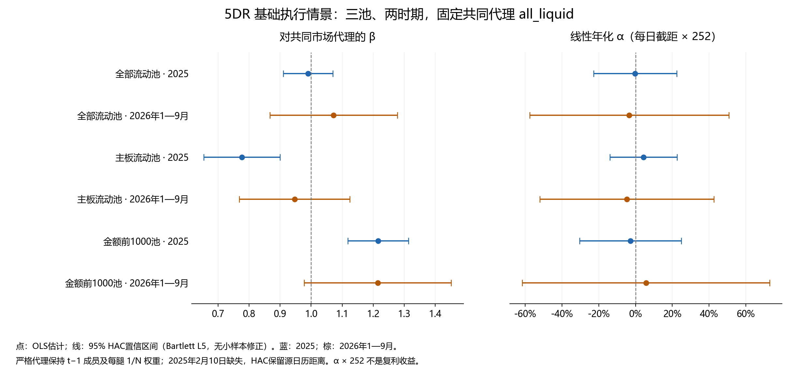

# 市场代理 β / α 扩展

独立验收：passed；核对项 4651。 计算状态保留 computed_pending_validation；验收由独立 validation.json 给出。201组市场回归与18组P3相对回归计算错误为0。

## 主结论

固定主判断为2025年、all_liquid、5DR、base、strict共同代理、HAC L5，不按结果选择情景。已验收原执行净收益为37.3564%；本扩展估计 β=0.9900 [0.9105, 1.0696]，日α=-0.0000080725，日α95%CI [-0.0009062460, 0.0008901010]；线性年化α=-0.20% [-22.84%, 22.43%]，原始P=0.985946。β的标准误为0.040593、t=24.3893、原始P=2.21935e-131；日α标准误为0.0004582602、t=-0.017616；R²=0.7915，有效242/243日。

这支持“未发现相对该代理的明确非零截距”，不能证明α等于0，也不能把全部净收益都归因于市场。α的不确定性很宽，β是每日收益共变斜率。净复利收益与每日截距×252的口径不同。

金额前1000池2025年对共同代理的线性年化α约−2.72%，而对自身代理约19.24%（原始P约0.1009）；这显示基准依赖，不能切换基准选赢家。两种代理及所有成本、容量、延迟情景均固定报告。

## 数据与预先固定的方法

唯一原始数据为 feathers.zip。交易不重跑，直接读取此前已验收的60条逐日净收益账本：三池×两时期×每期10情景。每期10情景为5DR、P3（base_combo）、P4（added_combo）各自的base、费用翻倍、0.1%容量，以及5DR额外延迟1日base。时期为2025与2026年1—9月，均为已接触的回顾性评价。

每个代理在收益日t使用前一源日期t−1收盘已知的Market.eligible集合，按各池相同base_config规则：至少120行历史、原始收盘价≥2元、过去20日均额≥2000万元、活跃日≥18、继承price_proxy风险筛选；主板池另限主板，金额前1000池另在合格股中按过去20日均额取前1000。集合每日动态更新，收益为累计复权收盘 C[t]/C[t−1]−1 的等权均值。每腿权重固定1/N；两日价格和复权因子都须有限且正。strict任一腿缺失则整日代理缺失，绝不按剩余股票重分配。missing_leg_zero_mark将缺失腿当日回报设0，其他腿仍1/N，仅为估值假设。

无风险利率按授权固定0。回归为 r_p=α+β×r_proxy，含截距OLS；主代理统一all_liquid，同池代理作固定敏感性，all_liquid同一拟合兼具两种角色，不重复拟合。HAC为Bartlett L5、无小样本修正、正态95%CI、原始双侧P；仅主格另给L20。缺失日保留完整源日历位置，排除观测的得分填零后按源行间隔求HAC，禁止压缩日期。α线性年化及CI都乘252，不是复利回报。全部201组回归共享数据和情景，不是201项独立发现，也未校正多重比较。

## 共同代理：固定5DR基础情景

|股票池|时期|β [95%CI]|线性年化α [95%CI]|α原始P|R²|有效/日历日|
|---|---|---|---|---|---|---|
|全部流动池|2025|0.9900 [0.9105, 1.0696]|-0.20% [-22.84%, 22.43%]|0.985946|0.7915|242/243|
|全部流动池|2026年1—9月|1.0725 [0.8674, 1.2776]|-3.44% [-57.62%, 50.74%]|0.900952|0.5785|181/181|
|主板流动池|2025|0.7772 [0.6544, 0.9000]|4.37% [-13.90%, 22.64%]|0.639074|0.7468|242/243|
|主板流动池|2026年1—9月|0.9466 [0.7688, 1.1245]|-4.79% [-52.11%, 42.53%]|0.842862|0.5980|181/181|
|金额前1000池|2025|1.2156 [1.1179, 1.3132]|-2.72% [-30.39%, 24.95%]|0.847111|0.7627|242/243|
|金额前1000池|2026年1—9月|1.2148 [0.9777, 1.4518]|5.67% [-61.59%, 72.94%]|0.868712|0.5305|181/181|

## 同池代理敏感性：固定5DR基础情景

|股票池|时期|β [95%CI]|线性年化α [95%CI]|α原始P|R²|有效/日历日|
|---|---|---|---|---|---|---|
|全部流动池|2025|0.9900 [0.9105, 1.0696]|-0.20% [-22.84%, 22.43%]|0.985946|0.7915|242/243|
|全部流动池|2026年1—9月|1.0725 [0.8674, 1.2776]|-3.44% [-57.62%, 50.74%]|0.900952|0.5785|181/181|
|主板流动池|2025|0.9302 [0.8351, 1.0253]|4.87% [-14.19%, 23.93%]|0.616299|0.7493|243/243|
|主板流动池|2026年1—9月|0.9881 [0.8161, 1.1601]|-0.08% [-53.76%, 53.61%]|0.99772|0.4923|181/181|
|金额前1000池|2025|1.0753 [0.9667, 1.1838]|19.24% [-3.75%, 42.22%]|0.100896|0.8459|242/243|
|金额前1000池|2026年1—9月|1.0522 [0.8792, 1.2253]|15.50% [-30.00%, 60.99%]|0.504418|0.7684|181/181|

## 缺失与主格敏感性

2025年all_liquid和liquid1000各有1个缺失腿日（2025年2月10日），分别缺1腿；主板池无缺失日。2026年1—9月三池均无缺失。strict主格排除2月10日，但其前后日HAC距离保持原样。每日N、有效N、缺失数及缺失权重保留本地，不发布股票级或原始日序列。

|主格方法|β [95%CI]|线性年化α [95%CI]|α原始P|有效日|
|---|---|---|---|---|
|strict L5|0.9900 [0.9105, 1.0696]|-0.20% [-22.84%, 22.43%]|0.985946|242|
|strict L20|0.9900 [0.8998, 1.0802]|-0.20% [-22.29%, 21.89%]|0.985599|242|
|缺失腿0回报 L5|0.9913 [0.9124, 1.0702]|0.12% [-22.47%, 22.71%]|0.991619|243|

## 18组相对P3回归

独立从已有paired.csv重算净 r_P4=α+β×净 r_P3，HAC L5及同样正态CI/原始P。这里的β、α是相对固定P3组合，并非市场CAPM或官方多因子风险α。P4将原三项权重一起改变，不能解释成其他权重保持不变的纯5DR边际作用。下表报告全部三池×两时期×三情景；与此前保存的α、β及αCI差值在聚合检查文件内。

|股票池|时期|情景|相对P3 β [95%CI]|相对P3线性年化α [95%CI]|α原始P|n|
|---|---|---|---|---|---|---|
|全部流动池|2025|base|1.1997 [0.9829, 1.4165]|14.83% [-14.89%, 44.55%]|0.32796|243|
|全部流动池|2025|double_cost|1.2007 [0.9832, 1.4182]|13.42% [-16.04%, 42.87%]|0.371974|243|
|全部流动池|2025|capacity_0p1pct|0.8790 [0.7516, 1.0065]|1.55% [-11.66%, 14.76%]|0.817712|243|
|全部流动池|2026年1—9月|base|0.7183 [0.5265, 0.9101]|-1.92% [-52.81%, 48.97%]|0.941138|181|
|全部流动池|2026年1—9月|double_cost|0.7230 [0.5292, 0.9167]|-4.53% [-55.35%, 46.30%]|0.861446|181|
|全部流动池|2026年1—9月|capacity_0p1pct|0.5655 [0.4195, 0.7116]|-9.20% [-44.73%, 26.33%]|0.611726|181|
|主板流动池|2025|base|1.0179 [0.8634, 1.1724]|10.30% [-14.54%, 35.14%]|0.416406|243|
|主板流动池|2025|double_cost|1.0139 [0.8601, 1.1677]|8.41% [-16.24%, 33.07%]|0.503556|243|
|主板流动池|2025|capacity_0p1pct|0.7552 [0.6316, 0.8789]|1.88% [-9.38%, 13.13%]|0.743703|243|
|主板流动池|2026年1—9月|base|0.6993 [0.5039, 0.8946]|-1.94% [-45.67%, 41.78%]|0.930546|181|
|主板流动池|2026年1—9月|double_cost|0.6991 [0.5031, 0.8951]|-4.19% [-47.77%, 39.39%]|0.850417|181|
|主板流动池|2026年1—9月|capacity_0p1pct|0.5236 [0.3673, 0.6799]|-6.41% [-34.22%, 21.40%]|0.651357|181|
|金额前1000池|2025|base|0.9885 [0.8722, 1.1048]|15.97% [-6.51%, 38.45%]|0.163778|243|
|金额前1000池|2025|double_cost|0.9892 [0.8724, 1.1060]|13.60% [-8.70%, 35.90%]|0.231939|243|
|金额前1000池|2025|capacity_0p1pct|0.8431 [0.7570, 0.9292]|5.65% [-6.51%, 17.81%]|0.362092|243|
|金额前1000池|2026年1—9月|base|0.8736 [0.7428, 1.0044]|10.25% [-21.43%, 41.94%]|0.525913|181|
|金额前1000池|2026年1—9月|double_cost|0.8746 [0.7418, 1.0073]|8.08% [-23.78%, 39.94%]|0.619213|181|
|金额前1000池|2026年1—9月|capacity_0p1pct|0.8492 [0.7090, 0.9894]|3.85% [-22.25%, 29.96%]|0.772406|181|

## 解释边界与聚合文件

代理不是官方或已证明可交易的指数：动态成员、收盘等权回报没有扣除指数再平衡成本，组合则是含成本净收益，存在口径差异。组合继承20交易日期末wind-down、现金缓冲及未投满影响，截距也可能混合这些差异。行业、规模和其他风险暴露未控制，price_proxy不是真实历史ST标签，日线假设不能证明开盘竞价可成交。rf=0不代表实际现金收益为零。

可复核聚合文件：[全部201组市场回归](regressions.csv)、[18组P3相对回归与原值差](relative_p3_checks.csv)、[代理缺失统计](proxy_missingness.csv)。不发布local目录、原始ZIP、策略逐日账本或股票级构造数据。图由这些聚合结果直接绘制，不是截图。
