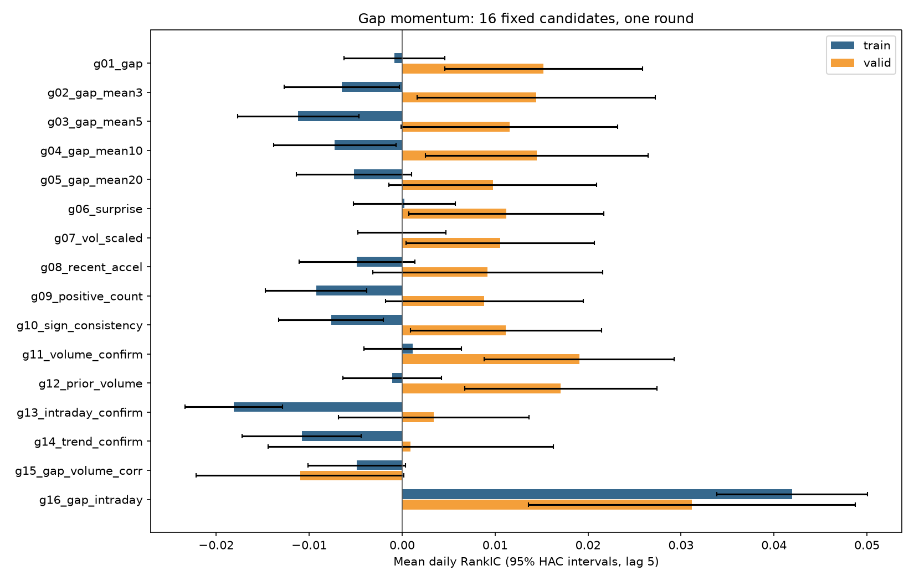

# 第二讲：第 1 轮跳空动量实验

本次实际运行：16 个因子、1 轮，用时 9.8 秒。使用课程原始股票数据缓存；没有使用合成市场数据。

原始数据 2,668,723 行 / 819 只股票，日期 2007-09-24 至 2024-01-10。
历史成分过滤后研究区间内 895,685 行；数据审计详见 data_audit.json。

所有因子在 T 日收盘后形成，目标是 T+1 收盘到 T+3 收盘的收益。RankIC 是每天股票排序与后续收益排序的相关；负值反对正向动量假设。

|因子|训练 RankIC|训练 RankIR|验证 RankIC|验证 RankIR|历史测试 RankIC|
|---|---:|---:|---:|---:|---:|
|g01_gap|-0.0008|-0.007|0.0152|0.135|0.0169|
|g02_gap_mean3|-0.0065|-0.054|0.0144|0.123|-0.0074|
|g03_gap_mean5|-0.0112|-0.092|0.0115|0.107|-0.0067|
|g04_gap_mean10|-0.0072|-0.059|0.0145|0.137|-0.0032|
|g05_gap_mean20|-0.0052|-0.043|0.0098|0.094|-0.0024|
|g06_surprise|0.0002|0.002|0.0112|0.101|0.0166|
|g07_vol_scaled|-0.0000|-0.000|0.0105|0.106|0.0117|
|g08_recent_accel|-0.0049|-0.041|0.0092|0.081|-0.0058|
|g09_positive_count|-0.0093|-0.093|0.0088|0.095|0.0015|
|g10_sign_consistency|-0.0076|-0.074|0.0112|0.118|-0.0045|
|g11_volume_confirm|0.0011|0.010|0.0190|0.174|0.0175|
|g12_prior_volume|-0.0010|-0.009|0.0171|0.157|0.0176|
|g13_intraday_confirm|-0.0181|-0.149|0.0034|0.029|0.0011|
|g14_trend_confirm|-0.0108|-0.084|0.0009|0.007|-0.0031|
|g15_gap_volume_corr|-0.0049|-0.047|-0.0110|-0.113|0.0064|
|g16_gap_intraday|0.0420|0.266|0.0312|0.186|0.0158|

训练期按事前规则入选：g16_gap_intraday。验证达标：g16_gap_intraday。

全部候选与公式见 candidates.json；完整统计、HAC 95% 区间、16 次比较校正见 metrics.json；每个因子的日度相关与十分组收益表均单独留存。

本轮未把负相关因子翻转成正收益策略，也未据验证结果继续调参数。完成一轮后按方案停止。

解释范围：这是复用教学历史数据的因子实验，不是新独立样本验证，也不是可执行的交易策略收益。老师此前已观察这些年份。数据缓存的复权、ST、涨跌停、退市和融券条件未获独立核验。

计算修正：使用成分过滤后的 T 日股票池；标签以全市场交易日历连接，缺失端点排除；每段末尾剔除跨段标签。原教材评估读取 result_df 的做法绕过了 raw_df 上的成分筛选，因此数值不应强求与原报告一致。

两日重叠收益没有逐日复利、没有伪装成策略年化；十分组仅用于观察预测关系。HAC 滞后 5 日用于处理重叠与短期序列相关，不消除所有历史选择偏差。
