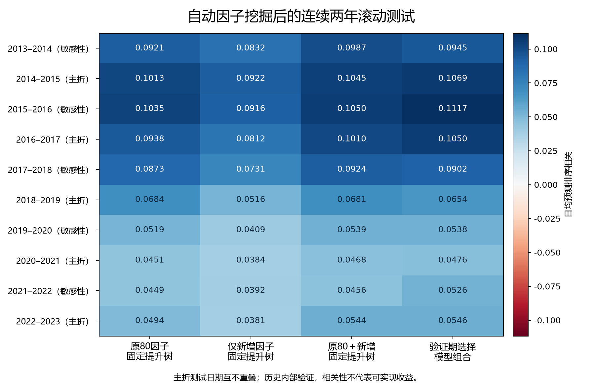

# 大规模股票价量因子挖掘：完成报告

**已在2号服务器完成搜索、滚动训练和独立重放核验。** 5小时预算包含方案部署、计算、验证和本地交付；本轮的正式起点是2026-09-23 10:27:53，截止15:27:53。

本轮登记40,000条带来源的候选记录，对应**35,375个唯一表达式**；公共候选20,000条、两代逐折演化20,000条，精筛6,259条。10折各入选128个新增代表因子，合并原80个后为208个输入。入选表示通过发现及因子验证规则，不表示每个因子在测试期均有效。

## 新因子是否有增量

|固定模型|原80因子|原80＋新增|日均相关差|时间相关稳健95%区间|两比较Holm校正p|
|---|---:|---:|---:|---|---:|
|岭回归|0.0584|0.0667|+0.0084|[+0.0042, +0.0125]|0.0001567|
|提升树|0.0717|0.0750|+0.0034|[+0.0012, +0.0055]|0.001954|

固定对照使用相同折、标签、预处理、超参数及随机种子，更适合评估新增因子的增量。区间和校正仅是复用历史数据上的条件统计，不代表校正了整个公式搜索。20日连续块重采样结果另见详细表。

验证期选择的组合，主折日均预测排序相关为 **0.0760**。这一结果同时包含模型选择效果，应与固定对照分开解释。

只用新增因子的固定提升树为0.0604，低于原80因子的0.0717；本轮新因子的价值主要体现在补充原模型。五个主折中四个有增量，2018–2019略降。近期窗口的整体预测强度仍弱于早期，扩大搜索规模没有消除时间衰减。

## 本轮如何训练

- 只研究股票价量；819只历史股票、约267万条原始日线。实际股票池支持2008–2023年，未补造财务、行业或市值因子。
- 143个基础窗口实例，组合加减乘除、极值、绝对值和滚动变换，限制公式复杂度；公共生成不看收益，每折演化只看本折发现期。
- 测试从2013–2014逐年滚动到2022–2023。对于起始年Y，2008至Y−4发现公式，Y−3验证因子，Y−2至Y−1验证模型，再用测试前数据重拟合。
- 每折先做覆盖及时间块稳定性筛选，再与原80因子及已选新因子比较发现期排序相关，去除高度相似的信号。阈值0.90，估计使用64个固定发现期日期。
- 三种预处理：训练期分位数截断标准化、中位数与四分位距稳健标准化、当日截面秩。岭回归3个参数、提升树6个配置，入选树配置使用3个固定种子。
- 实际完成370次内层拟合，保存171个最终模型。测试收益未参与最终拟合及选择；所有入选因子的负面测试结果均保留。
- 主统计只拼接2014–15、2016–17、2018–19、2020–21、2022–23五个不重叠折，其余窗口用于敏感性分析。标签为下一交易日收盘至第三交易日收盘的收益，跨分段标签已删除。

## 资源、耗时与修复

- 正式搜索在预算起点后19.1分钟完成；搜索、拟合及首轮汇总在起点后55.1分钟完成，之后执行独立重算和归档。
- 模型阶段本任务CPU采样平均63.4%，峰值86.8%；达到80%的采样占42.4%。不是整个研究的平均占用；短任务退出可能略低估。
- 公式阶段112个单线程进程，模型阶段28个任务×4线程。首次健康检查发现共享文件系统等待，随后把模型临时矩阵放入可写的/dev/shm。
- 首次模型启动因/ram权限失败，尚未拟合；失败记录保留。第二次在独立目录继续，未重跑公式搜索、未改变科学设计。
- 原方案的300–600基础实例目标未实现，实际为143个；先导测速实际128条。有限比较已补做Holm校正；研究范围限于当前可用的股票价量字段。

## 验证与限制

- 1120个入选唯一表达式从基础数组重新计算，与缓存逐值一致。
- 171个保存模型从原始因子重新预处理并重放预测；150组逐日指标独立重算，全部一致。
- 核心8项和模型集成1项服务器测试通过；数据哈希、分段终点、测试键唯一性和公式来源均已检查。
- 这些年份已被课程和上一轮研究使用，属于历史内部研究；需要新的时期与股票池验证。
- 缺完整复权、停复牌、涨跌停、退市及实际成交资料。成本表是两批等资本、两日持有目标组合的换手摩擦代理，不能解释为可执行净收益。

## 公开证据范围

本仓库提供报告和折间比较图；完整候选、模型、预测及核验记录保留在本地交付目录。

本地报告生成：2026-09-23T11:30:57.588805+08:00。
