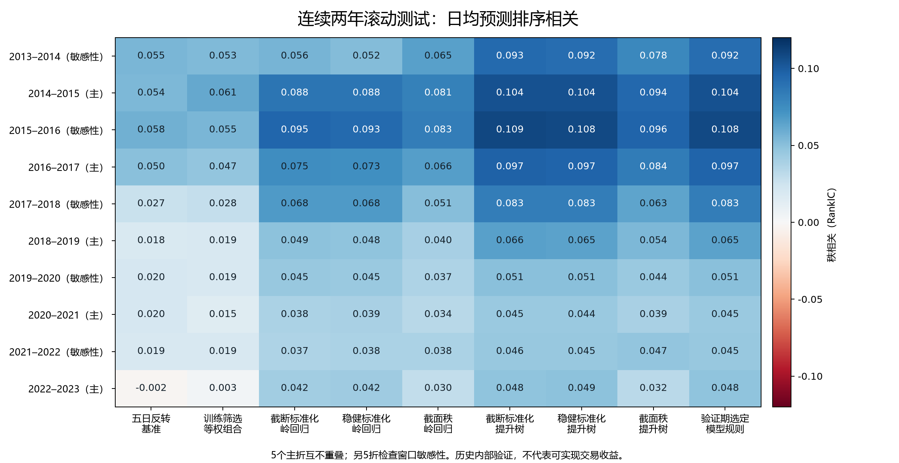

# 股票因子挖掘与多折训练：完成报告

**已在2号服务器完成并核验。** 80 个价量因子、3 种预处理、10 个连续两年测试窗口；120 次内层候选拟合，60 个最终模型。原始课程资料及上一轮16因子结果保持不变。

按验证期选模型的规则，在5个不重叠主折（2014–2023）的2,419个测试日期上，日均预测排序相关为 **0.0718**，95%时间相关稳健区间为 **0.0640–0.0796**；5个主折均为正。固定五日反转基准为 **0.0281**，两者配对差为 **0.0436**（95%区间0.0346–0.0527）。

这里的相关反映对未来股票收益排序的预测能力，不能当作收益率。近年预测强度较早期减弱：2014–2015年为0.1042，2020–2021年为0.0448，2022–2023年为0.0483。

## 做了什么

- 来源为819只历史股票的2,668,723条日线；按当日历史成分及成交量过滤后有1,138,202行，其中1,126,499行有可用未来收益标签，随后再按各折删除跨界标签。
- 16类公式×5种窗口：动量、滞后动量、均线偏离、通道位置、跳空、日内收益、标准化跳空、实体/影线、波动、下行波动、振幅、量能、非流动性代理、价量关系。全部80因子进入每个模型。
- 三种预处理：训练期分位数截断并标准化、训练期中位数/四分位距稳健标准化、当天截面秩变换。缺失处理参数仅从训练数据估计。
- 模型为岭回归和梯度提升树。每折用测试前两年做内层验证，更早年份做内层训练；选好参数后以全部测试前数据重新拟合。测试两年内固定模型。
- 主折为2014–2015、2016–2017、2018–2019、2020–2021、2022–2023；另五折只是窗口敏感性检查，不作为独立样本重复计数。

## 主要比较

|规则|主测试日均秩相关|
|---|---:|
|固定五日反转|0.0281|
|训练期筛选最多十因子等权组合|0.0291|
|截断标准化＋岭回归|0.0583|
|截断标准化＋提升树|0.0721|
|稳健标准化＋提升树|0.0719|
|截面秩＋提升树|0.0607|
|按验证期选定的模型规则（主分析）|0.0718|

截断标准化和稳健标准化的提升树历史表现接近；不能依据测试表重新把表现最高的一列指定为新主模型。本次主分析的选择规则始终由验证期决定。

## 因子发现

训练期反复入选的主要是短期动量/反转、日内收益和价格偏离类。下表按**训练期入选次数**列示，不以测试成绩挑选；有向相关的方向由每折训练期单独确定，不能把负向动量解读为正向趋势。

|因子|观测窗口|10折内层训练入选次数|主测试有向秩相关|训练方向为正的折数|
|---|---:|---:|---:|---:|
|动量|5|10|0.0281|0|
|滞后动量|3|10|0.0299|0|
|均线偏离|5|10|0.0269|0|
|均线偏离|10|10|0.0272|0|
|价格通道位置|5|10|0.0190|0|
|日内收益均值|5|10|0.0273|0|
|日内收益均值|3|9|0.0283|0|
|价量相关|5|7|0.0221|0|
|实体压力|5|6|0.0178|0|
|下行均方根|5|6|0.0015|10|

80个因子中有48个在主折拼接的探索性检验中达到多重比较校正q<0.05且有向均值为正。因子间高度相关，这不是48个独立机会，也没有据此追加调参。60观测日的实体/影线因子缺失约23.6%，60观测日非流动性代理缺失约22.1%；已经披露并使用训练统计量填补。

## 核验和资源

- 本地15项测试通过，2号服务器12项流程测试通过；包括80公式未来数据扰动、全市场日历标签、成分区间、跨界标签和测试收益反转隔离测试。统计公式与SciPy/statsmodels对照通过。
- 60个最终模型均已保存并重新加载核验；每折预测抽样重算和每日秩相关重算通过。主折测试日期无重复。完整模型、预测和失败尝试均已取回本地。
- 正式训练01:12:53启动，约100秒结束；10折×11线程预算。CPU平均34.2%、峰值58.8%，没有达到期望的80%，资源日志见下方。进程合计内存峰值约15.6 GiB。
- 运行未满15分钟已结束，完成核验后删除了临时巡检自动化，没有追加90%或其他定时监视。
- 准备阶段整数索引错误和首次训练日期类型错误均发生于拟合前，独立保留失败目录后修复。因子库、参数网格及测试划分未因此改变。

## 公开证据范围

本仓库仅提供结果报告和比较图；完整模型、预测、日志和数据核验保留在本地交付目录。

## 解释边界

当前数据足够完成这次股票价量因子研究，缺财报、行业、市值及较新年份完整行情，不能声称覆盖所有金融因子。课程已经使用过这些历史年份，因此结果属于历史内部验证。
复权、成分公告、风险警示、退市、涨跌停、停复牌、费用及融券条件没有全部独立核验。相邻两日标签有重叠；没有把标签差逐日复利或报告为可实现的策略年化收益。
