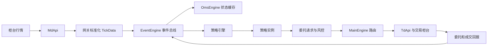

# 交易系统的三层架构

底层接口统一外部柜台的字段和流程，中层引擎组织消息、状态与路由，策略应用在统一接口上产生交易决策。

例子：铜期货最新价回调先转为 TickData；总线分发给行情缓存和铜策略；策略产生 OrderRequest，主引擎交给指定网关；真正成交后再收到 TradeData。发送请求成功不能代替成交确认。

注意图中的交易风控是系统设计职责，并不意味着仅创建 MainEngine 就已经具备完整风控。数据库/监控也需要明确接入。

来源：[course](../sources/course.md)、[vnpy](../sources/vnpy.md)；继续读 [standardization](standardization.md)、[oms-main-engine](../entities/oms-main-engine.md)。
